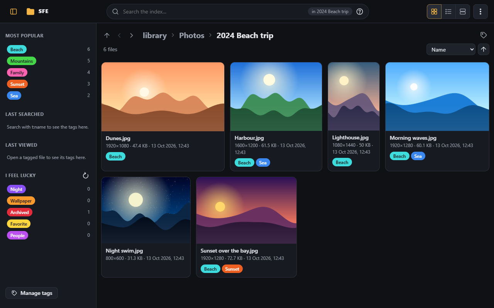

# SFE documentation

Everything about installing, using and administering **SFE — Simple File Explorer**. The short overview is the
[project README](../README.md); building, testing and the code are in [AGENTS.md](../AGENTS.md).

## Getting started

| Page | What it covers |
|---|---|
| [Installation](installation.md) | Running from source, portable packages, IIS, Windows service, systemd |
| [First start](first-start.md) | The setup code, creating the first administrator, recovering a lost password |
| [Configuration](configuration.md) | `appsettings.json`, environment variables, every server setting, the database |
| [Upgrading](upgrading.md) | What each version changes on an existing install |

## Using SFE

| Page | What it covers |
|---|---|
| [Signing in](user-guide/signing-in.md) | The sign-in page, visitors, switching spaces, the ⋮ menu |
| [Browsing](user-guide/browsing.md) | Folders, layouts, sorting, folder pictures, resolutions and durations, copying paths, themes, phones |
| [Viewer](user-guide/viewer.md) | Opening pictures, videos and audio full screen |
| [Video player](user-guide/video-player.md) | The player's controls and keys, its own window, external players |
| [Picture editor](user-guide/picture-editor.md) | Cropping a picture and saving it as a new file |
| [Search](user-guide/search.md) | The search box, the query language, explanations, history |
| [Tags](user-guide/tags.md) | Tagging files, selections, folders and searches; the tag sidebar |
| [Scanning](user-guide/scanning.md) | Keeping the index current, removing folders from it |

## Administration

| Page | What it covers |
|---|---|
| [The administration page](administration/README.md) | Layout, settings levels, saving, locks |
| [Interface](administration/interface.md) | Theme, listings, search box |
| [Playback](administration/playback.md) | Video player, external player, data server |
| [Scanning](administration/scanning.md) | What scans skip, file types, what scans read |
| [Tags](administration/tags.md) | The tag list and editor, the sidebar's history |
| [Duplicates & moves](administration/duplicates-and-moves.md) | Duplicates, similar videos, moved files |
| [Thumbnails](administration/thumbnails.md) | Previews in listings and the viewer |
| [Trickplay](administration/trickplay.md) | Frames along each video, hover previews |
| [Picture editor](administration/picture-editor.md) | Where edited pictures go, their quality |
| [Spaces & accounts](administration/spaces-and-accounts.md) | Spaces (libraries), groups, accounts, visitors |
| [Background tasks](administration/background-tasks.md) | Tasks, schedules, history and logs |
| [System](administration/system.md) | Version, API reference, shutdown and dismount |
| [My account](administration/my-account.md) | Personal preferences, password |

## Reference

| Page | What it covers |
|---|---|
| [Rights](reference/rights.md) | Every right, who gets it by default |
| [Settings by level](reference/settings-levels.md) | Environment, server, space and user values; locks |
| [Search syntax](reference/search-syntax.md) | Every search term, with the fine print |
| [API](reference/api.md) | The JSON API and its documentation |
| [Changes from the .NET Framework version](reference/changes-from-netfx.md) | What the port changed |

## Words used in these pages

- **Library**: a folder of the server whose files SFE shows, with its **index** (the database of its files, used by
  search, tags and duplicates).
- **Space**: one library with its own groups, accounts, tags and settings. A server can hold several; the first one
  is created at the first start.
- **Server administrator**: an account with every right in every space, plus the server's own settings.
