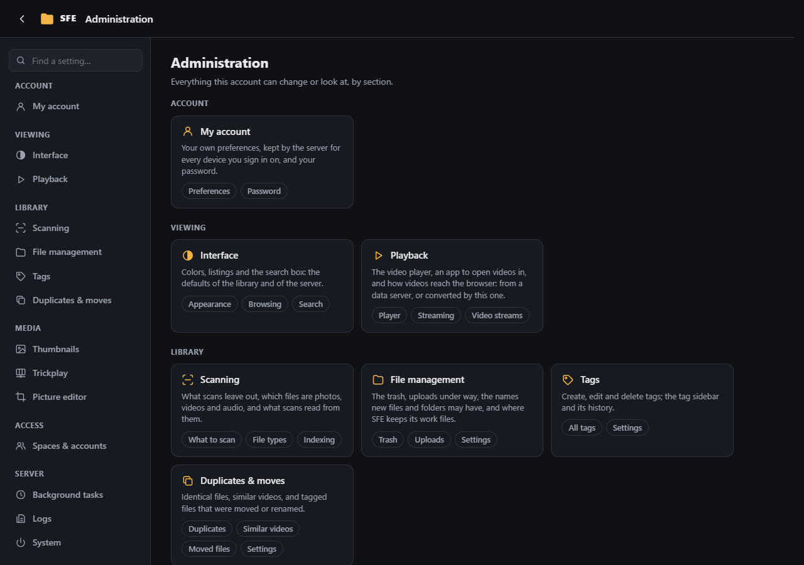
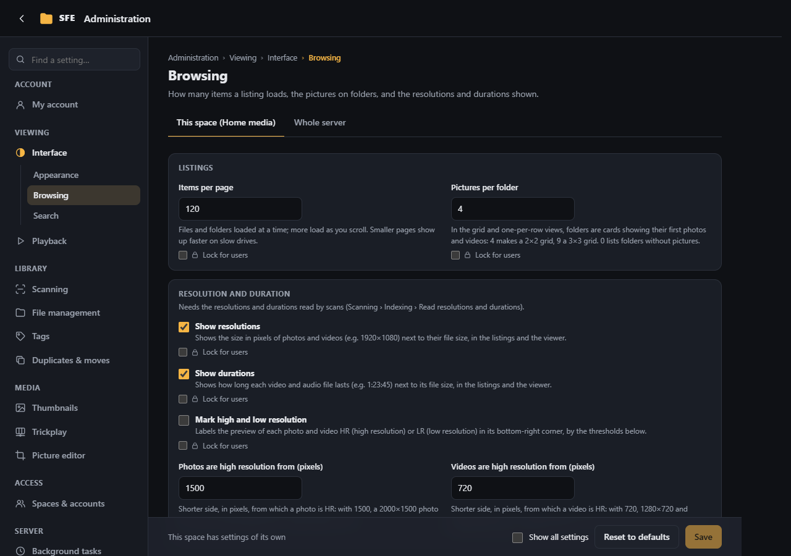
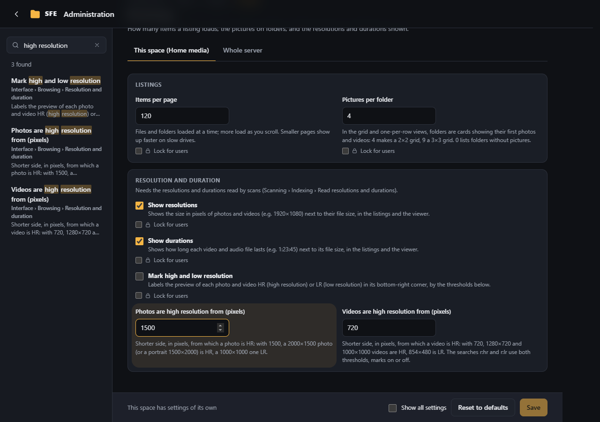
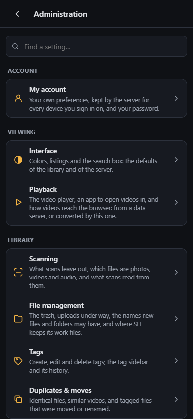
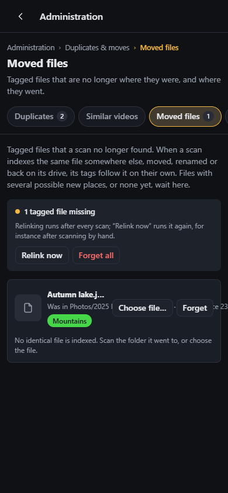

# The administration page

**Administration** in the [⋮ menu](../user-guide/signing-in.md#the--menu) opens the administration page: the settings,
the tag list, duplicates, accounts, background tasks, the server's log and your own account.

It opens on the overview: every section you may use, by group, as a card saying what it holds, with links to its
pages. The sidebar lists the same sections, **My account** first; the section open lists its pages under it. The arrow
at the top left goes back to the folder you came from, scrolled where you left it. An account that can only change its
own preferences and password goes straight to **My account**.

Breadcrumbs above the page's title say where you are (**Administration › Library › Tags › All tags**) and follow you
from page to page: click the section to open its first page, the group to see its sections on the overview, or
**Administration** for the whole overview. Under the title, a line says what the page holds.

| Group | Section | Pages |
|---|---|---|
| Account | [My account](my-account.md) | Preferences, Password |
| Viewing | [Interface](interface.md) | Appearance, Browsing, Search |
| | [Playback](playback.md) | Player, Streaming, Video streams |
| Library | [Scanning](scanning.md) | What to scan, File types, Indexing |
| | [File management](file-management.md) | Trash, Settings |
| | [Tags](tags.md) | All tags, Settings |
| | [Duplicates & moves](duplicates-and-moves.md) | Duplicates, Similar videos, Moved files, Settings |
| Media | [Thumbnails](thumbnails.md) | previews in listings and the viewer |
| | [Trickplay](trickplay.md) | Activity, Settings |
| | [Picture editor](picture-editor.md) | where edited pictures go |
| Access | [Spaces & accounts](spaces-and-accounts.md) | Spaces, Accounts |
| Server | [Background tasks](background-tasks.md) | Tasks, Schedules, History, Settings |
| | [Logs](logs.md) | Log, Settings |
| | [System](system.md) | About, Installation, Start-up, Maintenance |

Addresses of pages that moved (a bookmark of the old **System › Video streams**, now **Playback › Video streams**)
still open them.

Each page shows only to the accounts with its [right](../reference/rights.md): an account without any right to change
something sees only **My account**, a visitor without an account no administration page at all.

## Finding a setting

The box above the sections finds the settings and pages whose name, description or choices hold every word you type
(upper or lower case and accents don't matter; a setting's configuration key, like `browse.defaultPageSize`, works
too). What is found replaces the sections while you type, the names first, each with where it is
(**Interface › Browsing › Resolution and duration**). Click one, or press **Enter** for the first, to open its page: a
setting is scrolled into view, briefly highlighted and ready to change, the full view shown when it is one of the less
used ones. The **✕** in the box, or **Esc**, empties it and brings the sections back. Only what you are allowed to see is searched.

## Settings pages

- Each setting has a description under it.
- Changes on several pages are kept together until **Save** in the bar at the bottom. A dot marks the sections and
  pages with unsaved changes, **Discard** drops them, and leaving the page asks first.
- Saved values apply right away, for everyone using the space, and take precedence over `appsettings.json` and
  environment variables. **Reset to defaults** goes back to those.
- Errors are shown next to their fields, and their sections and pages are marked in red.
- The page shows the most used settings; tick **Show all settings** in the bottom bar for the others (each browser
  remembers the choice).
- Server administrators choose with the tabs at the top of a settings page whether they edit **This space** or the
  **Whole server** (the defaults of every space), and can **lock** a setting for the levels below: see
  [Settings by level](../reference/settings-levels.md). Changes made in one tab are kept while the other shows (a dot
  marks the tab); **Save** saves both tabs, the whole server's first, and **Discard** forgets both. When the values of
  a tab are refused, that tab opens with its errors; the other tab's saved changes stay saved.
- Only the settings you changed are saved: a space keeps following the server for the others, even if someone changed
  the server's settings while your page was open.
- A setting you can't change says why: set by the configuration, locked by the server or the space, a server setting,
  or not your section.

Some settings are never on this page, because they decide which programs run or where data lives: the library root,
the thumbnail cache folder, the database, the ffmpeg path, and everything about the setup and
sign-in. Set them in the [configuration](../configuration.md).

## On a phone

On phones the page opens on the list of sections, with the search box at its top, each one then a page of its own with a
back arrow to the list and its pages as chips at the top, on one line that scrolls sideways when they don't all fit
(the page shown is scrolled into view). The breadcrumbs leave the group out there, and **Administration** in them returns to the list
of sections.
