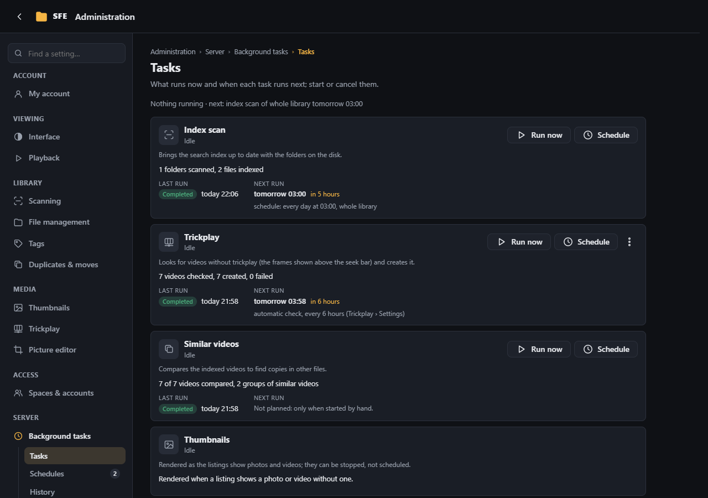
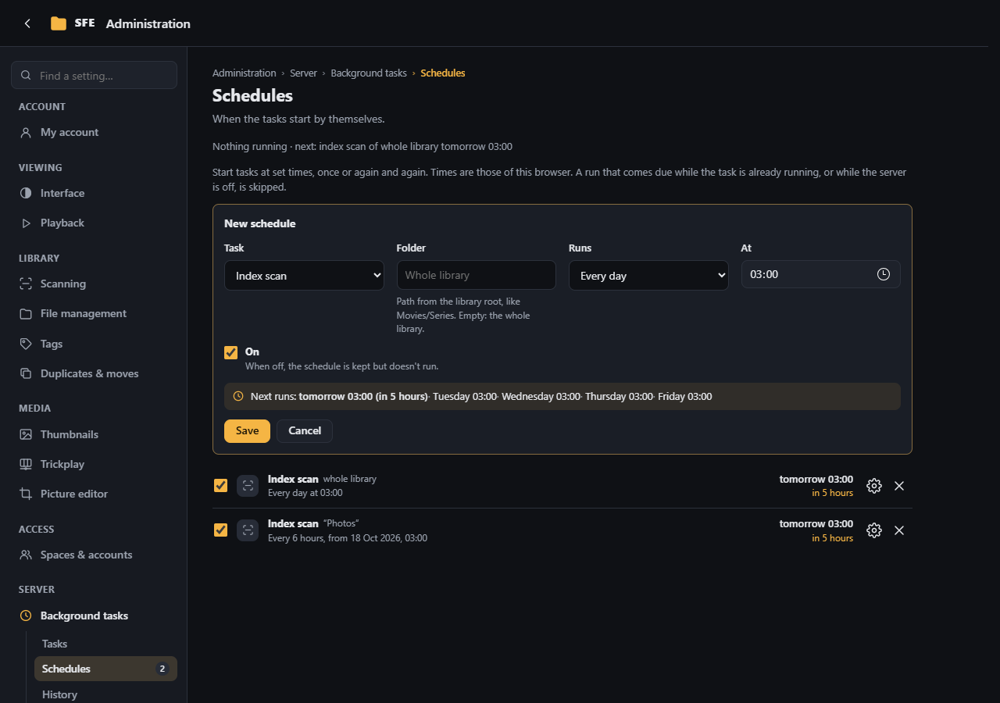
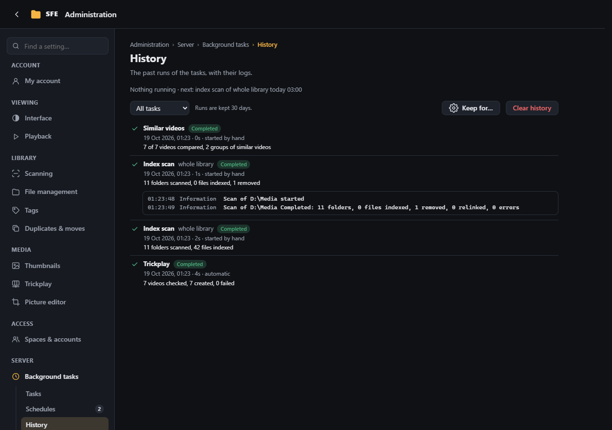
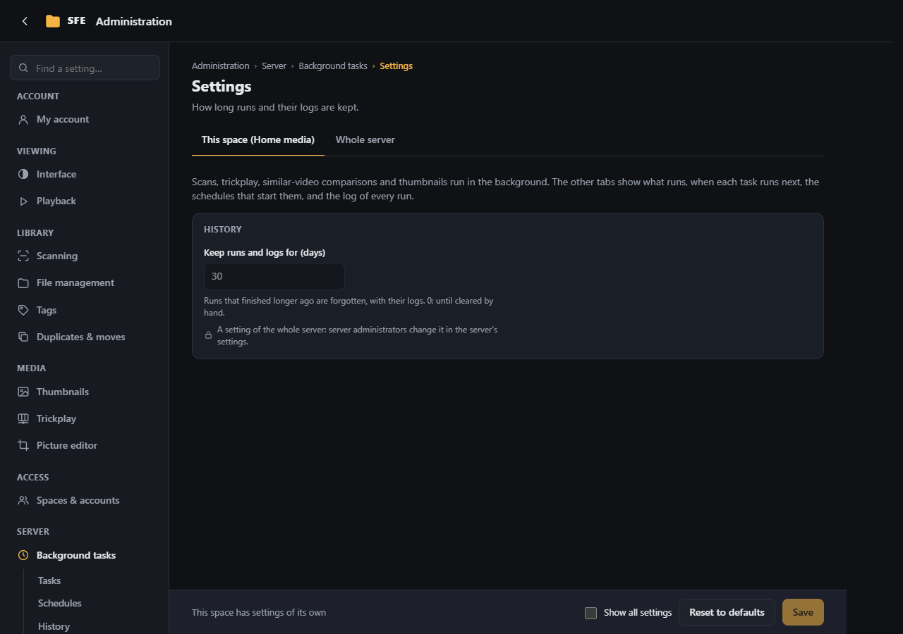

# Background tasks

**Administration › Background tasks** gathers the jobs the server runs on its own. It refreshes while shown; its first
line says what runs now and what runs next. Rights: `tasks.view` (Tasks, History), `tasks.run` (Run now, Cancel),
`tasks.schedule` (Schedules).

## Tasks

The index scan, trickplay, similar videos, the trash purge and thumbnails, each with its state, progress, last run and **next run**: the
exact time, how long until then, and why (which schedule, or trickplay's own periodic check).

- **Run now** starts a task (a scan covers the folder browsed last and asks first).
- **Cancel** stops it: a scan keeps what it already indexed; trickplay stops its pass and forgets the videos waiting
  until its next check; a comparison keeps the previous result; thumbnails being rendered are dropped and asked for
  again by the listings.
- **Schedule** opens a new schedule for that task.
- Thumbnails can't be started or scheduled: listings ask for them.
- **Trash purge** deletes for good what has been in the [trash](file-management.md#trash) longer than the space's
  **Days in the trash**. It also runs by itself when the trash is used (at most twice a day).

## Schedules

Start a scan (of a folder or the whole library), a trickplay check, a similar-video comparison or a trash purge:

| Runs | |
|---|---|
| **Once** | At a date and time |
| **Repeatedly** | Every N minutes, hours or days from a start |
| **Every day** | At a time |
| **On some days of the week** | At a time |

- While you fill in a schedule, the next five runs are shown as the server works them out.
- Each schedule shows its next and last run, and can be turned off without deleting it (the checkbox), edited or
  deleted.
- Times are shown in your browser's time zone; daily and weekly times follow the server's clock (the page says so when
  the two differ).
- A run that comes due while the task already runs is recorded as *skipped* (a trickplay check is queued after the
  current one instead); runs missed while the server was off are not caught up.

## History

Every run of a scan, trickplay check or comparison: when, how long, what started it (by hand, a schedule, automatic),
how it ended (completed, cancelled, failed, interrupted by a server stop, skipped) and a summary.

- The list can be filtered by task.
- Click a run for its log, live while it runs (the first and last 1,000 lines of a long one are kept).
- **Clear history** deletes the finished runs.

## Settings

**Keep runs and logs for (days)** (`Sfe:Tasks:LogRetentionDays`, default 30, 0 = until cleared; a server setting;
**Keep for…** on the History page leads here). Schedules and runs are stored in the database (tables `TaskSchedules`
and `TaskRuns`).
