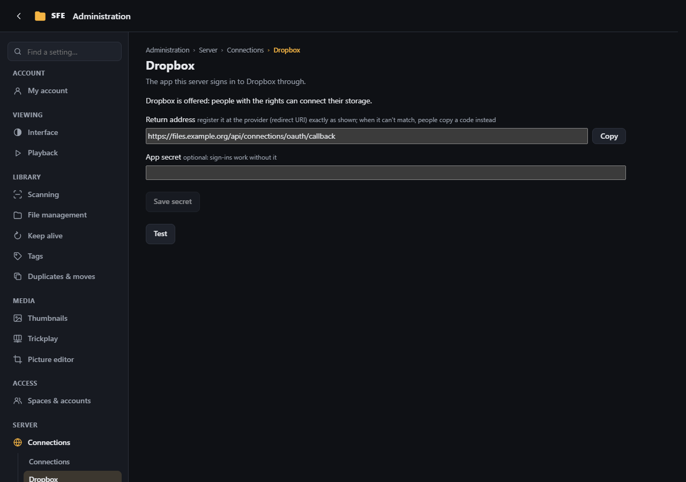
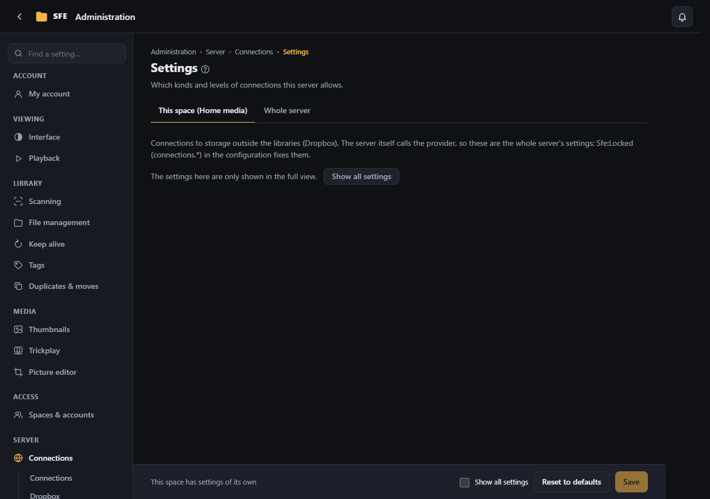
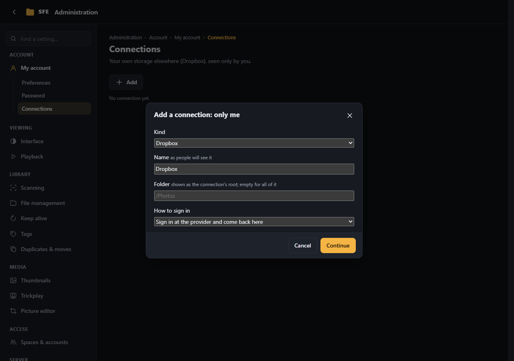

# Connections

**Connections** link SFE to storage outside its libraries: Dropbox, for now. Whoever runs the server registers an app
at Dropbox once; then people with the rights connect their Dropbox, or one for a space or for the whole server.

This version makes, signs in again and manages connections, browses their files
([browsing a connection](#browsing-a-connection)) and changes them where you may, uploads included. Copying and moving to and from the library come with a later
version.

## Levels

| Level | Who uses it | Who adds it | Right |
|---|---|---|---|
| **Only me** | the account that added it, in every space it opens | that account, in **My account › Connections** | `connections.own` |
| **This space** | the space's groups chosen for it | the space's administrators | `connections.library` |
| **The server** | the spaces it is offered to, then their groups | the server's administrators | `connections.server` |

The three rights go to the **Administrators** group of every space, never to guests
([rights](../reference/rights.md)). A connection of one account stays private: the server's administrators see that it
exists and can remove it, never open or change it.

## Setting up Dropbox (server administrators)

1. At Dropbox's App Console, create an app with **Scoped access** (the whole Dropbox, or an app folder only), and give
   it the permissions `account_info.read`, `files.metadata.read`, `files.content.read` and `files.content.write`.
2. In the app's settings at Dropbox, add the **Return address** this page shows to its redirect addresses, exactly as
   shown (**Copy** copies it). It is the address people reach SFE by; behind a proxy or under a sub-folder, open this
   page through that address. When Dropbox can't send people back to it, they sign in by copying a code instead.
3. Type the app's **app key** in **Administration › Connections › Settings** (`connections.dropbox.appKey`). Dropbox is
   offered from then on.
4. The **app secret** is optional: sign-ins work without it. Typed here, it is kept by the server in a file only the
   server's account can read, never shown again, and not in [backups](system.md): type it again after restoring on
   another computer. `Sfe:Connections:Dropbox:AppSecret` in the [configuration](../configuration.md) wins over it.
5. **Test** checks the key and secret with Dropbox (without a secret, the first sign-in checks the key).

The **Settings** say whether connections are allowed at all, of which kinds and at which levels; `Sfe:Locked` in the
configuration can fix them.

## Adding a connection

**Add** opens the form: the kind, the name people will see, and the **folder** of the storage shown as the
connection's root (empty for all of it).

- **Sign in at the provider and come back here**: the browser goes to Dropbox, you allow SFE in, and Dropbox sends
  you back to the connection's page.
- **Sign in at the provider and copy the code it shows**: Dropbox opens in a new tab and shows a code; paste it in the
  form and **Connect**.

A sign-in lasts 10 minutes and works once, for the account that started it.

## Managing a connection

**Manage** opens what you may do with it:

- **Rename**, **Read only** (nothing is changed in the storage through SFE, whatever the groups allow), **Off** (kept,
  with who uses it, but nobody opens it).
- **Sign in again** when it shows **Sign in again** in red: Dropbox no longer accepts its sign-in (access removed at
  Dropbox, or the server's keys lost with a restored backup). It stays the same connection, with the same people;
  signing in to another Dropbox account than before is said, as people then see other files.
- **Who uses it** (space and server connections): **Groups of this space** — doesn't see it, reads, or reads and
  changes; for a server connection, the **spaces it is offered to** (every space, or some), then each space's
  administrators choose their groups.
- **Remove**: the connection goes with who used it; the files stay in the storage.

## Browsing a connection

The connections you may use are listed in the sidebar under **Connections**, under the quick links. One opens its files
in the usual listing: folders first, sorted as you choose, pictures and videos shown with Dropbox's thumbnails.

- Pictures, videos, audio and PDF files open in the viewer; videos seek as usual. Other files are downloaded. Videos
  the browser can't play aren't converted, and there is no external player, trickplay, tags or search there: a search
  typed there searches the library.
- **Download** saves a file; several, or a folder, come as one zip, written while it downloads (as in the library;
  what has no content, a Dropbox Paper document, is listed in `SFE - left out.txt` inside).
- A folder of more than 20,000 items is listed in Dropbox's order, the sort off.
- **Properties** (item menu) shows a file's or folder's size, date (Dropbox keeps none for folders), path and
  Dropbox's content hash; on your own connection, the Dropbox account too.
- Where the connection gives you **reads and changes**: **New folder**, **Rename** (F2) and batch rename, **Delete**
  (into Dropbox's deleted files, where Dropbox keeps them for a while: no Undo in SFE), and moving or copying inside
  the connection by cut and paste (Ctrl+X / Ctrl+C, Ctrl+V) or by dragging onto a folder. A connection made read only
  shows none of them.
- **Upload** files or folders (the button, or dropping them from the desktop) on such a connection: each part goes
  on to Dropbox as it arrives, nothing is kept on the server. As in the library, a name already taken asks keep both,
  replace or skip, and the space's largest file size applies. An upload into a connection interrupted by closing the
  page starts over.
- When Dropbox no longer accepts the connection's sign-in, the listing says so and the connection shows **Sign in
  again** for whoever manages it. When Dropbox asks to wait (too many requests), wait a moment and try again.
