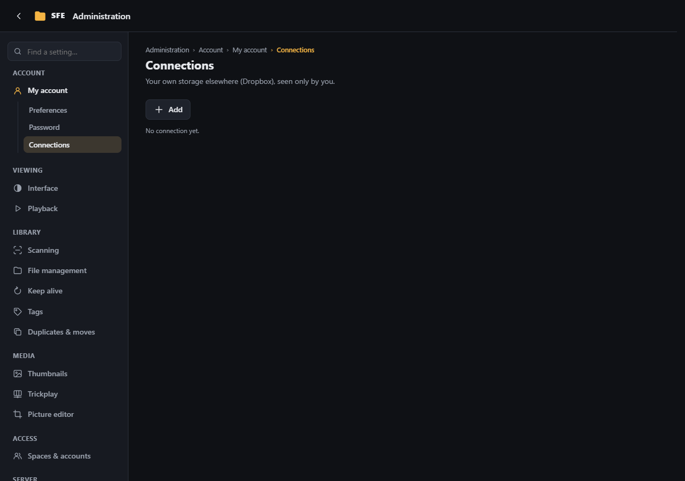

# Connections

**Connections** link SFE to storage outside its libraries: Dropbox, for now. Whoever runs the server registers an app
at Dropbox once; then people with the rights connect their Dropbox, or one for a space or for the whole server.

Connections are made, signed in to again and managed here; their files are browsed and downloaded
([browsing a connection](#browsing-a-connection)), changed and uploaded to where you may, copied and moved between a
connection and the library ([below](#between-the-library-and-a-connection)), and a space narrows what its groups do
in some folders with [folder rules](#folder-rules-of-a-connection). There is no search, tags or folder pictures in a
connection yet.

## Levels

| Level | Who uses it | Who adds it | Right |
|---|---|---|---|
| **Only me** | the account that added it, in every space it opens | that account, in **My account › Connections** | `connections.own` |
| **This space** | the space's groups chosen for it | the space's administrators | `connections.library` |
| **The server** | the spaces it is offered to, then their groups | the server's administrators | `connections.server` |

The three rights, and `connections.use` (to see and open the connections one is given), go to the **Administrators**
group of every space, never to guests ([rights](../reference/rights.md)): give `connections.use` to the groups that
should use a space's or the server's connections. A connection of one account stays private: the server's administrators see that it
exists and can remove it, never open or change it.

## Setting up Dropbox (server administrators)

1. At Dropbox's App Console, create an app with **Scoped access** (the whole Dropbox, or an app folder only), and give
   it the permissions `account_info.read`, `files.metadata.read`, `files.content.read` and `files.content.write`.
2. In the app's settings at Dropbox, add the **Return address** this page shows to its redirect addresses, exactly as
   shown (**Copy** copies it). It is the address people reach SFE by; behind a proxy or under a sub-folder, open this
   page through that address. When Dropbox can't send people back to it, they sign in by copying a code instead.
3. Type the app's **app key** in **Administration › Connections › Settings** (`connections.dropbox.appKey`). Dropbox is
   offered from then on.
4. The **app secret** is optional: sign-ins work without it. Typed here, it is kept by the server in a file only the
   server's account can read, never shown again, and not in [backups](system.md): type it again after restoring on
   another computer. `Sfe:Connections:Dropbox:AppSecret` in the [configuration](../configuration.md) wins over it.
5. **Test** checks the key and secret with Dropbox (without a secret, the first sign-in checks the key).

The **Settings** say whether connections are allowed at all, of which kinds and at which levels; `Sfe:Locked` in the
configuration can fix them.

## Adding a connection

**Add** opens the form: the kind, the name people will see, and the **folder** of the storage shown as the
connection's root (empty for all of it).

- **Sign in at the provider and come back here**: the browser goes to Dropbox, you allow SFE in, and Dropbox sends
  you back to the connection's page.
- **Sign in at the provider and copy the code it shows**: Dropbox opens in a new tab and shows a code; paste it in the
  form and **Connect**.

A sign-in lasts 10 minutes and works once, for the account that started it.

## Managing a connection

**Manage** opens what you may do with it:

- **Rename**, **Read only** (nothing is changed in the storage through SFE, whatever the groups allow), **Off** (kept,
  with who uses it, but nobody opens it).
- **Sign in again** when it shows **Sign in again** in red: Dropbox no longer accepts its sign-in (access removed at
  Dropbox, or the server's keys lost with a restored backup). It stays the same connection, with the same people;
  signing in to another Dropbox account than before is said, as people then see other files.
- **Who uses it** (space and server connections): **Groups of this space** — doesn't see it, reads, or reads and
  changes; for a server connection, the **spaces it is offered to** (every space, or some), then each space's
  administrators choose their groups.
- **Folder rules…** (space and server connections, for those who manage the space's connections): see below.
- **Index in this space**: where the space's index of the connection stands (files and folders, when it was last
  synced, a first listing still under way, what stopped the last sync), and **Sync now**. See below.
- **Remove**: the connection goes with who used it and its folder rules; the files stay in the storage.

### The index of a connection

Each space keeps an index of the connections opened in it: the names, sizes and dates the storage tells (nothing is
downloaded for it). Listings use it (below); searching and tagging a connection's files will.

- It begins the first time someone opens the connection in the space, and is brought up to date again when the
  connection is opened and its index is more than 10 minutes old.
- The first sync lists every folder; a large Dropbox takes a while (about 10 to 20 minutes for a million files). It
  goes on where it stopped after a restart. Later syncs only read what changed since (Dropbox tells it).
- What you change through SFE (new folders, uploads, renames, moves, deletes, copies with the library) is in the
  index at once. A folder copied inside the connection gets its contents at the next sync.
- If Dropbox forgets where the index was (after a long pause, for example), the next sync lists everything again;
  renamed files keep their place in the index.
- Paths longer than 260 characters are left out of the index, and counted in its status.
- **Sync now** (in **Manage**, for those who manage the connection) syncs it at once in the background. Every sync
  is a run of the **Connection index** task of [Background tasks](background-tasks.md): its history and log, and
  schedules that sync every connection indexed in the space. A connection of someone's own account is not named in
  the space's history, and only its owner sees where its index stands.
- Removing a connection, or no longer offering a server connection to a space, removes its index there.

### Folder rules of a connection

Like [folder access](spaces-and-accounts.md#folder-access) in the library, a space can narrow what its groups and
accounts may do in some folders of a space or server connection: **Manage** › **Folder rules…** opens the same card.

- **New rule**: pick a folder of the connection (every folder is listed, whatever rules apply to you), then a group
  or an account of the space and a level: **Hidden**, **Read only** or **Read & write**. Each rule's level can be
  changed later, or **Inherit (remove)** to remove it.
- The nearest rule above a folder decides, and groups add up, as in the library. A group still needs its level under
  **Groups of this space** to see the connection at all; a rule never opens it to a group without one, and a
  connection made **Read only** stays read only.
- Each space sets its own rules in a server connection; a space no longer offered the connection loses them. An
  account's own connection has none.
- A space has at most 250 rules per connection. The card has no **Who has access** report for a connection.
- Renaming or moving a folder of the connection here takes its rules along, for every space. When a move would let
  more of your space's people see or change the folder (it goes under a folder they see more of), you are asked
  first, as for a move in the library, and can **Keep the access they have now**; the other spaces' rules simply
  follow. A folder moved out of the connection (into the library, or another connection) takes its rules away; a
  deleted folder keeps them, shown as not found, to re-point if it comes back.
- A rule remembers its folder's id at Dropbox: a folder renamed or moved at Dropbox itself keeps at least that rule's
  restrictions where its listing shows it, and when opened (its subfolders follow the place it is in now). The card
  still shows the rule at the old place: re-point it there.

A screenshot of the card on a connection comes with the release check.

## Browsing a connection

The connections you may use are listed in the sidebar under **Connections**, under the quick links. One opens its files
in the usual listing: folders first, sorted as you choose, pictures and videos shown with Dropbox's thumbnails.

- Pictures, videos, audio and PDF files open in the viewer; videos seek as usual. Other files are downloaded. Videos
  the browser can't play aren't converted, and there is no external player, trickplay or tags there. A search typed
  there searches the connection ([below](#searching-a-connection)).
- **Download** saves a file; several, or a folder, come as one zip, written while it downloads (as in the library;
  what has no content, a Dropbox Paper document, is listed in `SFE - left out.txt` inside).
- Once the space's [index](#the-index-of-a-connection) holds a folder whole, the folder is listed from it, without
  asking Dropbox: at once, sorted whatever its size, and what you change through SFE shows at once; what was changed
  in Dropbox itself shows after the next sync (at most about 10 minutes while the connection is in use). Names sort
  as in the library (`file2` before `file10`).
- Until then (the first sync still under way, or the index not synced for more than 30 minutes), the folder is read
  from Dropbox, and items not in the index yet are faded, as files not scanned are in the library. A folder of more
  than 20,000 items read from Dropbox is listed in its order, the sort off.
- **Properties** (item menu) shows a file's or folder's size, date (Dropbox keeps none for folders), path and
  Dropbox's content hash; on your own connection, the Dropbox account too.
- Where the connection gives you **reads and changes**: **New folder**, **Rename** (F2) and batch rename, **Delete**
  (into Dropbox's deleted files, where Dropbox keeps them for a while, as the delete dialog says: no Undo in SFE),
  and moving or copying inside the connection by cut and paste (Ctrl+X / Ctrl+C, Ctrl+V) or by dragging onto a
  folder. A connection made read only shows none of them.
- **Upload** files or folders (the button, or dropping them from the desktop) on such a connection: each part goes
  on to Dropbox as it arrives, nothing is kept on the server. As in the library, a name already taken asks keep both,
  replace or skip, and the space's largest file size applies. An upload into a connection interrupted by closing the
  page starts over.
- When Dropbox no longer accepts the connection's sign-in, the listing says so and the connection shows **Sign in
  again** for whoever manages it. When Dropbox asks to wait (too many requests), wait a moment and try again.

## Searching a connection

The search box searches the connection you are browsing, from the space's [index](#the-index-of-a-connection) of it:
the folder you are in and below, with the library's [query language](../user-guide/search.md#the-query-language),
sorts and count. Dropbox is not asked: results come at once, even while Dropbox asks to wait.

- What is found is what the index holds. Until its first sync ends (or while it lists everything again, or when it
  hasn't been synced for more than 30 minutes) the results say they may be incomplete; a connection never opened in
  the space isn't indexed yet: searching it starts its index.
- Dropbox doesn't tell the width, height or duration of files when listing them: `w:`, `h:`, `r:` and `d:` find
  almost nothing in a connection for now, and the **Duration** and **Resolution** sorts list files by path.
- Names sort as in the connection's folders (`file2` before `file10`).
- Folder rules apply: files of folders hidden from you are in no result and no count.
- **Everywhere** (the chip at the end of the search box) searches the library and each connection you use, the
  results grouped by place ([Search › Everywhere](../user-guide/search.md#everywhere)).

## Between the library and a connection

Copy or move files and folders between the library and a connection like between two folders: **cut and paste**
(Ctrl+X / Ctrl+C, then Ctrl+V in the other place), **drag** them onto a folder or onto a connection in the sidebar, or
**Move to… / Copy to…**, whose folder picker starts with **Places**: the library and the connections you may change.

- It runs as a job of the operations panel (progress, cancel, the same keep both / replace / skip question).
- Each part goes on as it is read: the server keeps no copy. Sizes, and Dropbox's content hash, are checked; a moved
  file leaves its place only once its copy is checked, into SFE's trash (library) or Dropbox's deleted files.
- Tags stay with the library: files moved out lose them, files arriving get the folder's default tags.
- From a connection you only read, files can be copied into the library, never pasted into it.
- When some items failed (Dropbox unreachable, a file larger than the space allows, a name refused), **Retry** in the
  operations panel starts them again, for a day after the transfer ended. A file the failed transfer already wrote is
  taken as done when a copy finds it the same size; a move asks instead unless its content is proven the same.
- Each transfer is a run of **Administration › Tasks › History**, with a line per item.
