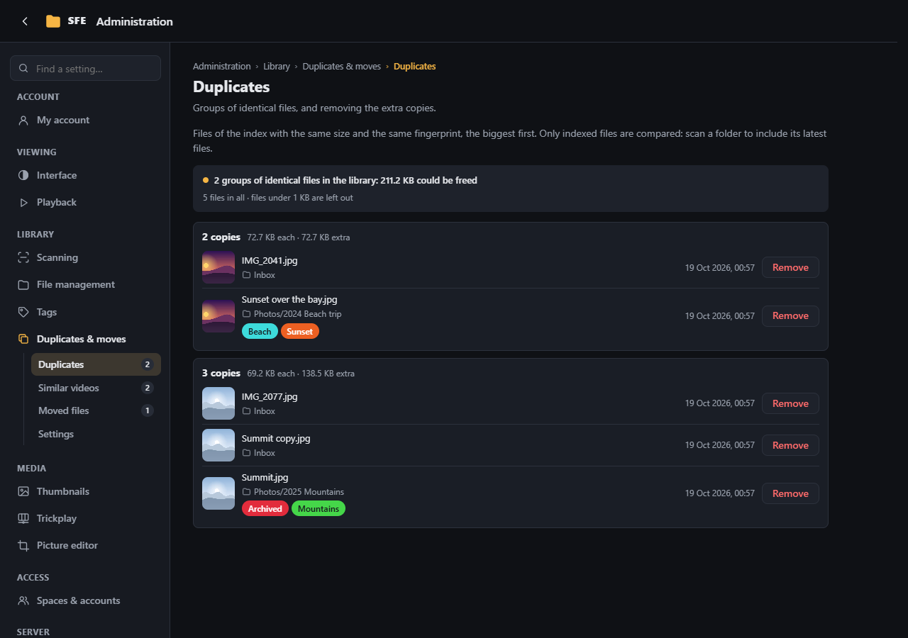
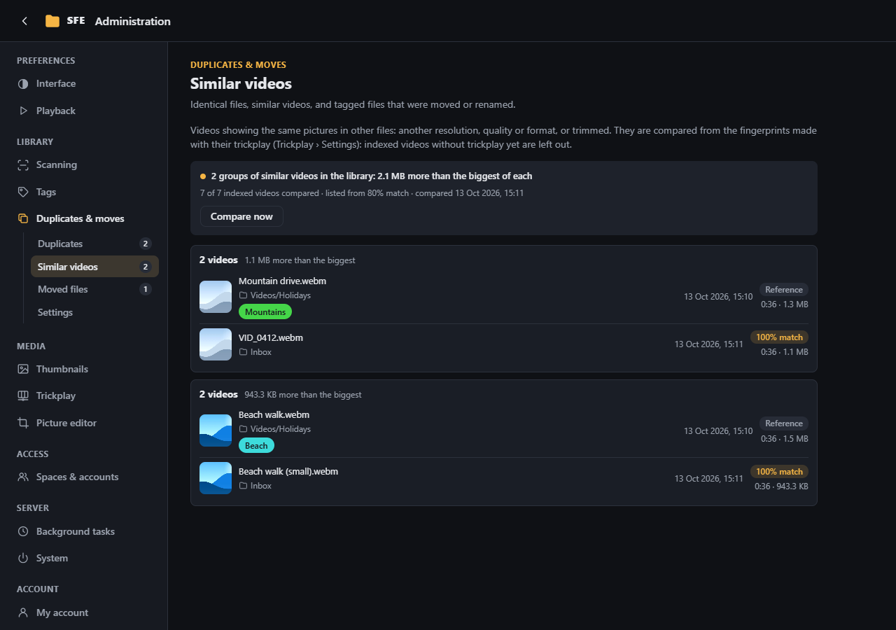
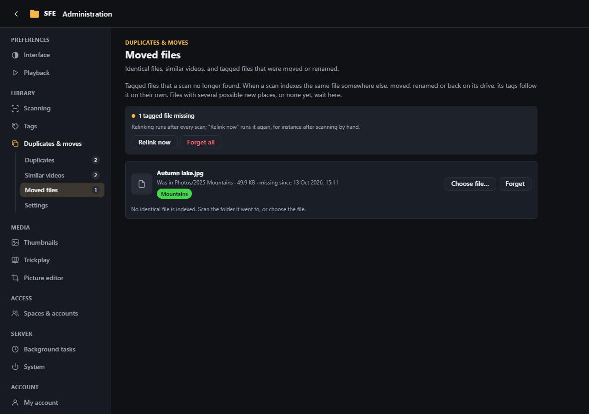
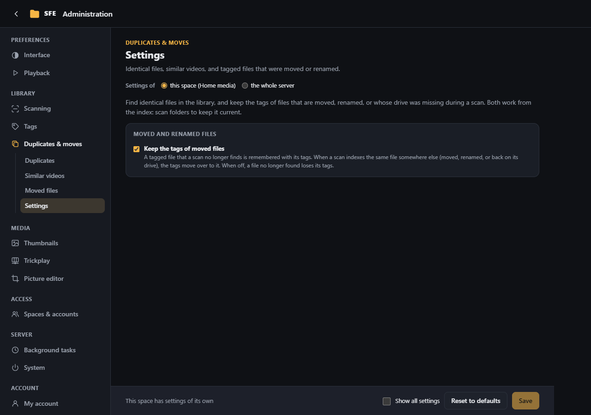

# Duplicates & moves

**Administration › Duplicates & moves**: identical files, similar videos, and tagged files that were moved or renamed.
All three work from the index, so [scan](../user-guide/scanning.md) folders to keep it current. Click a name to open
the file, or its folder to browse there.

## Duplicates

Groups of indexed files with the same size and fingerprint, biggest first, with the space the extra copies take
(right `tracking.duplicates`).

- **Only in “folder”** compares only the folder being browsed.
- The fingerprint (read by scans, [Scanning › Indexing](scanning.md#indexing)) covers the first megabyte, so files
  differing only further in can show up; files indexed without one are not compared.
- **Remove** moves a copy to the [trash](file-management.md#trash) and adds its tags to the copy you keep (right
  `tracking.duplicatesRemove`); **Undo** in the message puts it back, and so does **Restore** on the trash page, with
  its own tags. SFE first compares the two files byte for byte and refuses two paths to the same file (folder link,
  junction, hard link), so an identical copy always remains. When the space deletes permanently
  (`Files:DeletePermanently`), the copy is deleted for good instead, and the confirmation says so.

## Similar videos

Videos showing the same pictures in other files (another resolution, bitrate or format, or trimmed), which
**Duplicates** can't see (right `tracking.similar`).

- They are compared frame by frame from their [trickplay](trickplay.md), so **turn trickplay on** for the folders to
  check; the summary says how many videos were compared.
- The first video of a group is the longest; the others show their **match**: the frames they share with it, in percent
  of the longer of the two (another resolution ≈ 100 %, a copy cut by a tenth ≈ 90 %, a short excerpt stays low).
- **Compare now** runs the comparison in the background; its result is kept until the next one or a restart.
- Not found: clips shorter than three trickplay intervals, cropped, mirrored or sped-up copies. Videos that look alike
  all along (a still screen) can match each other.
- Nothing is deleted from this page.

## Moved files

Tagged files a scan no longer found (moved, renamed, or on a drive that was unplugged), right `tracking.missing`.
Instead of losing their tags, they are kept as *missing*.

- After each scan, a missing file with exactly one likely new place (same size and fingerprint, indexed after it; same
  name wins ties) gets its tags back there, with its thumbnail and trickplay. An identical copy indexed at the same
  time can be taken for it: the tags then go to a file with the same content.
- The others wait in the list: relink them to a candidate or any file (**Choose file…**), or **Forget** them.
- **Relink now** runs the matching again (for instance after scanning by hand); **Forget all** empties the list.

## Settings

Right `settings.tracking`; in the configuration under `Sfe:FileTracking`.

| Setting | Default | |
|---|---|---|
| **Smallest file (KB)** (`Duplicates:MinimumKilobytes`) | 1 | Smaller files are left out; 0 compares every file |
| **Groups per page** (`Duplicates:GroupsPerPage`) | 50 | Groups loaded at a time (up to 500) |
| **Allow deleting copies** (`Duplicates:AllowRemove`) | on | Shows **Remove** on each copy |
| **Smallest match (%)** (`SimilarVideos:MinimumPercent`) | 80 | Smallest match (50 to 100) to list two videos as similar; applies from the next comparison |
| **Keep the tags of moved files** (`Relink:Enabled`) | on | Keeps tagged files no longer found as missing. When off, they lose their tags |
| **Recognise files without a fingerprint by name** (`Relink:MatchByName`) | on | Matches files without a fingerprint on name, size and date (catches a move, not a rename) |
| **Remember missing files for (days)** (`Relink:RetentionDays`) | 30 | Missing files not found again in that time are forgotten; 0 = keep them |
