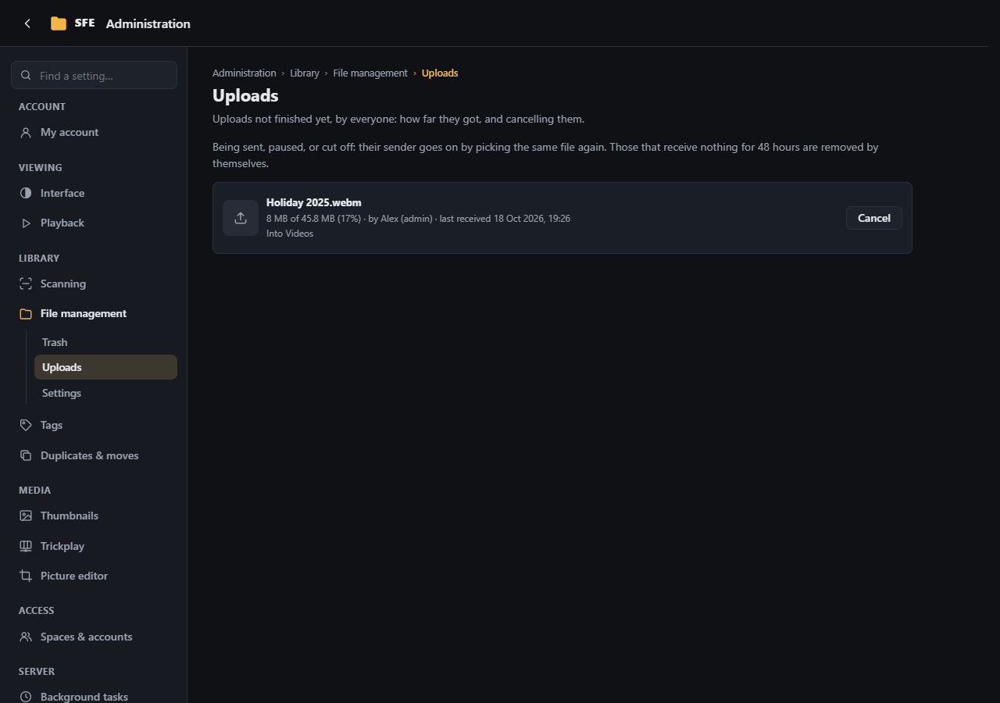

# File management

**Administration › Library › File management**: the trash of the space, the uploads under way and the settings of
[managing files](../user-guide/managing-files.md).

## Trash

What was deleted to the trash, newest first, with its size, when and by whom: **Restore** puts an item back where it
was, **Delete** deletes it for good, **Empty the trash** deletes everything you may for good. Rights: `files.delete`
(see and restore what you deleted, and what was deleted where you may delete), `files.deletePermanently` (delete for
good). A folder that had folder access rules of its own shows only to whoever deleted it and to those who manage the
space's access. Server administrators see everything.

## Uploads

Everyone's unfinished uploads in the space (right `settings.files`): the file, who sends it, how much arrived and when
the last piece came. **Cancel** stops one and removes what it received. Each person sees their own in the page's
panel; uploads that receive nothing for **Keep unfinished uploads for** are removed by themselves.

## Settings

Right: `settings.files`.

| Setting | Default | |
|---|---|---|
| **Always delete permanently** (`Sfe:Files:DeletePermanently`) | off | Every delete skips the trash: files are gone at once, and only those with `files.deletePermanently` can delete. What is already in the trash stays (restore and purge still work) |
| **Days in the trash** (`Sfe:Files:Trash:RetentionDays`) | 30 | Then the **Trash purge** task deletes it for good (it also runs by itself when the trash is used); 0 keeps everything until the trash is emptied |
| **Free space kept by copies and uploads** (`Sfe:Files:MinimumFreeSpaceMegabytes`) | 1024 | A [copy](../user-guide/managing-files.md#move-and-copy) or an [upload](../user-guide/managing-files.md#upload) is refused when it would leave less free space than this (in MB) on the drive it goes to; 0 lets them fill the drive |
| **Largest file to upload** (`Sfe:Files:Uploads:MaxFileSizeMegabytes`) | 0 | In MB; 0: no limit |
| **Keep unfinished uploads for** (`Sfe:Files:Uploads:KeepUnfinishedHours`) | 48 | Hours without a piece arriving before an unfinished upload is removed with what it received |
| **Largest zip to download** (`Sfe:Files:MaxArchiveMegabytes`) | 0 | In MB; a [zip of several files or a folder](../user-guide/managing-files.md#download-several-files-or-a-folder) larger than this, as the index counts it, is refused before it starts (folders not indexed count nothing); 0: no limit |
| **Only names Windows accepts** (`Sfe:Files:PortableNames`) | on | New names must also work on Windows: no `< > : " \ \| ? *`, no name ending with a dot or a space, no device names (`CON`, `NUL`, `COM1`…). Keep it on when the library is shared with Windows computers or may move to one. A Windows server always refuses them |
| **Where SFE keeps its work files** (`Sfe:Files:WorkFolder`) | In the library | **In the library** (`Library`): a hidden folder `.sfe` at the library's root. **On the server** (`Server`): the server's data folder, beside the thumbnails (`work`) |

## The work folder

File management keeps work files of its own: the trash, and uploads not finished yet (`uploads`).

- **In the library** (the default), they stay on the library's own drive, so putting a file in the trash is a rename,
  however large the file. The folder is hidden (Windows' hidden attribute; on Linux its dot hides it).
- **On the server** (in the server's data folder), the library holds nothing of SFE's, but large files are copied from one drive to
  the other.

Either way, the name `.sfe` at the library's root is reserved: it is never listed (not even with hidden items shown),
scanned, searched or reachable from the web pages, and no file or folder can be given that name there.

Changing the setting doesn't move what is in the trash: each item stays (and is restored) from where it went. Who may
create folders, rename, move, copy, upload and delete is decided by the rights `files.createFolders`, `files.rename`,
`files.move`, `files.copy`, `files.upload`, `files.delete` and `files.deletePermanently`, which no group has
until you give them ([Spaces & accounts](spaces-and-accounts.md#groups)), and by [folder access](spaces-and-accounts.md#folder-access).
The server's account needs write access to the library ([Installation](../installation.md)).
