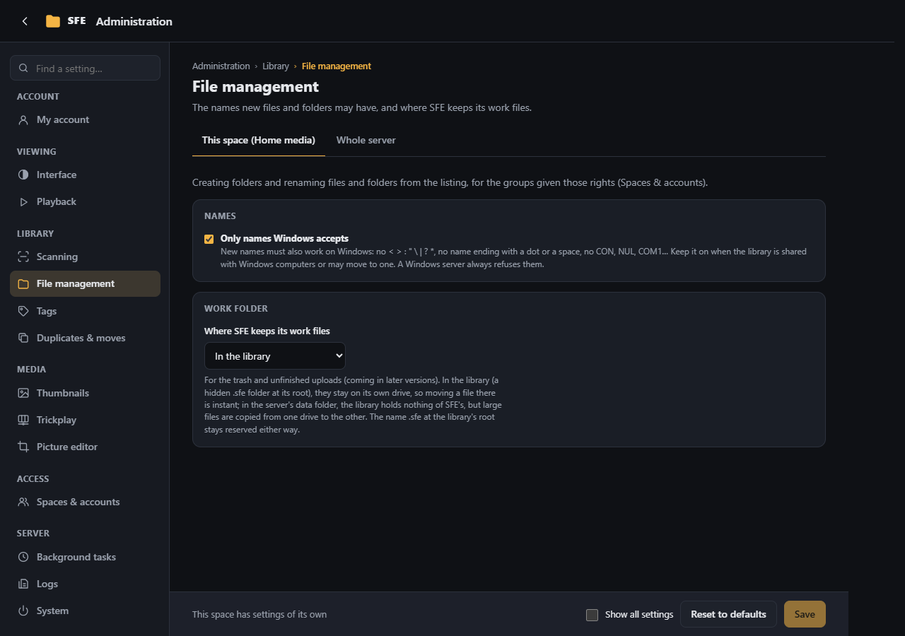

# File management

**Administration › Library › File management**: the settings of [managing files](../user-guide/managing-files.md) in a
space. Right: `settings.files`.

| Setting | Default | |
|---|---|---|
| **Only names Windows accepts** (`Sfe:Files:PortableNames`) | on | New names must also work on Windows: no `< > : " \ \| ? *`, no name ending with a dot or a space, no device names (`CON`, `NUL`, `COM1`…). Keep it on when the library is shared with Windows computers or may move to one. A Windows server always refuses them |
| **Where SFE keeps its work files** (`Sfe:Files:WorkFolder`) | In the library | **In the library** (`Library`): a hidden folder `.sfe` at the library's root. **On the server** (`Server`): the server's data folder, beside the thumbnails (`work`) |

## The work folder

File management keeps work files of its own: the trash and uploads not finished yet, which later versions add.

- **In the library** (the default), they stay on the library's own drive, so putting a file in the trash will be a
  rename, however large the file. The folder is hidden (Windows' hidden attribute; on Linux its dot hides it).
- **On the server** (in the server's data folder), the library holds nothing of SFE's, but large files are copied from one drive to
  the other.

Either way, the name `.sfe` at the library's root is reserved: it is never listed (not even with hidden items shown),
scanned, searched or reachable from the web pages, and no file or folder can be given that name there.

Who may create folders and rename is decided by the rights `files.createFolders` and `files.rename`, which no group has
until you give them ([Spaces & accounts](spaces-and-accounts.md#groups)), and by [folder access](spaces-and-accounts.md#folder-access).
The server's account needs write access to the library ([Installation](../installation.md)).
