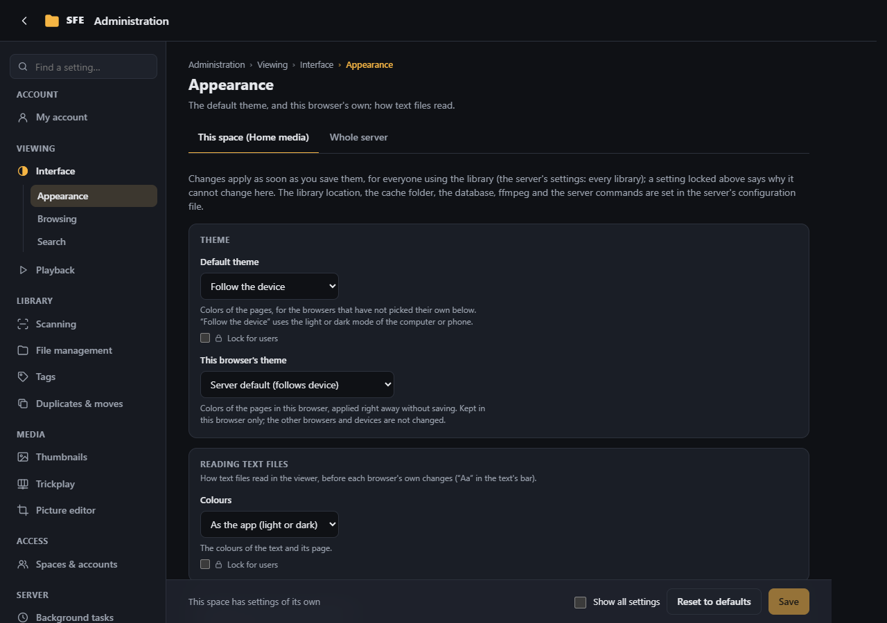
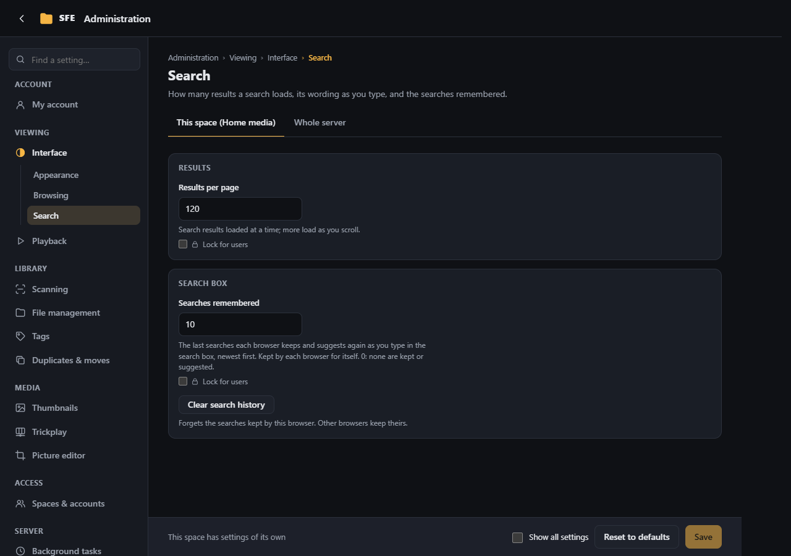

# Interface

**Administration › Interface**: colors, listings and the search box, as defaults of the space or of the server. Most
of these settings can also be changed by each user for themselves in [My account](my-account.md). Right:
`settings.interface`.

## Appearance

| Setting | |
|---|---|
| **Default theme** | `Follow the device` (default) uses the light or dark mode of each computer or phone; `Dark` and `Light` force one (`Sfe:Appearance:Theme`) |
| **This browser's theme** | Applied at once, without saving: **Light** or **Dark**, kept in this browser even if the default changes later, or back to the **Server default**. Other browsers and devices are not changed |

The separate video player window always stays dark.

### Reading text files

How [text files](../user-guide/text-files.md#reading-settings) read in the viewer, for the accounts and browsers that
haven't changed them: **Colours** (as the app, light, sepia or dark) and **Font of the device** (the name of a font
installed on the reader's device, used where a font is "The font named below"); then, for **notes and documents**
(`.txt`, `.md`, `README`…) and for **code, logs and settings**: the font, text size, line height, width, margins,
wrapping and line numbers (`Sfe:Reading:…`, see [Configuration](../configuration.md)).

Each account can make its own (**My account › Preferences**, or **Save as my default** in the reading settings), and
each browser keeps its own changes over them.

## Browsing

| Setting | Default | |
|---|---|---|
| **Items per page** | 120 | Files and folders loaded at a time; more load as you scroll |
| **Largest page** | 1000 | The most a client may ask for at once (all settings view) |
| **Pictures per folder** | 4 | [Folder pictures](../user-guide/browsing.md#folder-pictures) in the grid and one-per-row views: 4 makes a 2×2 grid, 9 a 3×3 grid, up to 16; 0 lists folders without pictures |
| **Copy full paths** | off | [Copy buttons](../user-guide/browsing.md#copying-full-paths) for the server's full path of folders and files; also needs the right `files.copyPaths` |
| **Show resolutions** | on | Photo and video sizes in pixels next to their file size, in listings and the viewer |
| **Show durations** | on | How long videos and audio files last |
| **Mark high and low resolution** | off | **HR** / **LR** labels on previews, by the two thresholds below |
| **Photos are high resolution from (pixels)** | 1500 | Shorter side from which a photo is HR |
| **Videos are high resolution from (pixels)** | 720 | Shorter side from which a video is HR |

Resolutions and durations come from scans ([Scanning › Indexing](scanning.md#indexing)); hiding them doesn't stop them
being searched. The thresholds also decide what `r:hr` and `r:lr` find, marks on or off.

## Search

| Setting | Default | |
|---|---|---|
| **Results per page** | 120 | Search results loaded at a time |
| **Largest page** | 1000 | The most a client may ask for at once (all settings view) |
| **Explain searches** | on | The speech-bubble button that [puts a search into words](../user-guide/search.md#explanations) (all settings view) |
| **Searches remembered** | 10 | The [search history](../user-guide/search.md#search-history) each browser keeps; 0 keeps none |

**Clear search history** forgets the searches kept by this browser; other browsers keep theirs.
