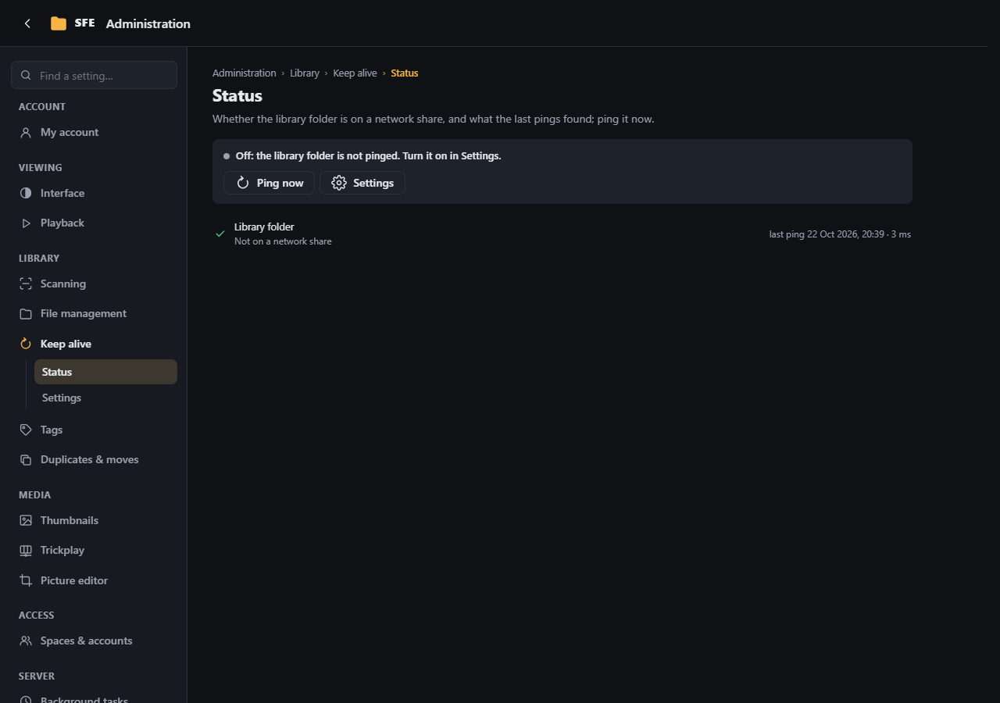
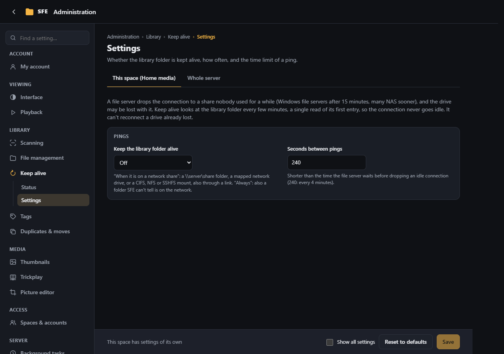

# Keep alive

**Administration › Keep alive**: for a space whose library folder is on a network share. A file server drops the
connection to a share nobody used for a while (Windows file servers after 15 minutes, many NAS sooner), and the drive
or mount may be lost with it. Keep alive makes SFE look at the library folder every few minutes, a single read of the
folder's first entry however large it is, so the connection never goes idle. Right: `settings.keepAlive`
(Administrators).

Keep alive keeps a connection from being dropped; it can't reconnect a drive that is already lost: reconnect it as
usual (a mapped drive, as the account SFE runs as).

## Status

- The line at the top says whether keep alive is on, how often it pings, or how many folders don't answer.
- Each folder pinged since the server started: whether it is **on a network share**, when it was last pinged and how
  long the ping took, or why it failed and **since when**. **Waiting for an answer**: the share doesn't answer at all;
  it is not pinged again until it does (or the ping's time limit is over, then it counts as failed).
- **Ping now** pings the library folder at once, also while keep alive is off: to try a share before turning it on,
  or to check it answers again.
- **Settings** opens the settings below.

Everyone browsing the space also sees how it goes on the ⋮ button at the top right: a green dot, or a yellow **!**
when a folder doesn't answer ([the network folder indicator](../user-guide/signing-in.md#the-network-folder-indicator));
no folder nor error is named there.

The [log](logs.md) also says when keep alive starts on a folder, when a folder stops answering (once, not at every
ping) and when it answers again.

## Settings

Settings of each space (and their default for every space at the **Whole server** level).

| Setting | Default | |
|---|---|---|
| **Keep the library folder alive** (`Sfe:KeepAlive:Mode`) | Off | **When it is on a network share** (`Auto`): a `\\server\share` folder, a mapped network drive, or a CIFS, NFS or SSHFS mount, also through a link. **Always**: also a folder SFE can't tell is on the network |
| **Seconds between pings** (`Sfe:KeepAlive:IntervalSeconds`) | 240 | 10–3600; shorter than the time the file server waits before dropping an idle connection |
| **Time limit (seconds)** (`Sfe:KeepAlive:TimeoutSeconds`) | 30 | 1–300; a ping taking longer counts as failed |
| **How the library folder is pinged** (`Sfe:KeepAlive:Method`) | Read the folder | **Read the folder** (`List`) is enough for most file servers, but the computer may answer it from its own cache without asking the server. **Write and delete a small file** (`Touch`) always reaches the server: SFE creates and deletes `ping.tmp` in its work folder, `.sfe/keep-alive` at the library's root. When the work folder is on the server (the default for spaces created since 1.82: choose **In the library** under [File management](file-management.md#the-work-folder) to use this method), the folder is read instead, and the log says so once |
| **More folders** (`Sfe:KeepAlive:Folders`) | none | Library folders kept alive too, paths from the library root, one per line: for folders reached through a link to another share. **When it is on a network share** looks at each one on its own; they are always read. A setting of each space only; it follows the folder when it is renamed or moved in SFE |

**How the library folder is pinged** and **More folders** show with **Show all settings**. On the status page the
library folder comes first, then the more folders; **file written** says the last ping of the library folder wrote its
file.
