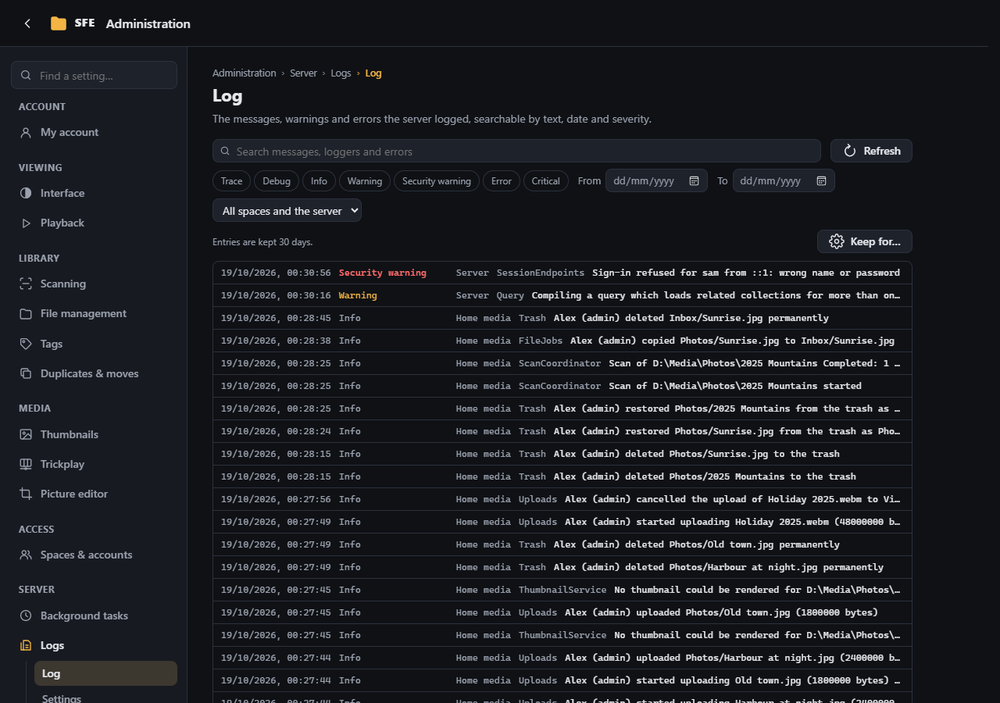
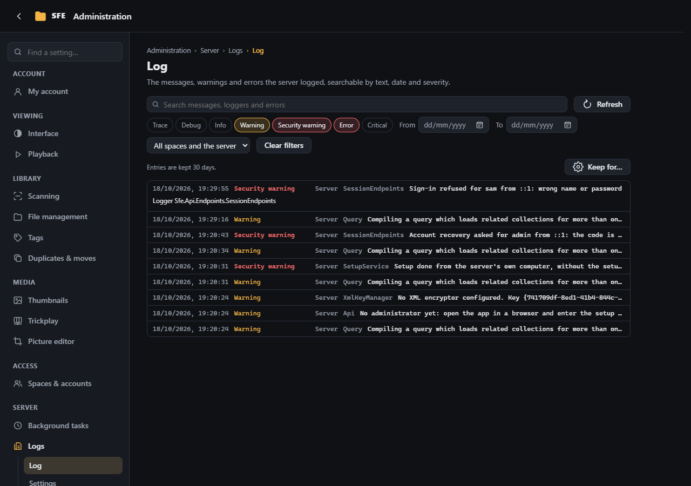
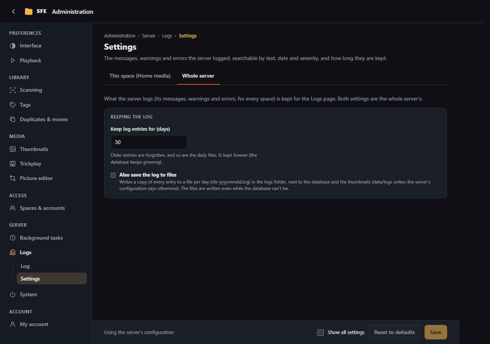

# Logs

**Administration › Logs** shows what the server logged (its messages, warnings and errors) without opening its
console or log files. Rights: `logs.view` (the log), `settings.logs` (its settings page; only server administrators
can change the settings, which belong to the whole server).

## Log

Entries are listed newest first, one per line: the moment, the severity, the space it concerns (**Server** for the
server's own: start-up, sign-ins, the accounts), the part of SFE that wrote it, and the message.

- **Search** by text: the words are looked for in the message, the name of the part that logged it and the error's
  details, ignoring case. The list follows as you type; **Refresh** reads it again (new entries reach the list a few
  seconds after they are logged).
- **Severity:** tick one or more of Trace, Debug, Info, Warning, Security warning, Error, Critical; none ticked shows
  them all. **Security warning** marks what someone did against the server's protections: wrong passwords (with the
  name and the address they came from), an address or an account blocked after too many, a wrong setup code (setup,
  installation page, update), account recoveries asked for, refused or done, the first administrator created, and
  changes saved on the installation page. Tick it alone to see who tried what. The console and the log files show
  them too (`SEC` in the files).
- **From** / **To:** days, both included, in your browser's time zone.
- **Space** (server administrators): every space and the server, the server's own entries only, or one space.
- **Clear filters** shows every entry again; **Load older entries** at the bottom adds the next ones.
- Click an entry to read all of it: the whole message, the full name of the part that logged it and, for an error, its
  details (the error's type, message and where it happened).

**Who sees what:** server administrators see the whole server's log. Anyone else with `logs.view` (by default the
Administrators group of each space) sees only the entries of the space they work in: not the server's own entries,
nor those of other spaces.

When the server refuses a request or fails at it with an explanation (a request it can't take, an archive it can't
read, a folder not found to extract into…), the log keeps what was asked (the address, without what follows `?`), by
whom, and the message given: a refused request is a Warning, a server failure an Error, the rest Info. Passwords are
never in it.

Which messages are logged follows the server's `Logging` configuration, as for its console: by default everything from Info up, except
the web server's and the database's components, which log only their warnings and errors (see
[Configuration](../configuration.md#logs)).

## Settings

Both are settings of the whole server (the **Whole server** tab; **Keep for…** on the Log page leads here):

- **Keep log entries for (days)** (`Sfe:Logs:RetentionDays`, default 30, 0 = forever): older entries are forgotten,
  about every hour, and so are older daily files.
- **Also save the log to files** (`Sfe:Logs:WriteFiles`, default off): a copy of every entry goes to a file per day,
  `sfe-yyyymmdd.log` (UTC dates), in the **logs folder**, next to the database and the thumbnails: `data/logs` in the
  application folder unless `Sfe:Logs:Directory` says otherwise. The files are written even while the database can't
  be (e.g. while an [update](../upgrading.md#the-update-page-137-and-later) waits to be confirmed), which helps to find
  out why.

The entries are kept in the accounts' database (table `LogEntries`).
