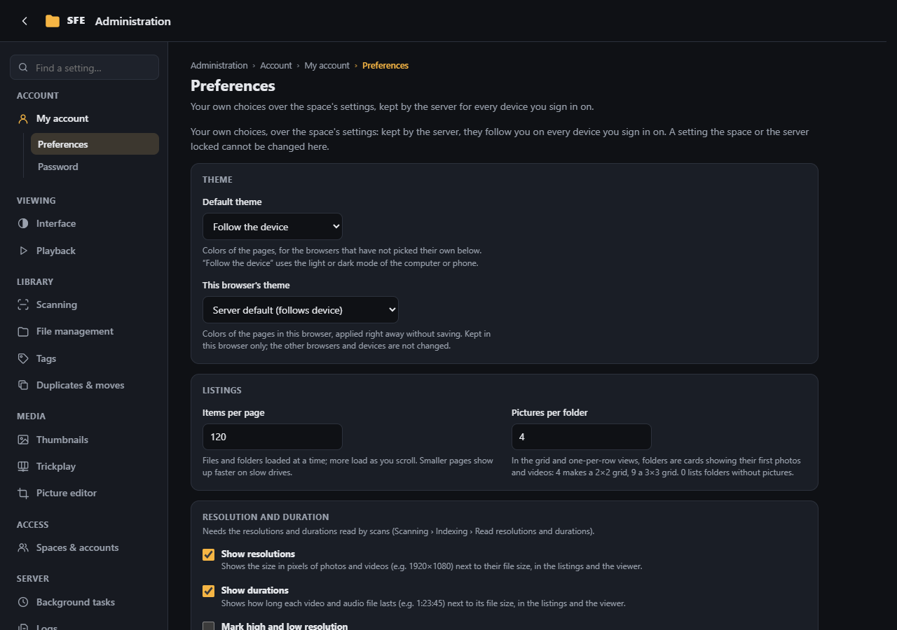
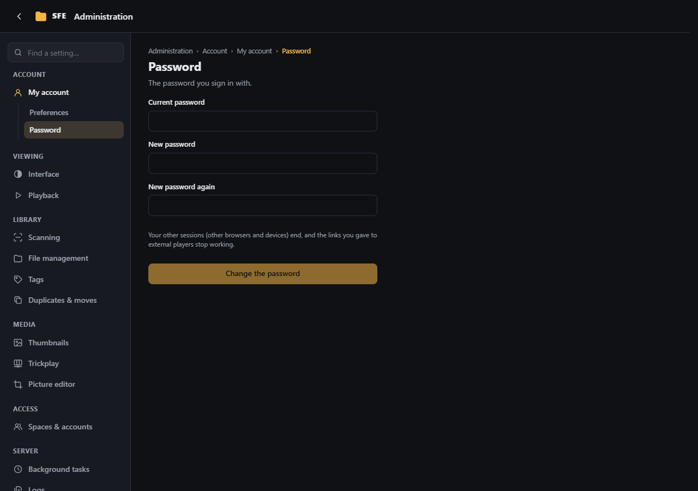

# My account

**Administration › My account**: your own preferences and your password. It is the only section an account without
any right to change something sees. Clicking your name at the top of the ⋮ menu opens it directly.

## Preferences

Your own choices, over the space's settings: kept by the server, they follow you on every device you sign in on.
A setting the space or the server locked cannot be changed here. Right: `account.preferences`.

They include the theme (and **This browser's theme**, kept in this browser only), items and results per page, pictures
per folder, the display of resolutions, durations and HR/LR marks, the player's jump and loop, play on hover (videos
and animated images), searches remembered and tags per sidebar section. Each has the same meaning as on the
[Interface](interface.md), [Playback](playback.md), [Thumbnails](thumbnails.md), [Trickplay](trickplay.md#settings)
and [Tags](tags.md#settings) pages.

## Password

Changes your password (right `account.password`): your current one, then the new one twice, and **Change the password**.
Your other sessions (other browsers and devices) end, and the links you gave to external players stop working.
