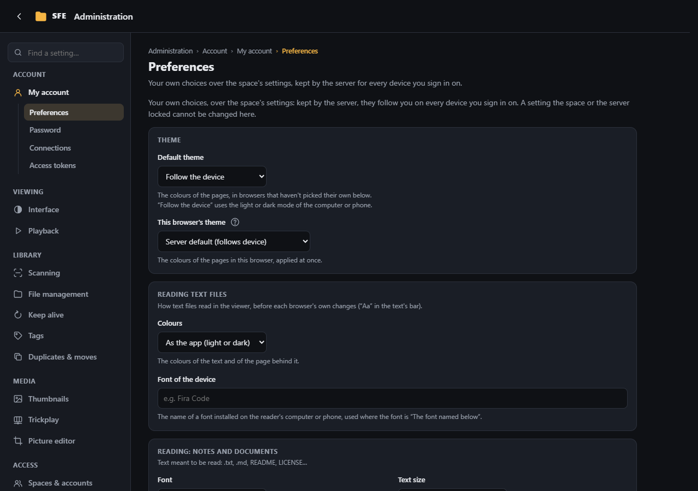
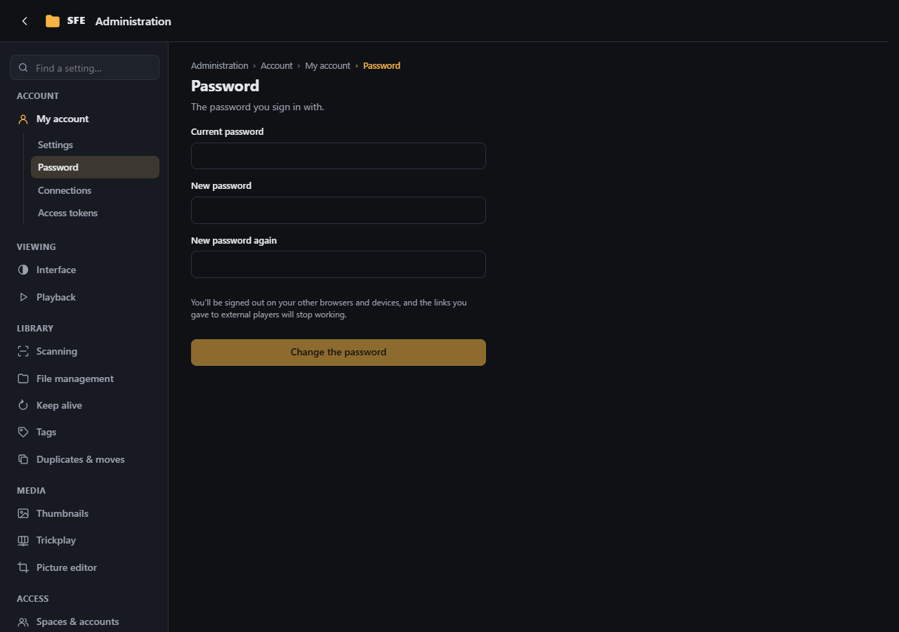
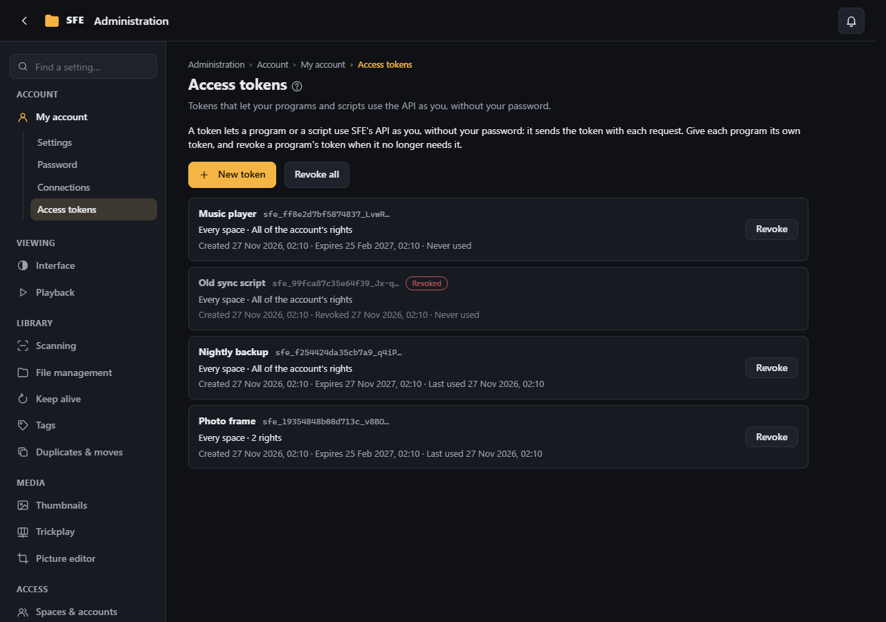
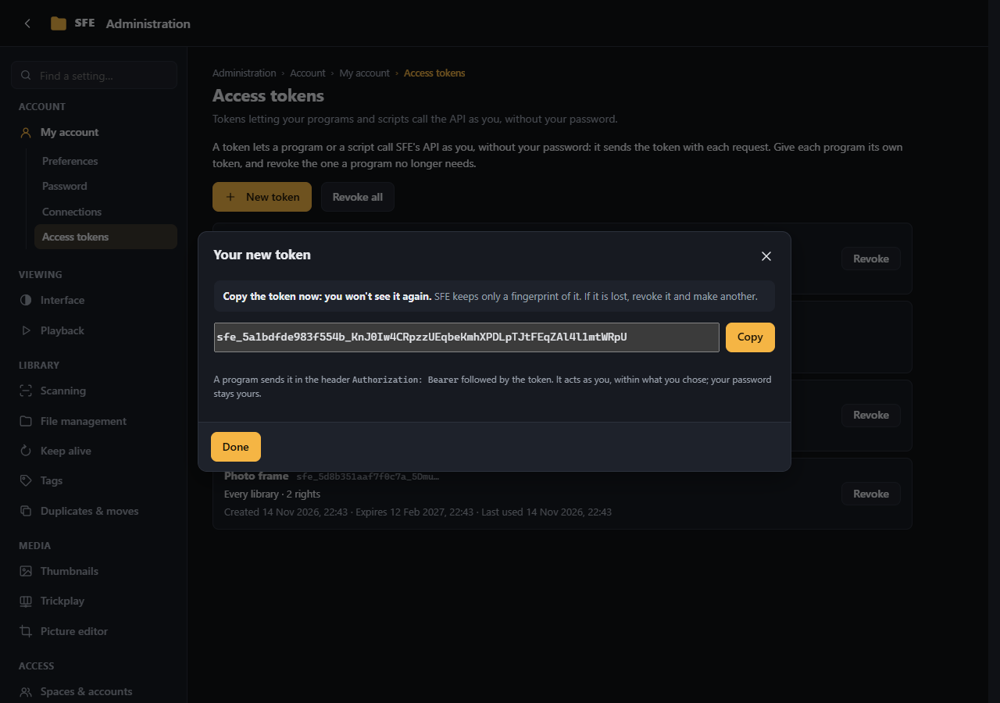

# My account

**Administration › My account**: your own preferences, your password and your access tokens. It is the only section an account without
any right to change something sees. Clicking your name at the top of the ⋮ menu opens it directly.

## Preferences

Your own choices, over the space's settings: kept by the server, they follow you on every device you sign in on.
A setting the space or the server locked cannot be changed here. Right: `account.preferences`.

They include the theme (and **This browser's theme**, kept in this browser only), items and results per page, pictures
per folder, the display of resolutions, durations and HR/LR marks, the player's jump and loop, play on hover (videos
and animated images), searches remembered, tags per sidebar section, and how [text files read](../user-guide/text-files.md#reading-settings)
(also saved from the reading settings with **Save as my default**). Each has the same meaning as on the
[Interface](interface.md), [Playback](playback.md), [Thumbnails](thumbnails.md), [Trickplay](trickplay.md#settings)
and [Tags](tags.md#settings) pages.

## Password

Changes your password (right `account.password`): your current one, then the new one twice, and **Change the password**.
Your other sessions (other browsers and devices) end, and the links you gave to external players stop working.

## Connections

Your own connections to storage outside the libraries (Dropbox), seen only by you:
[Connections](connections.md#adding-a-connection).

## Access tokens

A token lets a program or a script of yours call SFE's [API](../reference/api.md) as you, without your password
(right `account.tokens`, which only the Administrators group has by default). The list shows each token's name and
first characters, the library it works in, its rights, and when it was made, expires and was last used.

- **New token**: a name saying what it is for, how long it lives (at most what the server allows), one library or every
  library of yours, and every right of yours or only those you tick. **Create** shows the token **once**: copy it with
  **Copy** and keep it where the program reads it. SFE keeps only a fingerprint of it; a lost token is revoked and
  replaced.

  

- **Revoke** ends a token at once: the programs using it are refused from then on. **Revoke all** ends every token of
  yours.
- A token acts as your account: it never does more than you may do now, and a disabled or deleted account ends its
  tokens. Changing your password does **not** end them (as on other services): revoke them if they may have leaked.
- While the server has tokens switched off (**Spaces & accounts › Token settings**), no token can be made and those
  made are refused; they work again once tokens are switched back on.
- A token can't sign in, change a password, make other tokens or open the setup and installation pages: those stay
  with your session.

How a program sends its token, with examples in curl and PowerShell:
[Calling with a token](../reference/api.md#calling-with-a-token).
