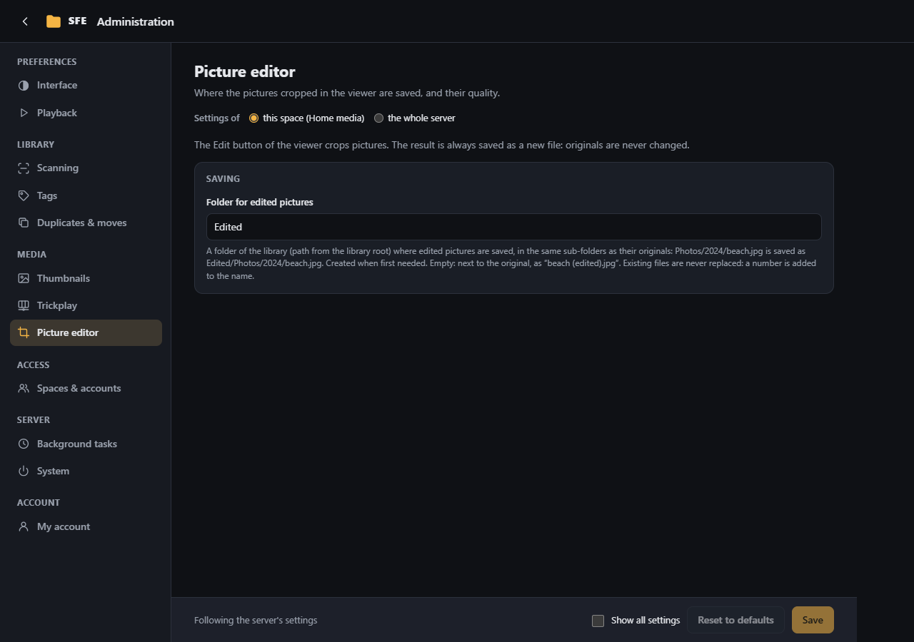

# Picture editor

**Administration › Picture editor**: where the pictures cropped in the [picture editor](../user-guide/picture-editor.md)
are saved, and their quality. Right: `settings.editor`.

| Setting | Default | |
|---|---|---|
| **Folder for edited pictures** (`Sfe:Editor:OutputFolder`) | `Edited` | Library folder (path from the root) under which edited pictures are saved, in the original's own folders: `Photos/2024/beach.jpg` becomes `Edited/Photos/2024/beach.jpg`. Empty: next to the originals, as `beach (edited).jpg`. A setting of each space |
| **Quality (JPEG and WebP)** (`Sfe:Editor:Quality`) | 92 | 10–100 |

Who may edit pictures is the right `files.edit` (Administrators and Users by default).
