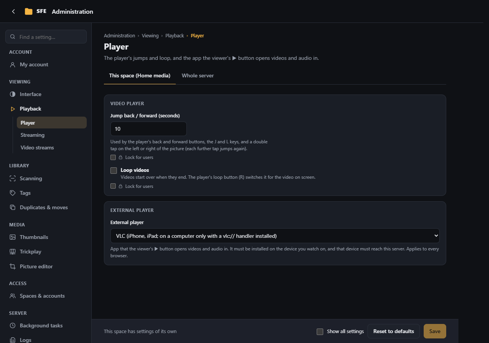
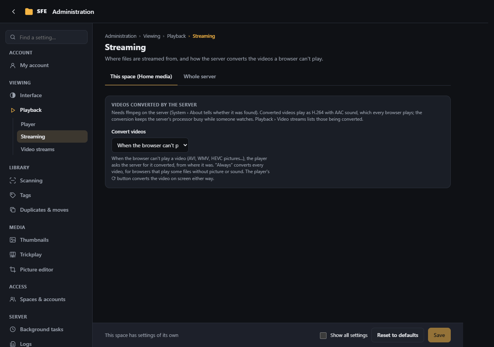
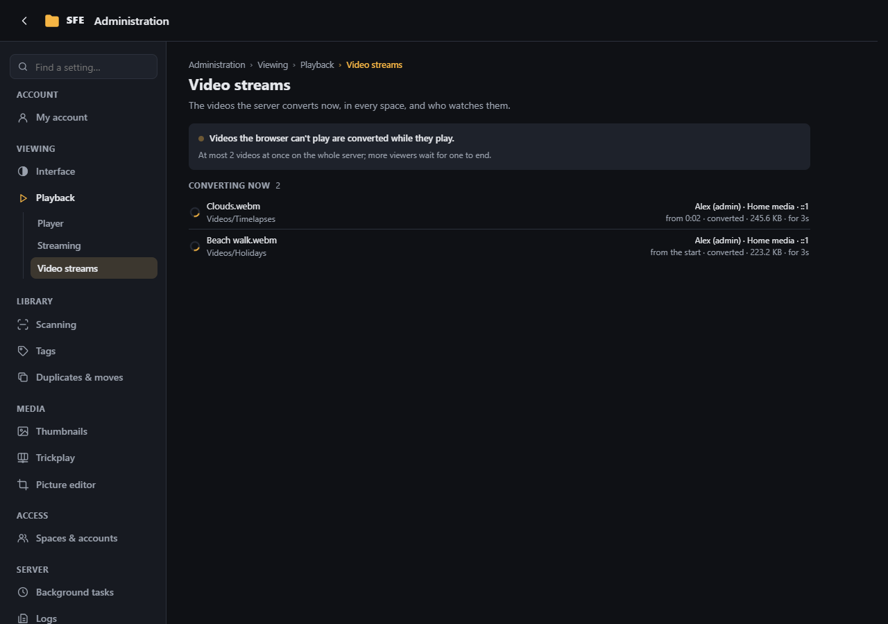

# Playback

**Administration › Playback**: the video player and an app to open videos in (**Player**), where files are streamed
from and how the server converts videos (**Streaming**), and the videos it converts now (**Video streams**). Rights:
`settings.playback` for the settings, `server.streams` for Video streams.

## Player

### Video player

| Setting | Default | |
|---|---|---|
| **Jump back / forward (seconds)** | 10 | Used by the player's back and forward buttons, the J and L keys and a double tap on the picture (`Sfe:Player:SeekSeconds`) |
| **Loop videos** | off | Videos start over when they end; the player's loop button (R) switches it for the video on screen (`Sfe:Player:Loop`) |

Users can change both for themselves in [My account](my-account.md). The player itself is described in
[Video player](../user-guide/video-player.md).

### External player

The viewer's ▶ button opens the video or audio file in a player app installed on the device. Pick your player from
the **External player** list (the players in the table below) and its link and name are filled in; pick “Custom…” to
write your own link. With “None (no button)” the link and name fields are greyed out. The setting applies to every
browser: pick the player of the device you use most.

| Setting | |
|---|---|
| **External player link** | `Sfe:Player:ExternalUrl`, default `vlc://{url}`; empty = no button. `{url}` is the file's full address and `{encodedUrl}` the same address percent-encoded (for a query string); a link with neither just gets the address appended, so `vlc://` works too |
| **External player name** | `Sfe:Player:ExternalName`, default `VLC`: the button's "Open in …" |
| **Link lifetime (minutes)** | `Sfe:Player:LinkLifetimeMinutes`, default 360: how long the link given to the player works without signing in (all settings view) |

| Player | Link | Notes |
|---|---|---|
| VLC (iPhone, iPad) | `vlc://{url}` | Built in. |
| VLC (Windows, macOS, Linux) | `vlc://{url}` | Desktop VLC does not register `vlc://`: install a handler such as [vlc-protocol](https://github.com/stefansundin/vlc-protocol). |
| VLC (Android) | `intent:{url}#Intent;package=org.videolan.vlc;type=video/*;end` | Android uses intents; Chrome-based browsers and Firefox open these. |
| MX Player (Android) | `intent:{url}#Intent;package=com.mxtech.videoplayer.ad;type=video/*;end` | `.pro` for the paid edition. |
| PotPlayer (Windows) | `potplayer://{url}` | Registered by the installer. |
| Infuse (iPhone, iPad, Mac) | `infuse://x-callback-url/play?url={encodedUrl}` | Not on Apple TV. |
| IINA (macOS) | `iina://weblink?url={encodedUrl}` | |
| mpv | `mpv://…` | Only through a third-party handler ([mpv-handler](https://github.com/akiirui/mpv-handler)), with its own link format. |

The address the player gets is a link of its own to that one file (`api/files/shared/<token>/<name>`), valid for the
link lifetime and ended early by a password change, a disabled account or the loss of the right `files.external`. With
a data server, the player gets that server's address instead.

## Streaming

### Data server

**Data server** (`Sfe:DataServer`, a server setting, all settings view): an optional web server already publishing the
library. When it is empty (the default), SFE streams the files itself, with range support.

- A base address gets the file's path appended: `http://nas/files` serves `Photos/a.jpg` from
  `http://nas/files/Photos/a.jpg`.
- Or write a URL template: `{url}` is the path (each part encoded, `/` kept), `{encodedUrl}` the whole path encoded (for
  a query string), e.g. `http://nas/files/{url}?raw=1` or `http://nas/get?file={encodedUrl}`.

That server has no sign-in of SFE's: anyone reaching it can read the files.

### Videos converted by the server

Browsers play few video formats: AVI, WMV, MPEG-2 and most MKV files, or HEVC (H.265) pictures, give "This browser
cannot play this format", or play with sound but a black picture. With ffmpeg on the server (see
[System › About](system.md#server)), SFE converts such a video while it plays, to H.264 pictures and AAC sound that
every browser plays. The player switches to it by itself, from where it was, and shows the video's whole length; a
seek further than what arrived asks the server for a new conversion from there (it starts within a second or two).
The player's ⟳ button converts the video on screen by hand, e.g. one that plays without sound.

| Setting | Default | |
|---|---|---|
| **Convert videos** | When the browser can't play them | Or **Always** (every video, even those the browser plays), or **Never** (`Sfe:Streaming:Mode`: `Fallback`, `Always`, `Off`). A setting of the space |
| **Videos converted at once** | 2 | For the whole server: each one keeps a processor core or more busy; a viewer asking for one more is told to try again later (`MaxStreams`) |
| **Quality (CRF)** | 23 | 15-40; lower is better and heavier (18 looks like the original, 28 is small) (`Quality`) |
| **Largest height (pixels)** | 1080 | Taller videos are scaled down while converted; 0 keeps their size (`MaxHeight`) |
| **Copy H.264 pictures** | on | 8-bit H.264 pictures are only repackaged, with the sound converted: almost no processor time, but a seek lands on the nearest earlier key frame and the largest height doesn't apply (`CopyVideo`) |

All but the first are server settings. Playing converted videos needs the right `files.stream` (Administrators and
Users by default, not guests); [Video streams](#video-streams) lists the videos being converted.

The conversion has no length and can't be downloaded or opened in an external player: those still get the file
itself. Safari (iPhone, iPad, Mac) may refuse converted videos, as it only plays streams it can seek in.

## Video streams

The videos the server is converting now (see [Videos converted by the server](#videos-converted-by-the-server)), in every space,
refreshed every 2 seconds: the video and its folder, who watches it (account, space, network address), where in the
video the conversion started, whether its pictures are **converted** or only **repackaged** (H.264 copied), what was
sent and for how long. Above the list: whether this space converts videos, whether ffmpeg was found, and how many
videos the server converts at once. A video leaves the list when its viewer closes or seeks it (a seek starts a new
conversion). Right `server.streams` (server administrators).
