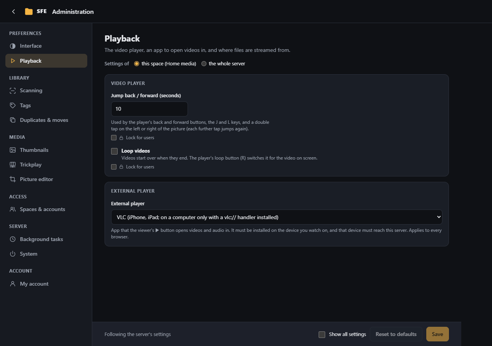

# Playback

**Administration › Playback**: the video player, an app to open videos in, and where files are streamed from. Right:
`settings.playback`.

## Video player

| Setting | Default | |
|---|---|---|
| **Jump back / forward (seconds)** | 10 | Used by the player's back and forward buttons, the J and L keys and a double tap on the picture (`Sfe:Player:SeekSeconds`) |
| **Loop videos** | off | Videos start over when they end; the player's loop button (R) switches it for the video on screen (`Sfe:Player:Loop`) |

Users can change both for themselves in [My account](my-account.md). The player itself is described in
[Video player](../user-guide/video-player.md).

## External player

The viewer's ▶ button opens the video or audio file in a player app installed on the device. Pick your player from
the **External player** list (the players in the table below) and its link and name are filled in; pick “Custom…” to
write your own link. With “None (no button)” the link and name fields are greyed out. The setting applies to every
browser: pick the player of the device you use most.

| Setting | |
|---|---|
| **External player link** | `Sfe:Player:ExternalUrl`, default `vlc://{url}`; empty = no button. `{url}` is the file's full address and `{encodedUrl}` the same address percent-encoded (for a query string); a link with neither just gets the address appended, so `vlc://` works too |
| **External player name** | `Sfe:Player:ExternalName`, default `VLC`: the button's "Open in …" |
| **Link lifetime (minutes)** | `Sfe:Player:LinkLifetimeMinutes`, default 360: how long the link given to the player works without signing in (all settings view) |

| Player | Link | Notes |
|---|---|---|
| VLC (iPhone, iPad) | `vlc://{url}` | Built in. |
| VLC (Windows, macOS, Linux) | `vlc://{url}` | Desktop VLC does not register `vlc://`: install a handler such as [vlc-protocol](https://github.com/stefansundin/vlc-protocol). |
| VLC (Android) | `intent:{url}#Intent;package=org.videolan.vlc;type=video/*;end` | Android uses intents; Chrome-based browsers and Firefox open these. |
| MX Player (Android) | `intent:{url}#Intent;package=com.mxtech.videoplayer.ad;type=video/*;end` | `.pro` for the paid edition. |
| PotPlayer (Windows) | `potplayer://{url}` | Registered by the installer. |
| Infuse (iPhone, iPad, Mac) | `infuse://x-callback-url/play?url={encodedUrl}` | Not on Apple TV. |
| IINA (macOS) | `iina://weblink?url={encodedUrl}` | |
| mpv | `mpv://…` | Only through a third-party handler ([mpv-handler](https://github.com/akiirui/mpv-handler)), with its own link format. |

The address the player gets is a link of its own to that one file (`api/files/shared/<token>/<name>`), valid for the
link lifetime and ended early by a password change, a disabled account or the loss of the right `files.external`. With
a data server, the player gets that server's address instead.

## Streaming (data server)

**Data server** (`Sfe:DataServer`, a server setting, all settings view): an optional web server already publishing the
library. When it is empty (the default), SFE streams the files itself, with range support.

- A base address gets the file's path appended: `http://nas/files` serves `Photos/a.jpg` from
  `http://nas/files/Photos/a.jpg`.
- Or write a URL template: `{url}` is the path (each part encoded, `/` kept), `{encodedUrl}` the whole path encoded (for
  a query string), e.g. `http://nas/files/{url}?raw=1` or `http://nas/get?file={encodedUrl}`.

That server has no sign-in of SFE's: anyone reaching it can read the files.
