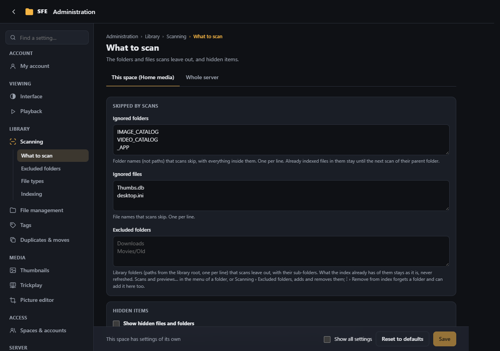
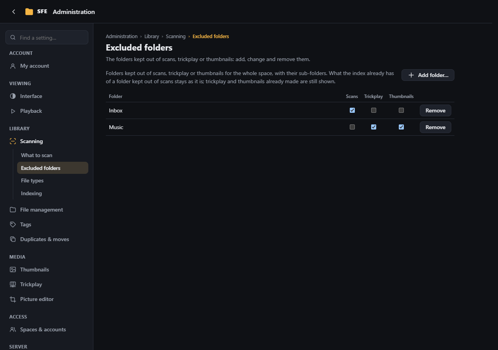
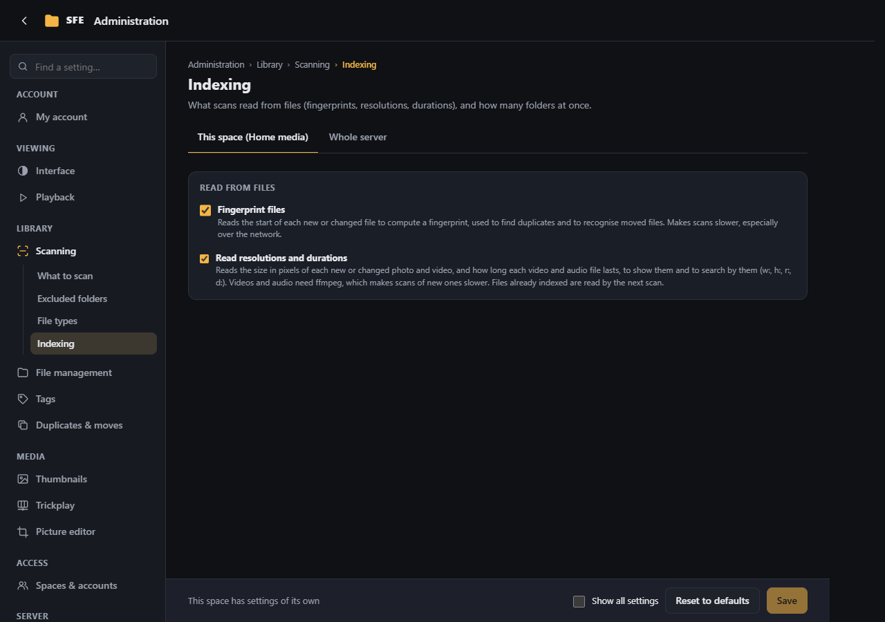

# Scanning

**Administration › Scanning**: what [scans](../user-guide/scanning.md) leave out, which files are photos, videos and
audio, and what scans read from them. Right: `settings.scanning`.

## What to scan

| Setting | |
|---|---|
| **Ignored folders** | Folder names skipped wherever they are, one per line (e.g. `$RECYCLE.BIN`) (`Sfe:Scan:IgnoredDirectories`) |
| **Ignored files** | File names skipped, one per line (e.g. `Thumbs.db`) (`Sfe:Scan:IgnoredFiles`) |
| **Excluded folders** | Folders of this space, as paths from the library root (e.g. `Downloads`, `Movies/Old`), left out of scans with their sub-folders (`Sfe:Scan:ExcludedFolders`). What the index already has of them stays as it is, never refreshed. **Scans and previews…** in a folder's menu adds and removes them ([Excluded folders](../user-guide/scanning.md#excluded-folders)); **Remove from index…** with **Skip this folder in future scans** forgets a folder and adds it |
| **Show hidden files and folders** | Off by default: hidden and system files (`Thumbs.db`, `desktop.ini`) are neither listed nor indexed. On Linux, hidden means a name starting with `.` (`Sfe:ShowHiddenItems`) |

Excluded folders are a setting of each space only.

## Excluded folders

Every folder kept out of scans, trickplay or thumbnails in the space, in one table (right `index.exclude`): the same
lists as **Scans and previews…** in a folder's menu ([Excluded folders](../user-guide/scanning.md#excluded-folders))
and the **Excluded folders** settings of Scanning, [Thumbnails](thumbnails.md) and [Trickplay](trickplay.md#settings).

- A box per list, saved as soon as it is ticked or cleared; **Remove** takes the folder off every list.
- **Add folder…** picks a folder of the library by clicking through it, then what to keep it out of.
- A folder renamed or deleted outside SFE shows **folder not found**: it can only be removed.
- Folders hidden from you by [folder access](spaces-and-accounts.md#folder-access) are not listed.

## File types

**Photos**, **Videos** and **Audio**: the extensions of each kind (`Sfe:FileTypes:Images`, `Videos`, `Audio`). They
decide the previews, the viewer, what gets thumbnails and trickplay, and what `r:hr` / `r:lr` consider. Other files
are listed and searched as plain files.

**More text files** (`Sfe:FileTypes:Text`): extensions opened as [text](../user-guide/text-files.md) in the viewer,
besides those it knows already (`.txt`, `.log`, `.md`, `.json`, code and scripts…), e.g. `out` or `dat` files your
programs write. A media extension can't be one of them.

## Indexing

| Setting | Default | |
|---|---|---|
| **Fingerprint files** | on | Reads a fingerprint of each file (its first megabyte) for [duplicates](duplicates-and-moves.md) and [moved files](duplicates-and-moves.md#moved-files) (`Sfe:Scan:ComputeHashes`) |
| **Read resolutions and durations** | on | Photos from their first bytes (JPEG, PNG, GIF, BMP, WebP; other formats through ffmpeg), videos and audio through ffmpeg (`Sfe:Scan:ReadResolution`) |
| **Folders scanned at once** | 4 | A server setting (`Sfe:Scan:Parallelism`) |

Reading durations makes the first scan of many videos or songs slower. Files indexed before it was on are read by the
next scan; without ffmpeg, videos and audio are read once it is set up.
