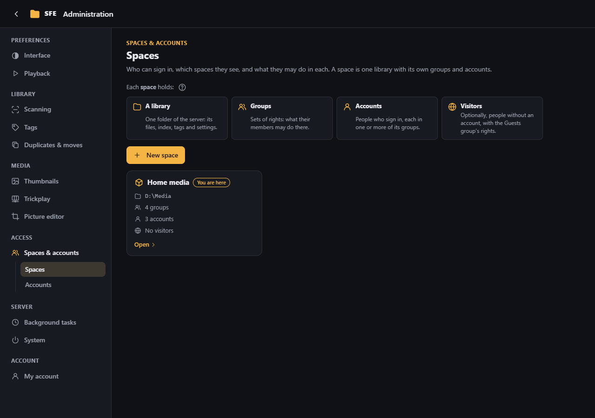
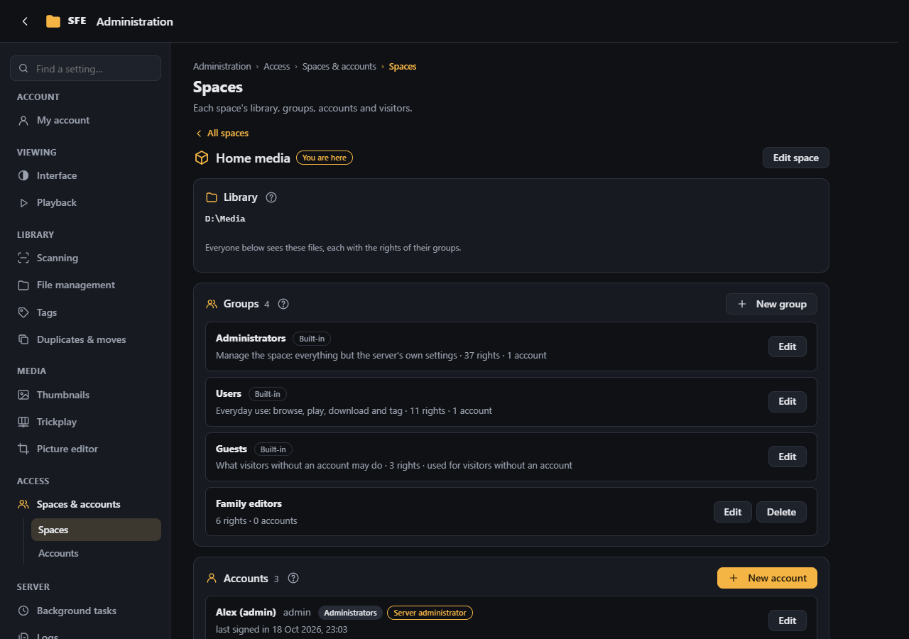
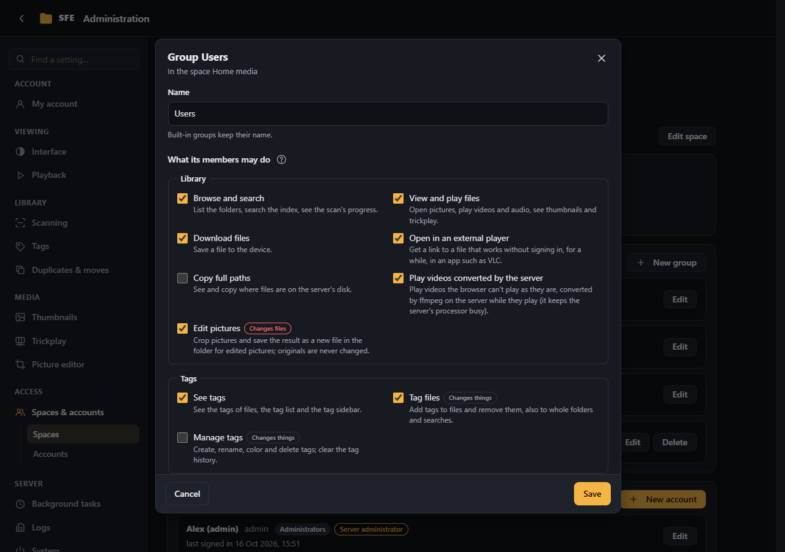
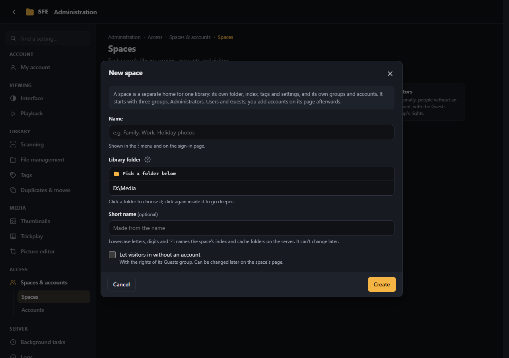
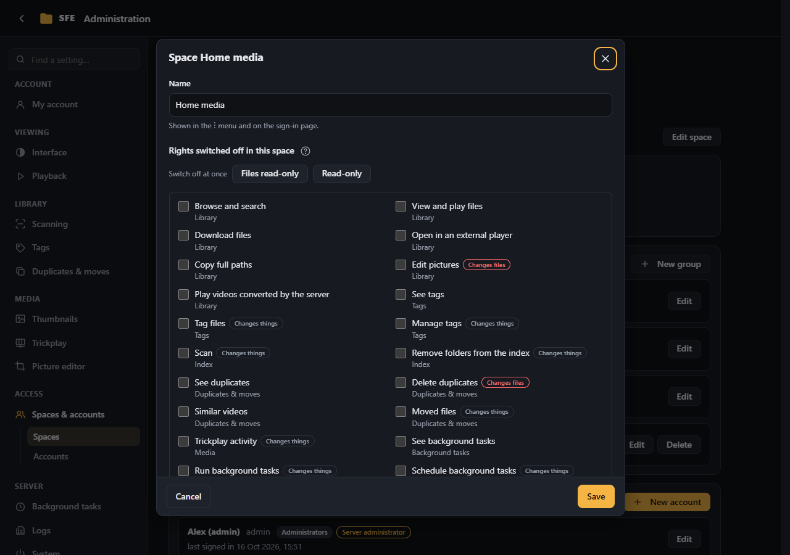
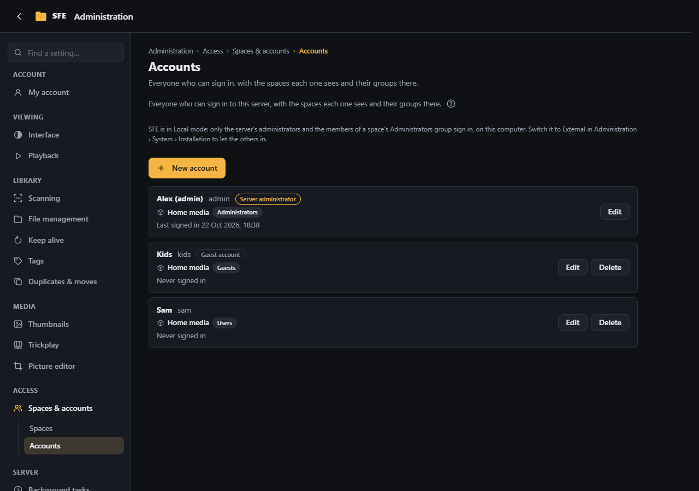
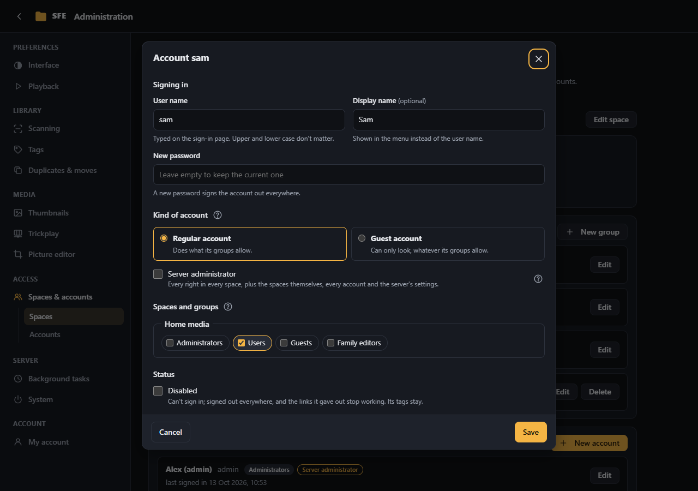

# Spaces & accounts

**Administration › Spaces & accounts**: who can sign in, which spaces they see, and what they may do in each.

A **space** is one library with its own groups and accounts. Each space holds:

- **a library**: one folder of the server, with its files, index, tags, schedules, thumbnails and settings;
- **groups**: sets of [rights](../reference/rights.md), what their members may do there;
- **accounts**: people who sign in, each in one or more of its groups;
- optionally **visitors**: people without an account, with the Guests group's rights.

Server administrators (right `server.tenants`) see every space; a space's administrators (right `tenant.members`) see
their own.

## Spaces

Each card shows a space's folder, groups, accounts and whether visitors may come in; **You are here** marks the one you
are browsing. **Open** shows its page:

| Part | |
|---|---|
| **Library** | The space's folder. Everyone below sees these files, each with the rights of their groups |
| **Groups** | **New group**, and **Edit** / **Delete** for each |
| **Accounts** | The accounts in a group of this space: **New account** (in its Users group to start with), put an account of another space in this one too, **Edit**, **Remove** (from this space) or **Delete** |
| **Visitors without an account** | **Let visitors browse … without an account** |
| **Edit space** | Rename it, disable it, switch rights off in it (server administrators) |

### Groups

Each space has three built-in groups, and any groups you add:

| Group | Rights by default |
|---|---|
| **Administrators** | Every right of the space: everything but the server's own settings |
| **Users** | Everyday use: browse, view, download, external player, edit pictures, tag files, own preferences and password |
| **Guests** | Browse, view and see tags; what visitors without an account may do |

A group's page lists every right by area with what it allows, those that only look first; **Changes things** marks a
right that changes the space (index, tags, settings, accounts) and **Changes files** one that creates, changes or
deletes files in the library ([kinds of rights](../reference/rights.md)). The **Administrators**, **Users** and
**Guests** buttons tick the rights a new space gives that group. **Members** lists its accounts. **Directory group** (optional, advanced)
makes its members those of a group of an external directory ([below](#directories-ldap)). Built-in groups keep their
name and can't be deleted.

### Visitors

When **Let visitors browse … without an account** is ticked, anyone who reaches the server can browse the space without
signing in: the sign-in page offers a button for each such space. They get the rights of the **Guests** group, and never
a right that changes something. For someone who should sign in but only look, make a *guest account* instead. The
configuration can forbid visitors everywhere (`Sfe:Security:AnonymousGuests=false`).

### Creating a space

**New space** (server administrators) asks for a **Name** (shown in the ⋮ menu and on the sign-in page), a **Library
folder** picked among the folders of `Sfe:Tenants:AllowedRoots` (by default the configured `Sfe:Root`, so a space can
be a sub-folder of it), an optional **Short name** (names its index and cache folders; it can't change later), and
whether visitors may come in. The space starts with the three built-in groups and its folder is indexed.

- Its index goes next to the first space's (SQLite: `tenants/<short name>.db` beside the index file; SQL Server: the
  database `<database>_<short name>` on the same server, which the server's account must be allowed to create), or
  where `Sfe:Tenants:ConnectionString` says; its caches under `<CacheDirectory>/tenants/<short name>`.
- Thumbnail and trickplay limits (`MaxConcurrency`, `Parallelism`) are for the whole server, not per space.

### Editing a space

- **Disabled**: nobody can open it and its background tasks stop. Its index, tags, groups and settings are kept.
- **Rights switched off in this space**: a right ticked here is taken from everyone in this space, whatever their groups
  say; only server administrators can tick it, the space's own administrators can't give it back. Example: tick
  *Delete duplicates* on a space whose files must never be deleted from the web page. **Files read-only** ticks every
  right marked *Changes files* (people can still tag and use the space); **Read-only** ticks every right that changes
  something (marked *Changes things* too), so the space can only be looked at.
- **Delete** forgets its groups and settings but leaves its index and caches on the disk.

The first space is the configuration's (`Sfe:Root`, `ConnectionStrings:Sfe`): it cannot be deleted or disabled.

## Accounts

Everyone who can sign in to the server, with the spaces each one sees and their groups there (server administrators;
a space's administrators see the accounts of their space). **Find an account** filters the list; badges mark server
administrators, guest accounts, disabled and locked accounts, and accounts from a directory.

| Field | |
|---|---|
| **User name** | Typed on the sign-in page; upper and lower case don't matter |
| **Display name** | Shown in the menu instead of the user name |
| **Password** / **New password** | At least 8 characters (`Sfe:Security:MinimumPasswordLength`). A new password signs the account out everywhere |
| **Kind of account** | **Regular account**: does what its groups allow. **Guest account**: can only look, whatever its groups allow, never getting a right that changes something; handy as a shared account for visitors or children |
| **Server administrator** | Every right in every space, plus the spaces themselves, every account and the server's settings |
| **Spaces and groups** | The groups it belongs to, space by space |
| **Disabled** | Can't sign in; signed out everywhere, and the links it gave out stop working. Its tags stay |

A locked account (too many wrong passwords from many addresses) can be unlocked here. A locked-out server
administrator recovers the account from the sign-in page with a code the server shows where it runs
([Locked out](../first-start.md#locked-out-or-lost-administrator-password)). The last server administrator cannot be
removed.

A space's administrators only change, in accounts other spaces share, their groups in their own space; an account that
is only in their space is fully theirs.

## Directories (LDAP)

Accounts are checked by **directories** in the order of `Sfe:Security:Directories` (empty = the local accounts only).
Only the local one exists today; the model is ready for others such as LDAP: an account coming from a directory gets a
local entry at its first sign-in (its rights and preferences hang on it), and a group with a **Directory group** name
takes that directory group's members at each sign-in. The setup's administrator always stays local, so a directory
outage never locks you out.
