# Spaces & accounts

**Administration › Spaces & accounts**: who can sign in, which spaces they see, and what they may do in each.

A **space** is one library with its own groups and accounts. Each space holds:

- **a library**: one folder of the server, with its files, index, tags, schedules, thumbnails and settings;
- **groups**: sets of [rights](../reference/rights.md), what their members may do there;
- **accounts**: people who sign in, each in one or more of its groups;
- optionally **visitors**: people without an account, with the Guests group's rights.

Server administrators (right `server.tenants`) see every space; a space's administrators (right `tenant.members`) see
their own.

Its sub-pages: **Spaces**, **Accounts**, **Groups**, **Folder access**, **Visitors**, **Access tokens** and **Token
settings**. Groups, Folder access and Visitors are about one space: the one you are browsing, or (server
administrators) the one picked in **Space** at the top, which the other sub-pages keep. Accounts lists every account
until a space is picked there. Each one is in the overview of the administration, so any of them is three clicks from
the library: ⋮, **Administration**, then the sub-page (on phones, the section first).

## Spaces

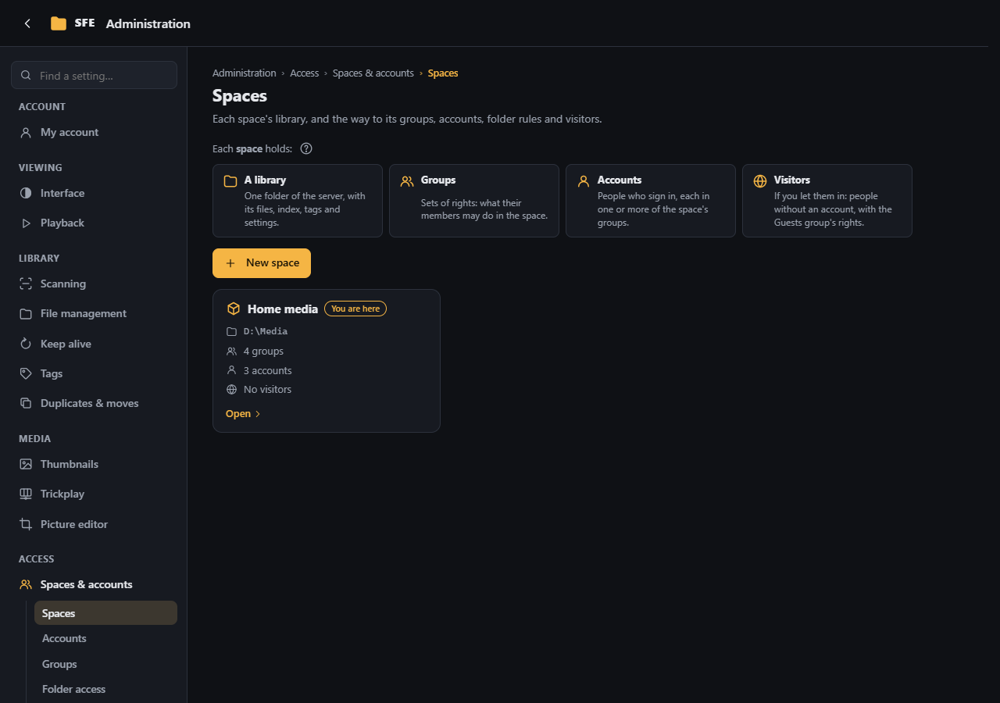

Each card shows a space's folder, groups, accounts and whether visitors may come in; **You are here** marks the one you
are browsing. **Open** shows its page (a space's administrators get their own space's page at once):

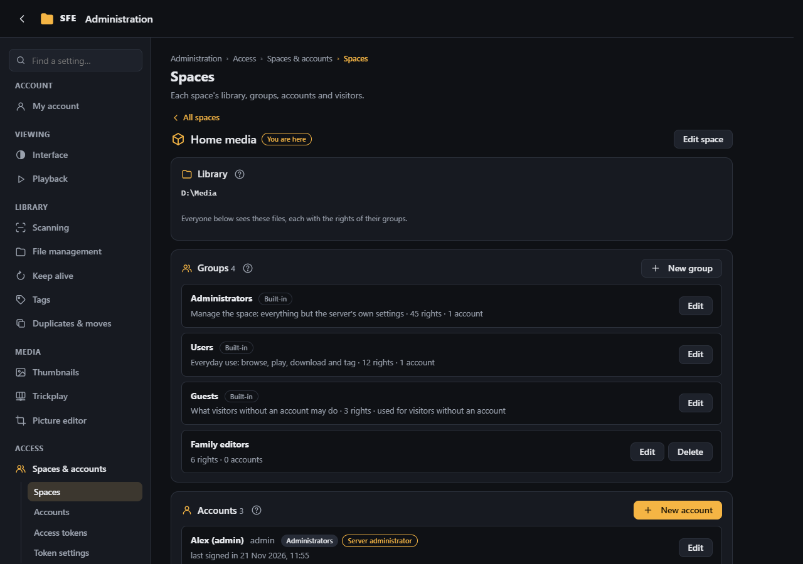

Its **Library** is the space's folder: its accounts see these files, each with the rights of their groups. The cards
below open the **Groups**, **Accounts**, **Folder access** and **Visitors** sub-pages about this space. **Edit space**
renames it, disables it or switches rights off in it (server administrators).

### Groups

**Groups** lists the space's groups: **New group**, and **Edit** / **Delete** for each.

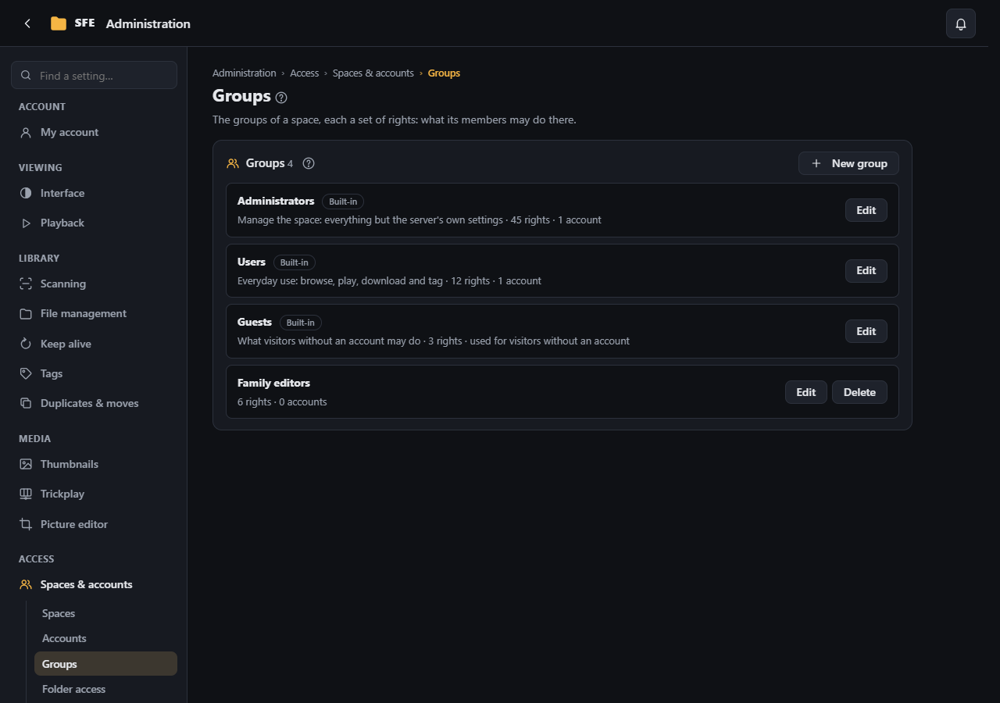

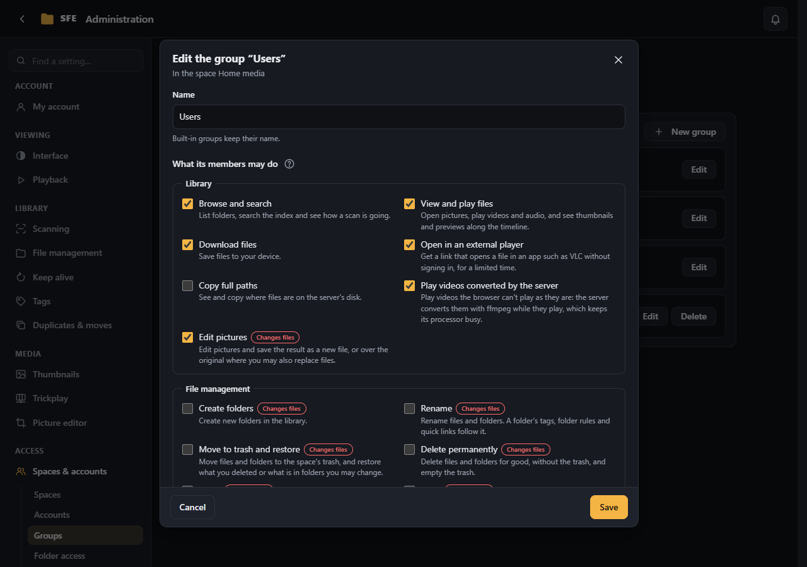

Each space has three built-in groups, and any groups you add:

| Group | Rights by default |
|---|---|
| **Administrators** | Every right of the space: everything but the server's own settings |
| **Users** | Everyday use: browse, view, download, external player, edit pictures, tag files, own settings and password |
| **Guests** | Browse, view and see tags; what visitors without an account may do |

A group's page lists every right by area with what it allows, those that only look first; **Changes things** marks a
right that changes the space (index, tags, settings, accounts) and **Changes files** one that creates, changes or
deletes files in the library ([kinds of rights](../reference/rights.md)). The **Administrators**, **Users** and
**Guests** buttons tick the rights a new space gives that group. **Members** lists its accounts. **Directory group** (optional, advanced)
makes its members those of a group of an external directory ([below](#directories-ldap)). Built-in groups keep their
name and can't be deleted.

### Visitors

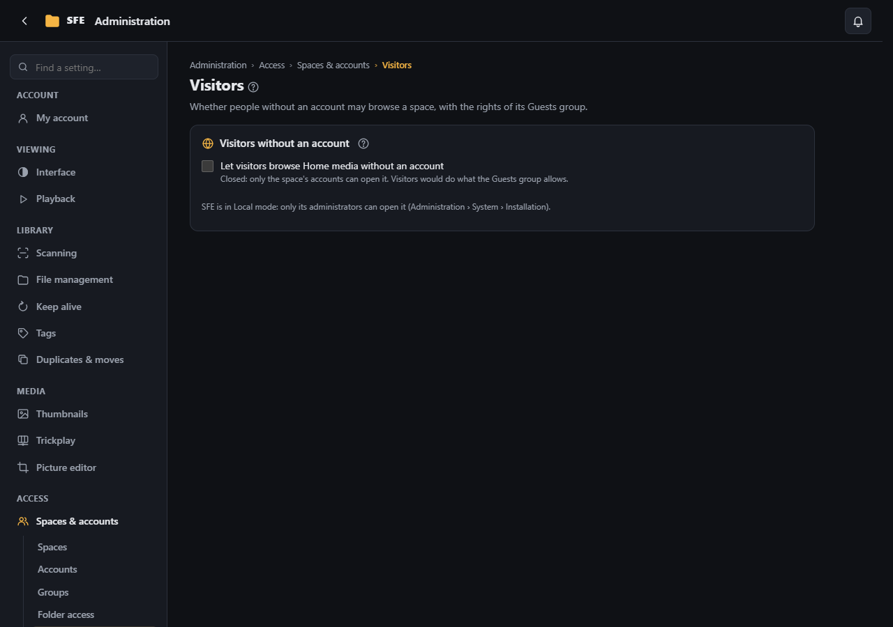

**Visitors** has a single choice. When **Let visitors browse … without an account** is ticked, anyone who reaches the server can browse the space without
signing in: the sign-in page offers a button for each such space. They get the rights of the **Guests** group, and never
a right that changes something. For someone who should sign in but only look, make a *guest account* instead. The
configuration can forbid visitors everywhere (`Sfe:Security:AnonymousGuests=false`).

A **Local** server ([Installation](system.md#installation)) has no visitors, and only its administrators sign in:
server administrators and the members of a space's **Administrators** group. Other accounts are kept, and sign in
again once the server is External; the accounts page says so while it is Local.

### Folder access

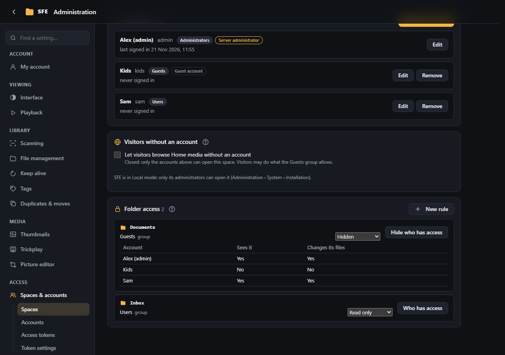

**Folder access** lists the space's folder rules. **Folder access…** in the menu of a folder (right-click it, or the
folder you are in) opens this page with a new rule started on that folder; it is there for those who manage the space,
on the library's folders (a connection's folder rules are on its own page).

Without rules, every group's rights apply in every folder of the space. A **rule** narrows that for one folder and
everything below it, for a group (Guests included: visitors without an account) or for one account:

| Level | They… |
|---|---|
| **Hidden** | don't see the folder: it answers as if it weren't there, in listings, searches, tags, duplicates and links |
| **Read only** | see its files and use them with their rights (play, download, tag), but nothing that changes the files themselves (editing pictures, deleting duplicates) |
| **Read & write** | have their rights in full |

- **The nearest rule wins.** Hide *Private* and set *Private/Shared* to Read only again: *Private* then only shows the
  way to *Shared* (none of its own files), and everything else in *Private* stays hidden.
- **One folder deep down opens directly.** When the folders above the ones someone sees only lead one way (the top of
  the library to *Clients*, *Clients* to *Acme*), they start in *Acme*: the folders above it show greyed in the path,
  not as links. Where those folders lead several ways, they list the ways as usual.
- **Groups add up.** An account sees a folder when **any** of its groups does, and may do there what each group's own
  rights and level allow. To hide a folder from the kids, hide it from every group they are in.
- **An account's own rule only adds** to what its groups give: open one folder to one person without a new group.
- Server administrators always see everything. A space has at most 250 rules.

**New rule** picks the folder (every folder of the space, whatever rules apply to you; **Top of the library** for the
whole library), who it is for and the level.
Each rule's list changes its level, or **Inherit (remove)** drops it. **Who has access** lists every account (and the
visitors) with whether they see the folder and may change its files, all groups and rules counted.

A rule follows the folder's path. A folder renamed or moved **outside SFE** leaves its rules behind, marked **Folder
not found**: **Re-point…** moves them to the folder's new place.

### Creating a space

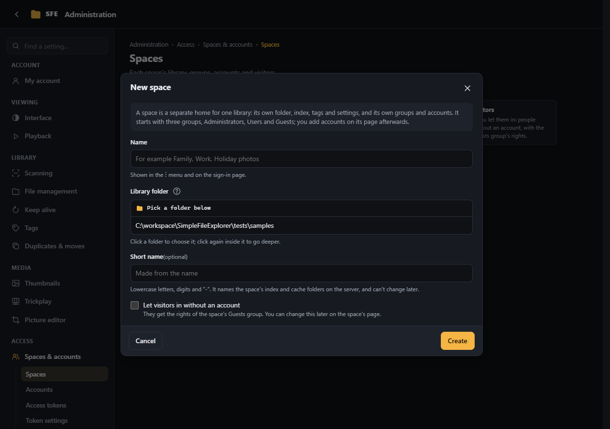

**New space** (server administrators) asks for a **Name** (shown in the ⋮ menu and on the sign-in page), a **Library
folder** picked among the folders of `Sfe:Tenants:AllowedRoots` (by default the configured `Sfe:Root`, so a space can
be a sub-folder of it), an optional **Short name** (names its index and cache folders; it can't change later), and
whether visitors may come in. The space starts with the three built-in groups and its folder is indexed.

- Its index goes next to the first space's (SQLite: `tenants/<short name>.db` beside the index file; SQL Server: the
  database `<database>_<short name>` on the same server, which the server's account must be allowed to create), or
  where `Sfe:Tenants:ConnectionString` says; its caches under `<CacheDirectory>/tenants/<short name>`.
- Thumbnail and trickplay limits (`MaxConcurrency`, `Parallelism`) are for the whole server, not per space.

### Editing a space

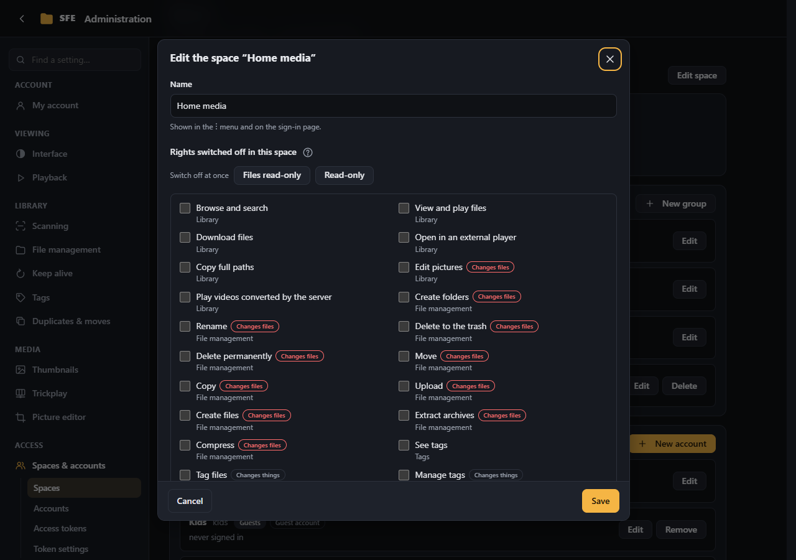

- **Disabled**: nobody can open it and its background tasks stop. Its index, tags, groups and settings are kept.
- **Rights switched off in this space**: a right ticked here is taken from everyone in this space, whatever their groups
  say; only server administrators can tick it, the space's own administrators can't give it back. Example: tick
  *Remove duplicates* on a space whose files must never be deleted from the web page. **Files read-only** ticks every
  right marked *Changes files* (people can still tag and use the space); **Read-only** ticks every right that changes
  something (marked *Changes things* too), so the space can only be looked at.
- **Delete** forgets its groups and settings but leaves its index and caches on the disk.

The first space is the configuration's (`Sfe:Root`, `ConnectionStrings:Sfe`): it cannot be deleted or disabled.

## Accounts

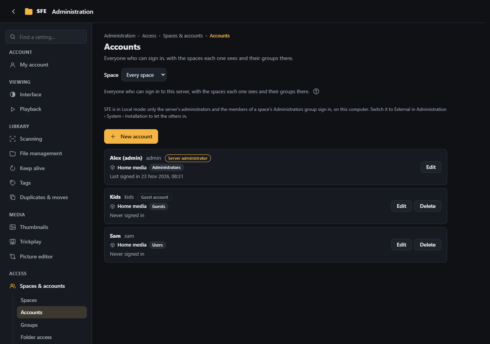

Everyone who can sign in to the server, with the spaces each one sees and their groups there (server administrators;
a space's administrators see the accounts of their space).

With a space picked in **Space**, server administrators get that space's accounts instead (those in one of its
groups): **New account** (in its Users group to start with), **Add an existing account…** (an account of another space,
put in this one's Users group), **Edit**, **Remove** (from this space; the account stays) or **Delete**. **Find an account** filters the list; badges mark server
administrators, guest accounts, disabled and locked accounts, and accounts from a directory.

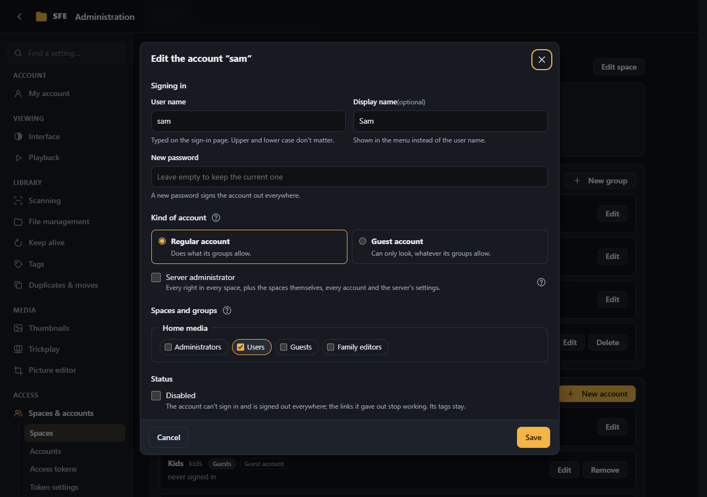

| Field | |
|---|---|
| **User name** | Typed on the sign-in page; upper and lower case don't matter |
| **Display name** | Shown in the menu instead of the user name |
| **Password** / **New password** | At least 8 characters (`Sfe:Security:MinimumPasswordLength`). A new password signs the account out everywhere |
| **Kind of account** | **Regular account**: does what its groups allow. **Guest account**: can only look, whatever its groups allow, never getting a right that changes something; handy as a shared account for visitors or children |
| **Server administrator** | Every right in every space, plus the spaces themselves, every account and the server's settings |
| **Spaces and groups** | The groups it belongs to, space by space |
| **Disabled** | Can't sign in; signed out everywhere, and the links it gave out stop working. Its tags stay |

A locked account (too many wrong passwords from many addresses) can be unlocked here. A locked-out server
administrator recovers the account from the sign-in page with a code the server shows where it runs
([Locked out](../first-start.md#locked-out-or-lost-administrator-password)). The last server administrator cannot be
removed.

A space's administrators only change, in accounts other spaces share, their groups in their own space; an account that
is only in their space is fully theirs.

## Access tokens

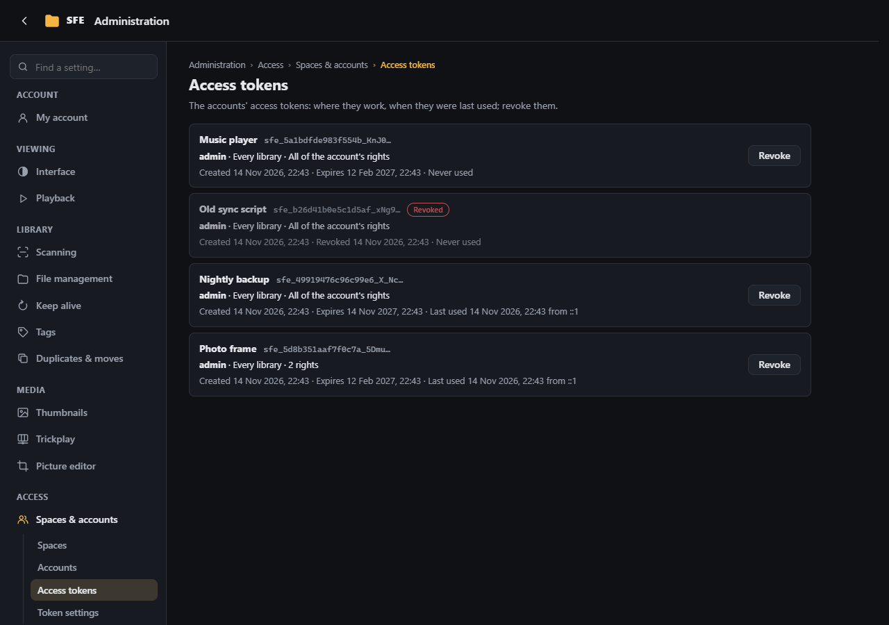

Every account's [access tokens](my-account.md#access-tokens) (right `access.tokens`: a space's administrators see
those of their space's accounts, server administrators all of them): the account each belongs to, its name and first
characters, its library and rights, its dates and the address it was last used from. Revoked and expired tokens stay
listed, faded. **Revoke** ends a token at once; **Find a token** filters a long list by token or account name. Tokens
themselves are never shown again after they were made.

**Token settings** (server administrators; `Sfe:Locked` with `security.accessTokens.*` fixes them):

| Setting | |
|---|---|
| **Allow access tokens** (`security.accessTokens.enabled`) | Off: no token can be made, and those made are refused (kept, they work again once it is back on). Default on |
| **Longest life (days)** (`security.accessTokens.maxLifetimeDays`) | A new token expires after at most this many days; 0 lets a token never expire. Default 365 |
| **Tokens per account** (`security.accessTokens.maxPerAccount`) | Tokens an account may hold at once, neither revoked nor expired. Default 20 |

A space's administrators never see nor revoke a server administrator's token. Every change made with a token is in
the server's [log](logs.md), with the account and the token's name.

## Directories (LDAP)

Accounts are checked by **directories** in the order of `Sfe:Security:Directories` (empty = the local accounts only).
Only the local one exists today; the model is ready for others such as LDAP: an account coming from a directory gets a
local entry at its first sign-in (its rights and preferences hang on it), and a group with a **Directory group** name
takes that directory group's members at each sign-in. The setup's administrator always stays local, so a directory
outage never locks you out.
