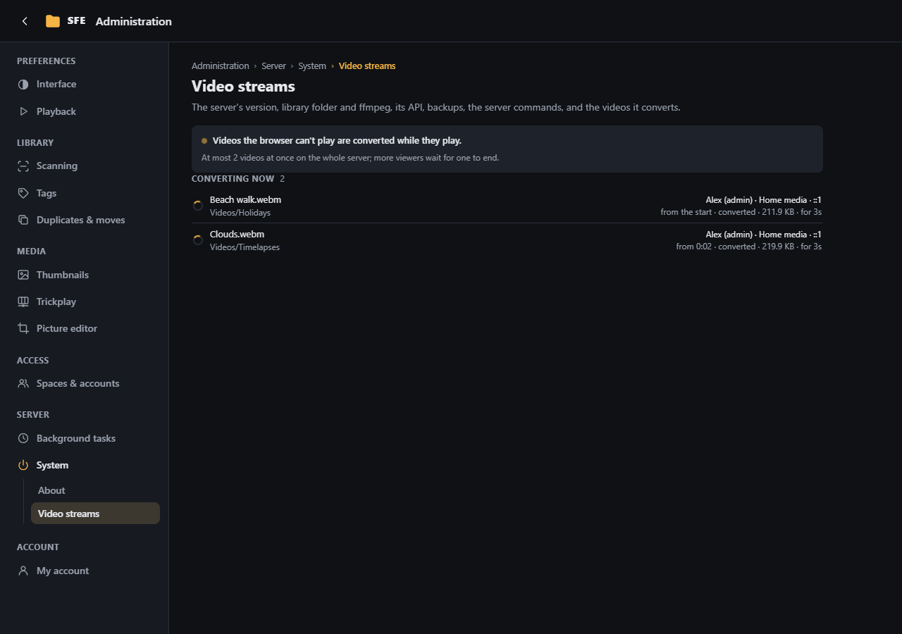

# System

**Administration › System**: the server's version, library folder and ffmpeg, its API, backups, the server commands
(**About**), and the videos the server converts (**Video streams**).

## Server

The version of SFE and the commit it was built from (also at the bottom of the ⋮ menu), and the space's short name.
Server administrators (`server.settings`) also see:

- **Library folder**: where the space's library is on the server's disk (`Sfe:Root`, or the space's own folder).
- **ffmpeg**: **Found**, with where and its version, or **Not found**, with what was looked for
  (`Sfe:Thumbnails:FfmpegPath`, a path or a name looked up on the `PATH`). Without it there are no video thumbnails,
  trickplay, video resolutions and durations, nor [converted videos](playback.md#videos-converted-by-the-server); set its
  path in the [configuration](../configuration.md) and restart.

**API reference** opens the [API documentation](../reference/api.md) (right `system.apiDocs`).

## Backup

**Download a backup** (right `server.backup`, server administrators) saves a zip file with:

- `databases/`: the accounts, spaces and the first space's index (the database of `ConnectionStrings:Sfe`), and the
  index of every other space (`databases/tenants/`): tags, schedules, task history;
- `config/`: `settings.json` (what the administration pages saved) and the `appsettings*.json` files of the server;
- `manifest.json` (where each file came from, and the version the databases belong to) and a `README.txt`.

Thumbnails and trickplay are left out: they are made again when needed. The file holds password hashes and connection
strings: keep it somewhere safe. The [update page](../upgrading.md#the-update-page-137-and-later) offers the same
backup, with the setup code, before an update.

SQLite databases are copied while the app keeps working. On SQL Server, SFE asks the database server for a backup
(`BACKUP DATABASE … WITH COPY_ONLY`, which leaves your own backup chain alone) into `Sfe:Backup:SqlServerFolder` (default:
the server's backup folder), then adds the `.bak` file to the zip when SFE can read that folder; otherwise the zip's
README says where the backup was left on the database server.

To restore: stop SFE, put the files back where `manifest.json` says (SQLite: replace the `.db` file and delete the
`-wal` and `-shm` files next to it; SQL Server: `RESTORE DATABASE` from the `.bak`), then start the version the
databases belong to.

## Server commands

**Shut down server** and **Dismount drives** run commands on the server's computer (rights `server.shutdown`,
`server.dismount`); each asks first. They are opt-in and set only in the configuration:

| Setting | |
|---|---|
| `Sfe:System:EnableShutdown` | `true` shows **Shut down server** |
| `Sfe:System:ShutdownCommand` | Empty: `shutdown /s /f /t 5` on Windows, `shutdown -h +1` elsewhere |
| `Sfe:System:DismountCommand` | The command that dismounts the drives; empty = no **Dismount drives** button |

Commands run through `cmd.exe /c` on Windows, `/bin/sh -c` elsewhere. On Linux the service account usually may not shut
down: use e.g. `sudo -n /usr/sbin/shutdown -h +1` and allow that command in sudoers (or polkit).

## Video streams

The videos the server is converting now (see [Playback](playback.md#videos-converted-by-the-server)), in every space,
refreshed every 2 seconds: the video and its folder, who watches it (account, space, network address), where in the
video the conversion started, whether its pictures are **converted** or only **repackaged** (H.264 copied), what was
sent and for how long. Above the list: whether this space converts videos, whether ffmpeg was found, and how many
videos the server converts at once. A video leaves the list when its viewer closes or seeks it (a seek starts a new
conversion). Right `server.streams` (server administrators).
