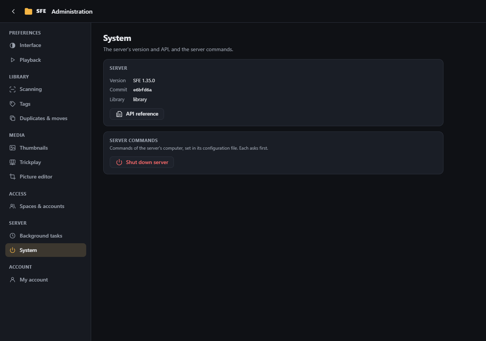

# System

**Administration › System**: the server's version and API, and the server commands.

## Server

The version of SFE and the commit it was built from (also at the bottom of the ⋮ menu), and the space's short name.
**API reference** opens the [API documentation](../reference/api.md) (right `system.apiDocs`).

## Server commands

**Shut down server** and **Dismount drives** run commands on the server's computer (rights `server.shutdown`,
`server.dismount`); each asks first. They are opt-in and set only in the configuration:

| Setting | |
|---|---|
| `Sfe:System:EnableShutdown` | `true` shows **Shut down server** |
| `Sfe:System:ShutdownCommand` | Empty: `shutdown /s /f /t 5` on Windows, `shutdown -h +1` elsewhere |
| `Sfe:System:DismountCommand` | The command that dismounts the drives; empty = no **Dismount drives** button |

Commands run through `cmd.exe /c` on Windows, `/bin/sh -c` elsewhere. On Linux the service account usually may not shut
down: use e.g. `sudo -n /usr/sbin/shutdown -h +1` and allow that command in sudoers (or polkit).
