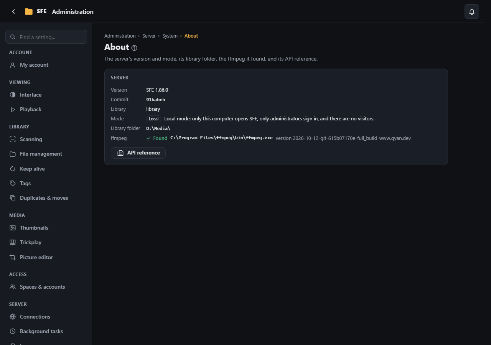
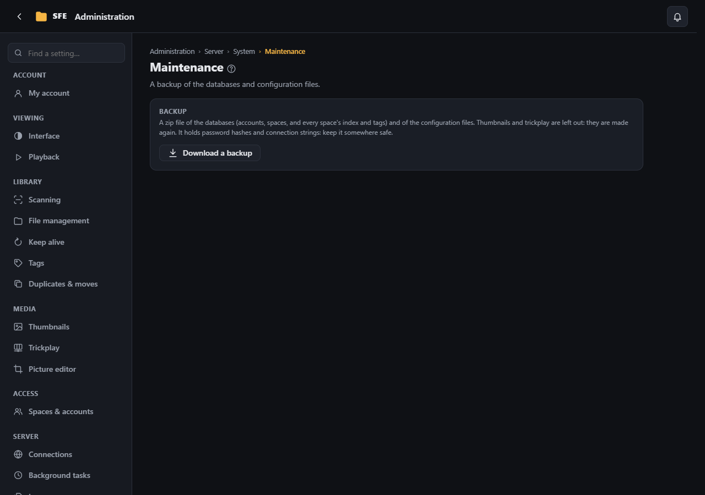
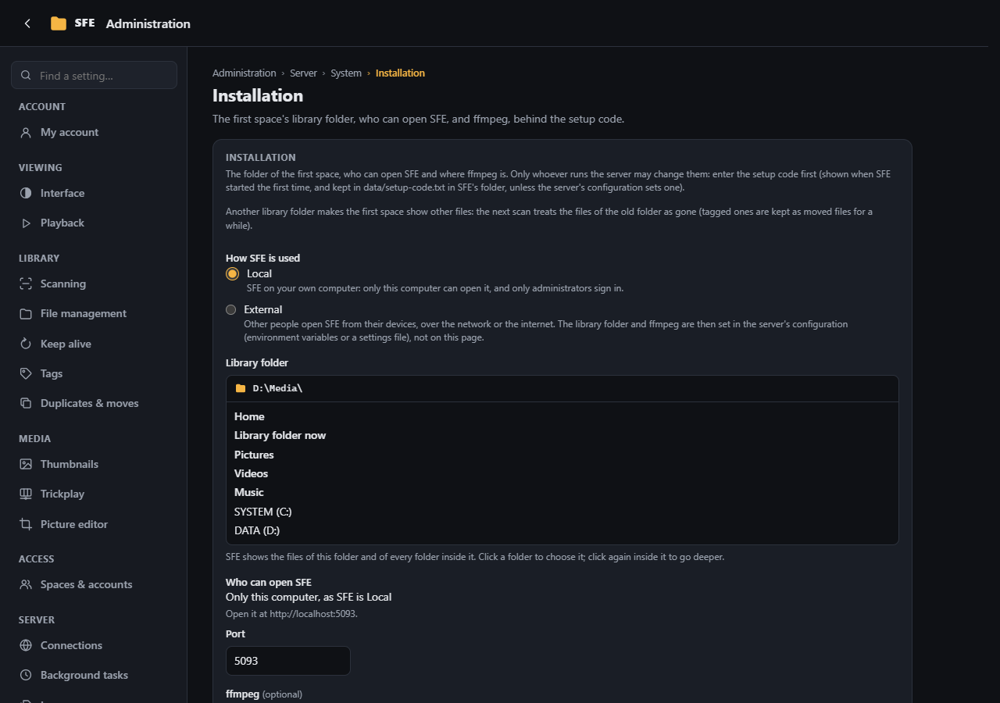
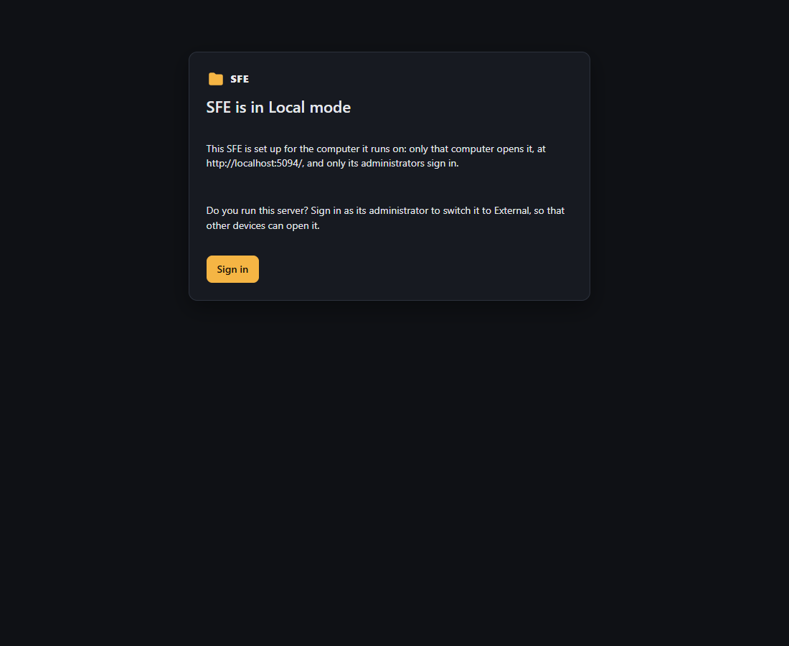
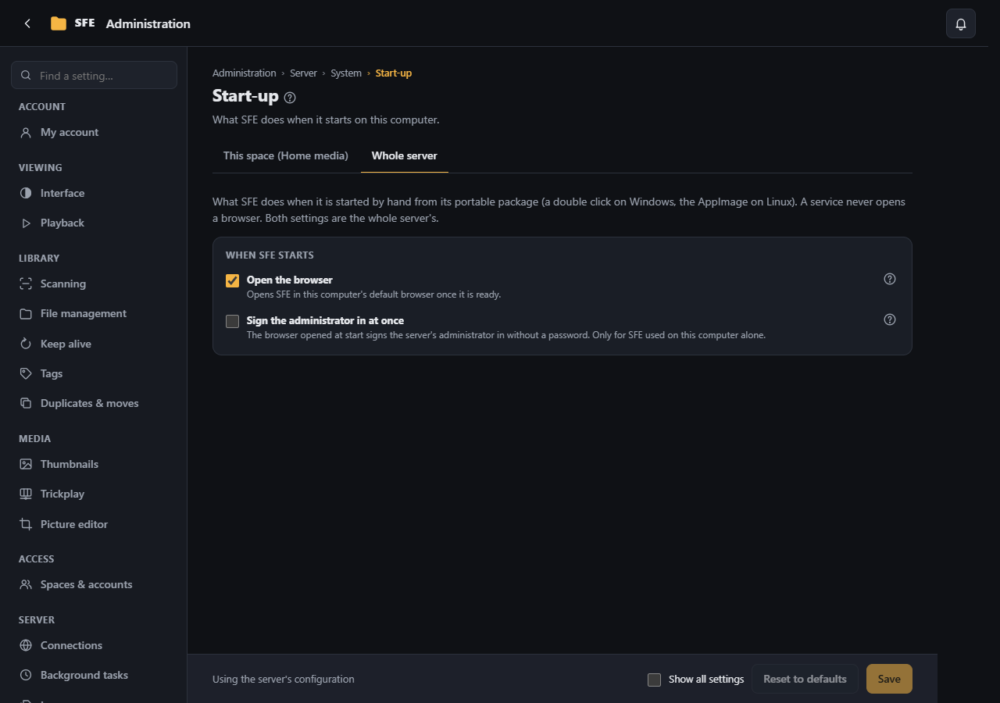

# System

**Administration › System**: the server's version, library folder, ffmpeg and API (**About**), the library folder,
network address and ffmpeg of the installation (**Installation**), what SFE does when it starts (**Start-up**), and
backups (**Maintenance**). The videos the server converts are in
[Playback › Video streams](playback.md#video-streams).

## About

### Server

The version of SFE and the commit it was built from (also at the bottom of the ⋮ menu), the space's short name, and
the server's **Mode**, Local or External, with what it means ([what each mode allows](#what-each-mode-allows)). The
mode also shows after the version at the bottom of the ⋮ menu, for everyone; hold the pointer over it for what it
means. Server administrators (`server.settings`) also see:

- **Library folder**: where the space's library is on the server's disk (`Sfe:Root`, or the space's own folder).
- **ffmpeg**: **Found**, with where and its version, or **Not found**, with what was looked for
  (`Sfe:Thumbnails:FfmpegPath`, a path or a name looked up on the `PATH`). Without it there are no video thumbnails,
  trickplay, video resolutions and durations, nor [converted videos](playback.md#videos-converted-by-the-server); pick its
  folder in [Installation](#installation).

**API reference** opens the [API documentation](../reference/api.md) (right `system.apiDocs`).

## Maintenance

Shown to those with the right to download backups or to run a server command.

### Backup

**Download a backup** (right `server.backup`, server administrators) saves a zip file with:

- `databases/`: the accounts, spaces and the first space's index (the database of `ConnectionStrings:Sfe`), and the
  index of every other space (`databases/tenants/`): tags, schedules, task history;
- `config/`: `settings.json` (what the administration pages saved) and the `appsettings*.json` files of the server;
- `manifest.json` (where each file came from, and the version the databases belong to) and a `README.txt`.

Thumbnails and trickplay are left out: they are made again when needed. The file holds password hashes and connection
strings: keep it somewhere safe. The [update page](../upgrading.md#the-update-page-137-and-later) offers the same
backup, with the setup code, before an update.

SQLite databases are copied while the app keeps working. On SQL Server, SFE asks the database server for a backup
(`BACKUP DATABASE … WITH COPY_ONLY`, which leaves your own backup chain alone) into `Sfe:Backup:SqlServerFolder` (default:
the server's backup folder), then adds the `.bak` file to the zip when SFE can read that folder; otherwise the zip's
README says where the backup was left on the database server.

To restore: stop SFE, put the files back where `manifest.json` says (SQLite: replace the `.db` file and delete the
`-wal` and `-shm` files next to it; SQL Server: `RESTORE DATABASE` from the `.bak`), then start the version the
databases belong to.

## Installation

The settings of the [setup page](../first-start.md#the-setup-page)'s second step, for server administrators
(`server.settings`). They decide where data lives and which program runs, so the page first asks for the **setup code**
(the one in `data/setup-code.txt` in SFE's folder, or the one the configuration sets), as the
[update page](../upgrading.md#the-update-page-137-and-later) does; it stays unlocked for an hour. Both are needed: a
signed-in server administrator without the code can't use it, nor can anyone with the code alone.

- **How SFE is used** (`Sfe:Mode`; side by side in [what each mode allows](#what-each-mode-allows)):
  - **Local**: SFE on your own computer. Only that computer opens it (at `http://localhost:<port>`), only
    administrators sign in (server administrators and members of a space's Administrators group), and no space is
    open to visitors without an account. Other devices get a page saying so, where the server administrator can sign
    in and switch to External with the setup code:

    
  - **External**: other people open SFE from their devices, over the network or the internet. The first space's
    library folder and ffmpeg are then set in the server's configuration only (`Sfe__Root` and
    `Sfe__Thumbnails__FfmpegPath` in its environment, or `Sfe:Root` and `Sfe:Thumbnails:FfmpegPath` in
    `appsettings.json`): the page shows them without a way to change them, whoever signs in. New spaces still get
    their folders inside `Sfe:Tenants:AllowedRoots`, which only the configuration sets. Fast sign-in is off.

  Local can only be chosen from a browser on the server itself (`http://localhost:<port>`). The page switches from Local
  to External, but never back: an External server returns to Local only in its configuration (`Sfe:Mode` in
  `data/installation.json`, or the environment). An install from before 1.76 has no mode chosen yet and counts as
  Local. Switching to External keeps the folder and ffmpeg saved so far; a new folder or ffmpeg can't be saved together
  with the switch.
- **Library folder**: the first space's folder (`Sfe:Root`), picked by clicking through the server's drives and folders.
  Saving starts the libraries again on it at once. Another folder makes the space show other files: the next scan
  treats the files of the old folder as gone (tagged ones are kept as [moved files](duplicates-and-moves.md) for a while,
  and found again if the new folder holds them). Other spaces keep their own folder.
- **Who can open SFE**: **Only this computer** (`http://localhost:<port>`) or **The other devices on my network too**
  (`http://*:<port>`), and the port. It applies once SFE starts again (the page says so). A Local server only shows
  the port: it answers this computer only.
- **ffmpeg**: **Found** with its path and version, or **Not found**. Type its program or folder, or **Browse** to the
  folder it was unzipped to (its `bin` folder is found too); empty = look for `ffmpeg` on the `PATH`. Saving checks it
  and starts the libraries again with it. The program must be named `ffmpeg` (`ffmpeg.exe` on Windows) and be outside
  every space's folder: whoever can add files to a library must not choose the program SFE runs.

What the page saves goes to `data/installation.json` (see [Configuration](../configuration.md#where-settings-come-from)).
A value the server's environment variables or command line set (e.g. `Sfe__Root` in a systemd unit, `--urls`) wins
over it: the page shows it with **Set by …** and can't change it.

## What each mode allows

What changes between the two modes (`Sfe:Mode`, chosen in [Installation](#installation)). Everything else works the
same in both. The server enforces each line; a setting that only one mode uses is greyed out in the other, saying so.

| | Local | External |
|---|---|---|
| Who opens SFE | This computer only, at `http://localhost:<port>`; other devices get a page saying so | Any device the address reaches (**Who can open SFE**) |
| Who signs in | Administrators only: server administrators and members of a space's Administrators group | Every enabled account |
| Access tokens | Administrators' tokens only | Every account's, with its rights |
| Visitors without an account | Never: spaces open to them are closed until the server is External | When the configuration allows them (`Sfe:Security:AnonymousGuests`) and the space opens to them |
| Library folder and ffmpeg | Chosen in Installation | From the server's configuration only (`Sfe__Root`, `Sfe__Thumbnails__FfmpegPath`) |
| New spaces | Inside `Sfe:Tenants:AllowedRoots` | Inside `Sfe:Tenants:AllowedRoots` |
| [Fast sign-in](#start-up) | When turned on in Start-up | Off (the setting is greyed out, and kept for a return to Local) |
| Setup without the code | From this computer, through the [setup link](../first-start.md#on-the-servers-own-computer-no-code-with-the-setup-link) | Only when External was chosen on that setup page; External from the configuration always asks for the code |
| Changing the mode from the web | To External | Never back to Local: only in the configuration (`Sfe:Mode`) |
| Browser opened at start | When turned on in Start-up | When turned on in Start-up |

## Start-up

What the portable package and the AppImage do when they are started by hand (a service never opens a browser), for
server administrators (`server.settings`). Both are settings of the whole server, on its **Whole server** tab.

- **Open the browser**: opens SFE in the computer's default browser once it is ready (`Sfe:OpenBrowser`). Starting SFE
  with `--no-browser` keeps it closed whatever this says.
- **Sign the administrator in at once** ([fast sign-in](../first-start.md#fast-sign-in), `Sfe:FastSignIn`): the browser
  opened at start signs the server administrator in without a password, with a link that works once, for a minute,
  from that computer only. Only while the server has a single administrator. Leave it off unless SFE is used on that
  computer alone. Local mode only: greyed out on an External server.
