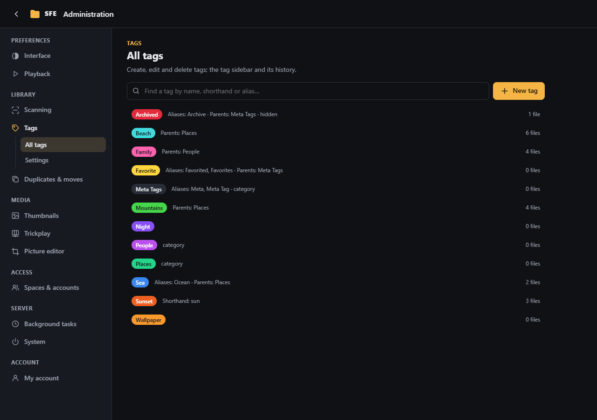
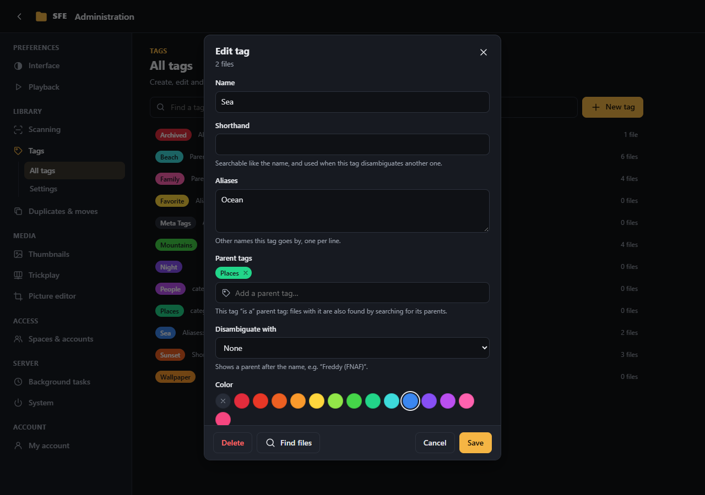
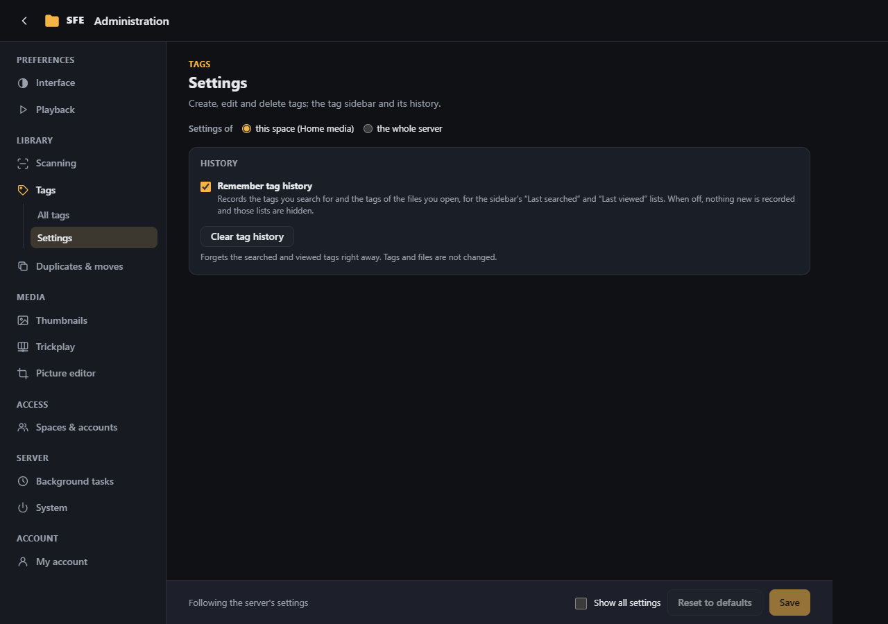

# Tags

**Administration › Tags**: create, edit and delete tags, and the tag sidebar's settings. How tags work and how files
are tagged is in the [user guide](../user-guide/tags.md).

## All tags

Every tag of the space, with its aliases, shorthand, parents and number of files (right `tags.manage`; also
**Manage tags** under the tag sidebar). **Find a tag** filters the list, **New tag** creates one (named after the
filter, if any), and a click on a tag edits it.

| Field | |
|---|---|
| **Name** | Need not be unique |
| **Shorthand** | Searchable like the name, and used when this tag disambiguates another one |
| **Aliases** | Other names `t:` finds it by, one per line |
| **Parent tags** | Tags it "is a": a file with this tag is found by `t:parent` too, through any number of levels (loops are refused) |
| **Disambiguate with** | A parent shown after the name, e.g. "Freddy (FNAF)" |
| **Color** | TagStudio's standard palette |
| **Category** | Groups the tags inheriting from it in a file's tag list |
| **Hidden** | Its files stay out of search results unless the search names it (or a parent) |

**Find files** searches the files with the tag. **Delete** removes the tag from every file. The built-in **Favorite**, **Archived** and **Meta Tags** can be edited,
not deleted.

## Settings

| Setting | Default | |
|---|---|---|
| **Remember tag history** | on | Records the tags searched for and the tags of the files opened, for the sidebar's **Last searched** and **Last viewed** lists, shared by everyone using the space. When off, nothing new is recorded and those lists are hidden (`Sfe:Tags:RecordHistory`) |
| **Tags per sidebar section** | 5 | All settings view; users can change it for themselves (`Sfe:Tags:SidebarCount`) |

**Clear tag history** forgets the searched and viewed tags right away; tags and files are not changed. Right:
`settings.tags`.
