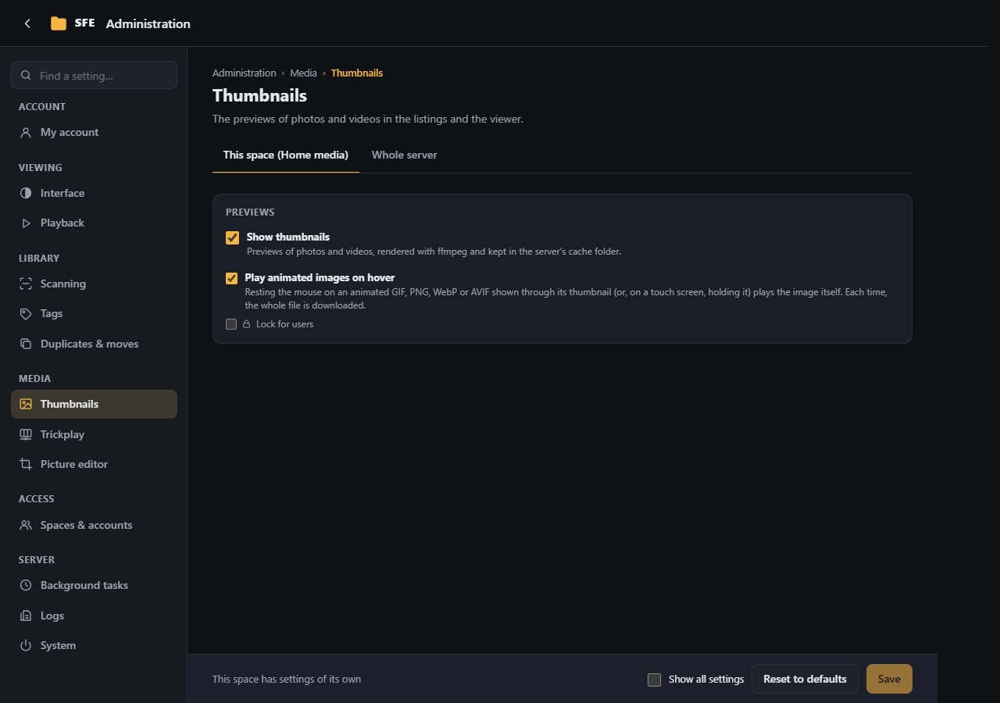

# Thumbnails

**Administration › Thumbnails**: the previews of photos and videos in the listings and the viewer. Thumbnails are made
with ffmpeg, on demand, as the listings show files; they are kept in `Sfe:Thumbnails:CacheDirectory`. Right:
`settings.thumbnails`.

| Setting | Default | |
|---|---|---|
| **Show thumbnails** (`Enabled`) | on | Off: no thumbnails are made |
| **Width (pixels)** (`Width`) | 480 | Width of new thumbnails; old ones are still served |
| **Video position (seconds)** (`VideoSeekSeconds`) | 4 | The second of a video used for its thumbnail |
| **Large image size (KB)** (`LargeImageKilobytes`) | 512 | Larger photos are previewed through their thumbnail, in listings and the viewer; 0 = always |
| **Full images in one-per-row view** (`SingleViewOriginals`) | off | Shows the photos themselves in the **one per row** layout, so big previews stay sharp; each photo is then downloaded whole as you scroll past it |
| **Play animated images on hover** (`AnimatedHover`) | on | Resting the mouse on an animated image (GIF, PNG, WebP, AVIF) shown through its thumbnail plays the image itself; on a touch screen, press and hold it. Each hover downloads the whole file (the last few stay in the browser while the folder is open). Users can turn it off for themselves |
| **Rendered at once** (`MaxConcurrency`) | 2 | A server setting (all settings view) |
| **Time limit (seconds)** (`TimeoutSeconds`) | 30 | Per thumbnail (all settings view) |

Without ffmpeg, the [Background tasks](background-tasks.md) page shows thumbnails as unavailable. Thumbnails being
rendered can be cancelled there; listings ask for them again.
