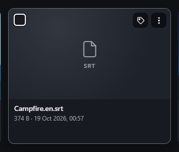
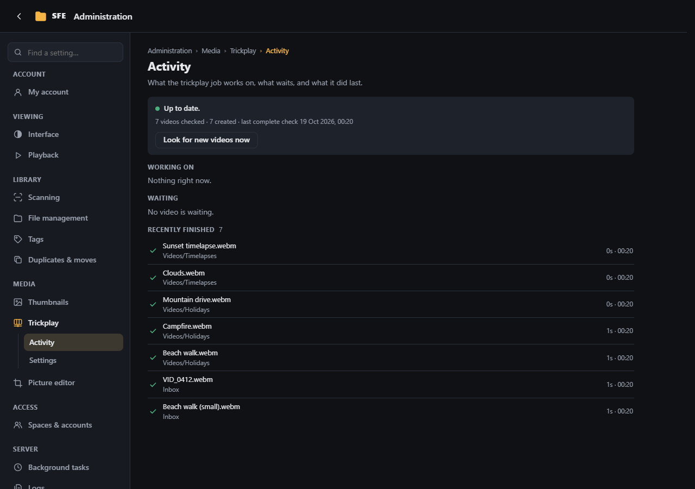
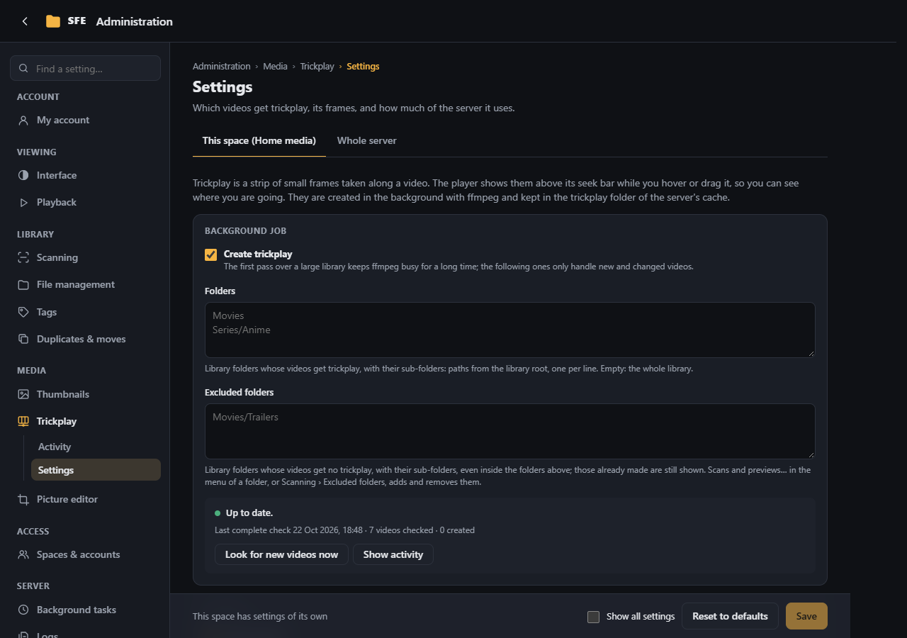

# Trickplay

Trickplay is a set of small frames taken along each video (one every **Interval**, tiled on JPEG sheets). SFE shows
them:

- above the [player](../user-guide/video-player.md)'s seek bar while you hover or drag it;
- over a video's thumbnail while the mouse rests on its tile or row (on a phone: while you hold it), when **Play on
  hover** is on;
- and uses them to find [similar videos](duplicates-and-moves.md#similar-videos).

It needs ffmpeg and is **off by default**. Rights: `trickplay.manage` (Activity), `settings.trickplay` (Settings).

## Activity

What the background job is doing: the videos being processed, waiting and recently finished, with the reason of
failures. **Look for new videos now** starts a pass at once. In the listings, a video waiting for trickplay shows a
clock, one being processed a spinner.

## Settings

**Background job**

| Setting | Default | |
|---|---|---|
| **Create trickplay** (`Enabled`) | off | Turns on the background job. The first pass over a large library keeps ffmpeg busy for a long time; the following ones only handle new and changed videos |
| **Folders** (`Folders`) | empty | Library folders whose videos get trickplay, with their sub-folders, one per line; empty = the whole library. Folders skipped by scans and hidden items are skipped too. A setting of each space only |
| **Excluded folders** (`ExcludedFolders`) | empty | Folders whose videos get no trickplay, with their sub-folders, even inside **Folders**; those already made are still shown. **Scans and previews…** in a folder's menu adds and removes them ([Excluded folders](../user-guide/scanning.md#excluded-folders)). A setting of each space only |
| **Look for new videos every (hours)** (`RecheckHours`) | 6 | Periodic pass; 0 = never (all settings view) |

The job goes over the folders at start-up, when the trickplay settings change, every `RecheckHours` and on **Look for
new videos now**. A video opened in the player without trickplay goes first. The next periodic pass, and passes at set
times, are in [Background tasks](background-tasks.md).

**Listings**

| Setting | Default | |
|---|---|---|
| **Play on hover** (`HoverPreview`) | on | Resting the mouse on a video in a listing plays its frames over the thumbnail, picked along the whole video, with a bar showing where. On a touch screen, press and hold the video: it plays until you lift your finger (a tap still opens it, scrolling cancels the hold). Only videos that already have trickplay: hovering doesn't queue one. Users can turn it off for themselves |

**Frames** and **Performance** (all settings view)

| Setting | Default | |
|---|---|---|
| **Interval (seconds)** (`IntervalSeconds`) | 10 | One frame every … |
| **Frame width (pixels)** (`Width`) | 320 | |
| **Frames per row** / **Rows per sheet** (`Columns`, `Rows`) | 10 / 10 | Layout of the JPEG sheets |
| **Fast mode** (`KeyFramesOnly`) | on | Much faster, but a frame can be a few seconds off |
| **Videos at once** (`Parallelism`) | 1 | A server setting |
| **Time limit per video (minutes)** (`TimeoutMinutes`) | 30 | A video that fails is skipped until it or the settings change |

Changing the frame settings makes every trickplay again (the old frames are shown until then).

Configuration keys are under `Sfe:Trickplay`. Trickplay is stored under `{Thumbnails:CacheDirectory}/trickplay/`.
Trickplay of deleted videos is not cleaned up: delete that folder to start over.
