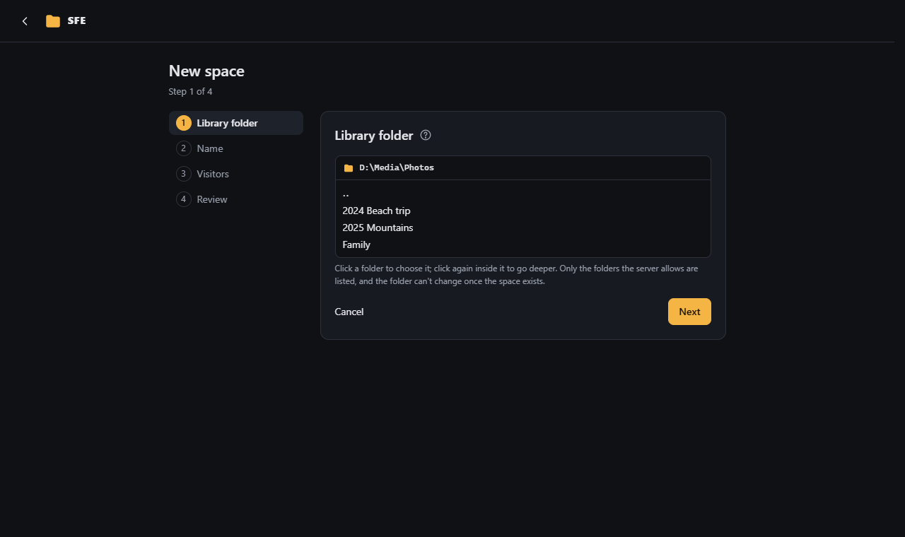
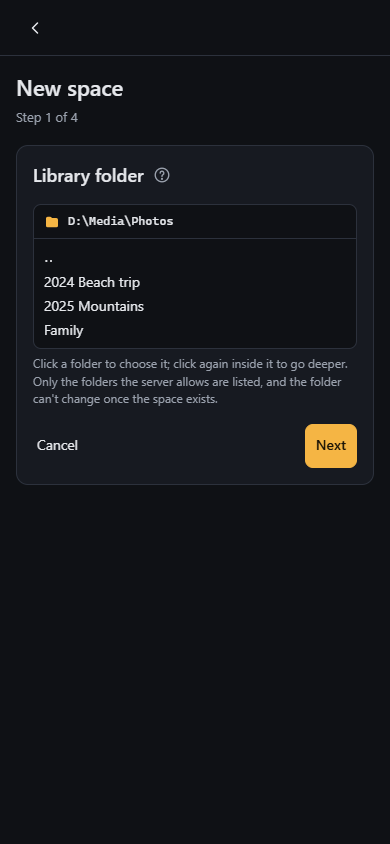
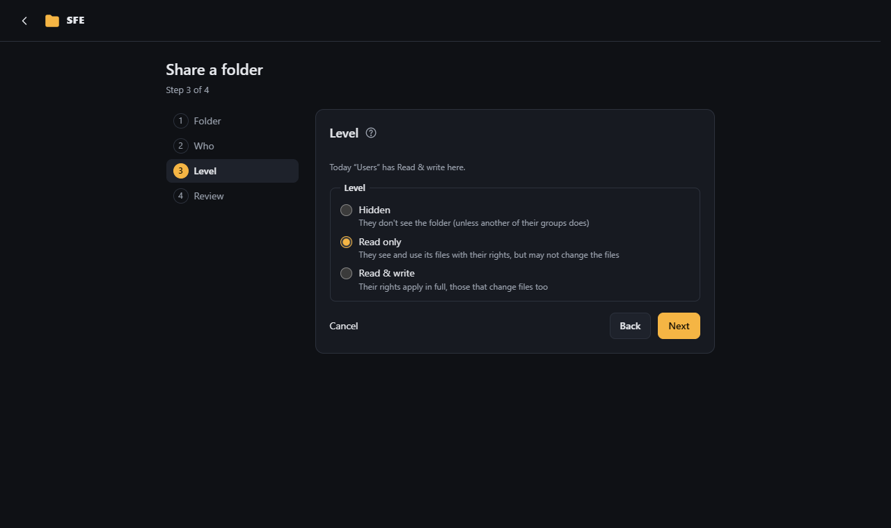
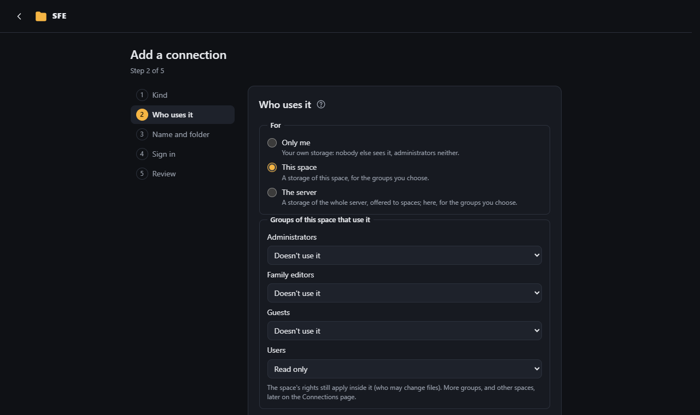

# Wizards

A wizard does one administration job step by step: each step asks for a few things and says what they are for, and
nothing is saved until the last one. The usual pages stay: a wizard is another way to do what they do, for when you'd
rather be guided.

## Opening a wizard

- Search for it in the box of the [administration page](README.md#finding-a-setting): its name, or what it does
  (**space**, **visitors**, **share**…). Wizards are listed under **Wizards** among what is found.
- Or click **Step by step** next to the button that does the same job on its page (**New space** on
  **Spaces & accounts › Spaces**, **New rule** on **Spaces & accounts › Folder access**, **Add for this space** on
  **Connections › Connections**).
- The [getting-started list](README.md#getting-started) of the administration overview opens them too.

Only the wizards you have the [rights](../reference/rights.md) for are found; one opened from a link you may not use
says so.

## Moving through a wizard

- **Step n of m** under the wizard's name says where you are; on a computer the steps are listed at the left. A step
  that your earlier answers make useless is left out, and not counted.
- The **?** next to a step's title says what it is for; **More in the help** opens its part of this page in a new tab.
- **Next** (or **Enter** in a field) checks the step with the server before going on: a name already taken, a folder
  that isn't allowed is said under its field, and the wizard stays on the step. **Next** is greyed out until the step
  has what it needs.
- **Back** goes to the previous step; what you chose stays.
- The last step, **Review**, lists everything you chose, each step with a **Change** link back to it. **Finish** saves
  it all at once. If the server refuses something then (another administrator took the name meanwhile), the wizard
  goes back to the step concerned with the reason under the field.
- Once saved, the wizard says what it made, with links to it. **Run again** starts over with nothing chosen; **Done**
  goes back to the administration page.
- **Cancel**, the arrow at the top left, or leaving the page in any other way asks first when you have chosen
  something: nothing is kept. A reload of the page starts the wizard again.
- A wizard whose **Finish** signs in somewhere else ([Add a connection](#add-a-connection)) sends the browser there
  and comes back to the wizard's end. Meanwhile what you chose is kept in this browser tab only, without any password,
  for 15 minutes.

On a phone the steps' list is hidden (**Step n of m** stays) and the buttons are larger.

## New space

Creates a [space](spaces-and-accounts.md#spaces): a library on a folder of the server, with its own index, tags,
settings and groups. For server administrators (the right **Manage spaces**). The same as **New space** on the
**Spaces** page, in three steps.

### New space: folder

The space's **library folder**: the folder whose files the space shows, with everything below it. Click a folder to
choose it, click again inside it to go deeper, **‥** to go up. Only the folders the server allows are listed
(those inside the first space's folder, so a space is a sub-folder of it, unless the
[configuration](../configuration.md) allows others), and the folder can't change once the space exists. The folder's name becomes the space's name until you type another one.

### New space: name

The **Name** is shown in the ⋮ menu and on the sign-in page. The **Short name** is optional: lowercase letters, digits
and “-”, made from the name when left empty. It names the space's index and cache folders on the server and can't
change later; one already used by another space is refused here.

### New space: visitors

Whether people without an account may look at the space, with the rights of its **Guests** group. On a server in
Local mode nobody comes in without an account until it is in External mode
([what each mode allows](system.md#what-each-mode-allows)). It can be changed later on the space's page
([Visitors](spaces-and-accounts.md#visitors)).

### New space: the end

**Finish** creates the space with the groups **Administrators**, **Users** and **Guests**, and its index. **Open the
space's page** leads to it, where you add accounts, groups and folder rules.

## Share a folder

Sets one [folder rule](spaces-and-accounts.md#folder-access): what a group, or one account, may do in a folder and
everything below it. For those who may manage the space's groups (the right **Manage the space's accounts and
groups**). The same as **New rule** on the **Folder access** page, in three steps, for the space you are browsing.

### Share a folder: folder

The folder to share. Click a folder to choose it, click again inside it to go deeper, **‥** to go up. Every folder of
the space is listed, whatever rules apply to you. A folder further down can have a rule of its own, which decides
there. A rule on the top of the library is set on the **Folder access** page.

### Share a folder: who

A **group** of the space (the rule decides for everyone in it), or **one account**. Groups add up: someone sees a
folder when any of their groups does. An account's own rule only adds to what its groups allow, so to keep a folder
from someone, set the rule on their groups.

### Share a folder: level

- **Hidden**: they don't see the folder (unless another of their groups does).
- **Read only**: they see its files and use them with their rights (play, download, tag), but may not change them.
- **Read & write**: their rights apply in full, those that change files too.

Above the levels, the wizard says what the group or the account has there today. A rule they already have on this
folder is replaced.

### Share a folder: the end

**Finish** sets the rule. The end lists **who has access now**: every account of the space (and the visitors, when the
space lets them in) with whether they see the folder and may change its files, all groups and rules counted. **Open
the Folder access page** leads to every rule of the space.

## Add a connection

Makes a [connection](connections.md): a storage outside the libraries (Dropbox…) browsed beside the library, and
gives it to the groups of the space that use it. For those who may manage the space's connections (the right
**Manage the space's connections**). The same as **Add for this space** or **Add for the server** on the
**Connections** page, with the groups chosen before the sign-in, in four steps.

### Add a connection: kind

The kind of storage, among those this server offers. A kind is offered once whoever runs the server has registered
SFE at the provider ([Setting up Dropbox](connections.md#setting-up-dropbox-server-administrators)); until then the
step says so, with a link to that page for server administrators. The connection is named after the kind until you
type another name.

### Add a connection: who uses it

- **Only me**: a storage of your own account. Nobody else opens it, administrators neither.
- **This space**: a storage of the space you are browsing, for the groups you choose below it.
- **The server**: a storage of the whole server; here it is offered to this space, for the groups you choose. Other
  spaces are offered it later on the **Connections** page.

Each group of the space either **doesn't use it**, uses it **read only**, or **read & write**. Inside it the space's
rights still apply (who may delete, upload…). A connection given to no group is used by the server's administrators
only, until groups are given it on the **Connections** page. Only the levels the server allows and your rights let
you make are listed.

### Add a connection: name and folder

The **Name** people see it by in the sidebar, and the **Folder** of the storage shown as the top of the connection
(`/Photos`): empty for all of it.

### Add a connection: sign in

How SFE signs in to the storage; SFE keeps the sign-in, protected, on the server, never your password at the
provider.

- **Sign in at the provider and come back here**: **Finish** sends the browser to the provider's page; you sign in
  there and allow SFE in, and the provider sends you back to the wizard, which ends. If you refuse there, or the
  sign-in fails, the wizard is back at its review with the reason: **Finish** tries again.
- **Sign in at the provider and copy the code it shows**: **Open the sign-in page** opens the provider in a new tab;
  paste the code it shows, then **Next** and **Finish**. Changing an earlier step after that asks for the page again.
- **Name and password** (or a key): typed here, and tried with the storage on **Next**.

A sign-in lasts 10 minutes and works once.

### Add a connection: the end

The connection is made with its groups at once. The end lists who uses it, **Open the connection** shows its files,
**Open the Connections page** leads to where it is renamed, given to more groups or spaces, or signed in again.
