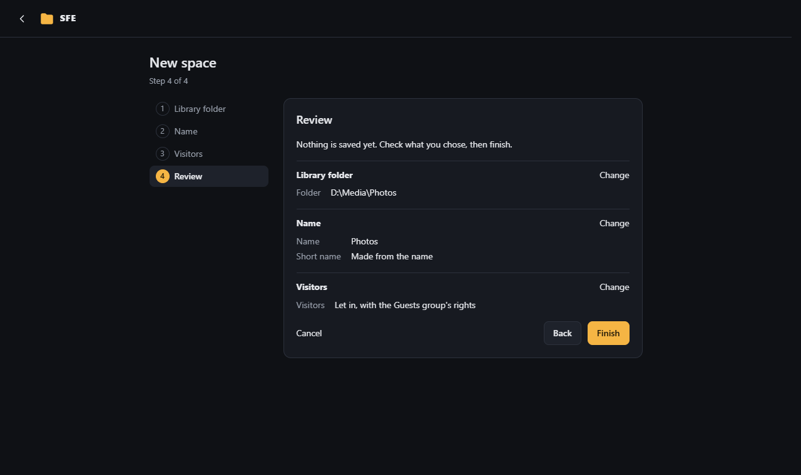

# Wizards

A wizard does one administration job step by step: each step asks for a few things and says what they are for, and
nothing is saved until the last one. The usual pages stay: a wizard is another way to do what they do, for when you'd
rather be guided.

## Opening a wizard

- Search for it in the box of the [administration page](README.md#finding-a-setting): its name, or what it does
  (**space**, **visitors**…). Wizards are listed under **Wizards** among what is found.
- Or click **Step by step** next to the button that does the same job on its page (**New space** on
  **Spaces & accounts › Spaces**).

Only the wizards you have the [rights](../reference/rights.md) for are found; one opened from a link you may not use
says so.

## Moving through a wizard

- **Step n of m** under the wizard's name says where you are; on a computer the steps are listed at the left. A step
  that your earlier answers make useless is left out, and not counted.
- The **?** next to a step's title says what it is for; **More in the help** opens its part of this page in a new tab.
- **Next** (or **Enter** in a field) checks the step with the server before going on: a name already taken, a folder
  that isn't allowed is said under its field, and the wizard stays on the step. **Next** is greyed out until the step
  has what it needs.
- **Back** goes to the previous step; what you chose stays.
- The last step, **Review**, lists everything you chose, each step with a **Change** link back to it. **Finish** saves
  it all at once. If the server refuses something then (another administrator took the name meanwhile), the wizard
  goes back to the step concerned with the reason under the field.
- Once saved, the wizard says what it made, with links to it. **Run again** starts over with nothing chosen; **Done**
  goes back to the administration page.
- **Cancel**, the arrow at the top left, or leaving the page in any other way asks first when you have chosen
  something: nothing is kept. A reload of the page starts the wizard again.

On a phone the steps' list is hidden (**Step n of m** stays) and the buttons are larger.

## New space

Creates a [space](spaces-and-accounts.md#spaces): a library on a folder of the server, with its own index, tags,
settings and groups. For server administrators (the right **Manage spaces**). The same as **New space** on the
**Spaces** page, in three steps.

### New space: folder

The space's **library folder**: the folder whose files the space shows, with everything below it. Click a folder to
choose it, click again inside it to go deeper, **‥** to go up. Only the folders the server allows are listed
(those inside the first space's folder, so a space is a sub-folder of it, unless the
[configuration](../configuration.md) allows others), and the folder can't change once the space exists. The folder's name becomes the space's name until you type another one.

### New space: name

The **Name** is shown in the ⋮ menu and on the sign-in page. The **Short name** is optional: lowercase letters, digits
and “-”, made from the name when left empty. It names the space's index and cache folders on the server and can't
change later; one already used by another space is refused here.

### New space: visitors

Whether people without an account may look at the space, with the rights of its **Guests** group. On a server in
Local mode nobody comes in without an account until it is in External mode
([what each mode allows](system.md#what-each-mode-allows)). It can be changed later on the space's page
([Visitors](spaces-and-accounts.md#visitors)).

### New space: the end

**Finish** creates the space with the groups **Administrators**, **Users** and **Guests**, and its index. **Open the
space's page** leads to it, where you add accounts, groups and folder rules.
