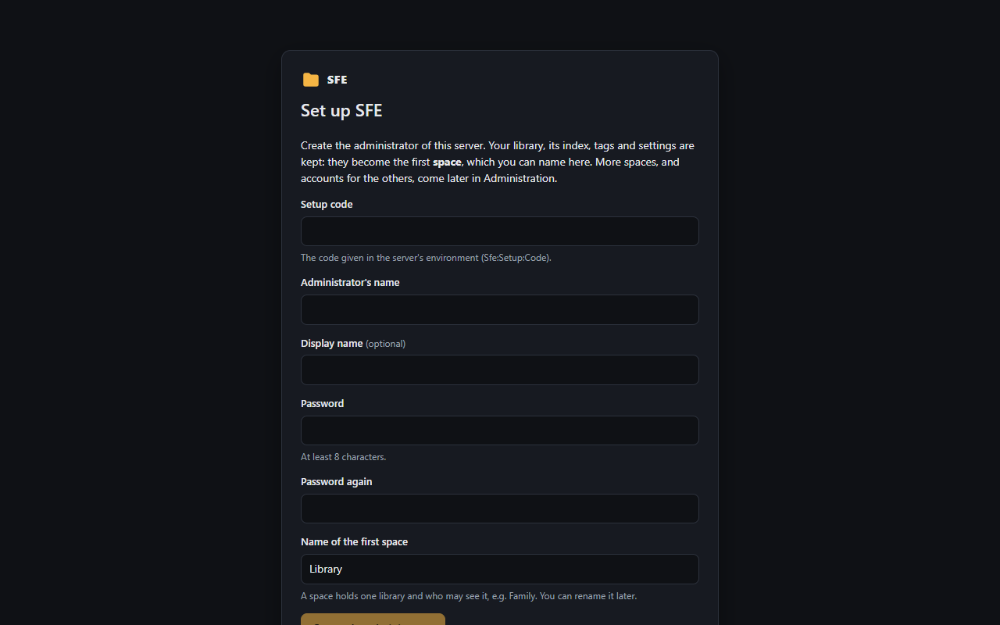

# First start

SFE has accounts, and nothing works until its first administrator exists: until then every page shows the setup
page and the API answers nothing else.

## The setup code

So that only whoever runs the server can claim it, the setup page asks for a **setup code** that you give the server in
its environment first, at least 12 characters long:

| How SFE runs | Where the code goes |
|---|---|
| Windows service | `"Setup": { "Code": "…" }` in the `Sfe` section of `appsettings.json` next to the program, or the system environment variable `Sfe__Setup__Code`; restart the service |
| systemd | `Environment=Sfe__Setup__Code=…` in the `[Service]` section (`systemctl edit sfe`), then `systemctl restart sfe` |
| IIS | `<environmentVariable name="Sfe__Setup__Code" value="…" />` in the site's `web.config`, then recycle the app pool |
| Container | the environment variable `Sfe__Setup__Code` (`docker run -e`, a compose file, your NAS's container settings) |
| Portable package / AppImage | `"Setup": { "Code": "…" }` in the `Sfe` section of its `appsettings.json` (`~/.config/sfe` for the AppImage) |
| From source | `Sfe__Setup__Code=…` in the environment, or `appsettings.Development.json` |

Without a code, or with one that is too short, the page shows these instructions for the way your server runs.

## Creating the administrator

Open the app: it asks for the code, the administrator's name, display name and password, and the name of the first
**space** (your library, its index, tags and settings; more spaces come later in
[Spaces & accounts](administration/spaces-and-accounts.md)). The administrator is signed in at once and is a **server
administrator**: every right in every space.

The code is not used again: remove it from the environment (the log reminds you).

## Next steps

1. **Scan the library**: ⋮ menu › **Scan this folder** at the top of the library, so that search, tags and duplicates
   know its files ([Scanning](user-guide/scanning.md)). Scans can also run on a
   [schedule](administration/background-tasks.md#schedules).
2. **Create accounts** for the others, or let visitors in without one:
   [Spaces & accounts](administration/spaces-and-accounts.md).
3. Look through the [administration page](administration/README.md) for the settings of your library.

## Lost administrator password

Set `Sfe__Setup__Recover=true` (with the setup code) and restart: the sign-in page links to the setup page, which now
gives a local administrator (by name) a new password, unlocked and enabled, or creates one. The app keeps working
meanwhile. Turn it off afterwards.
