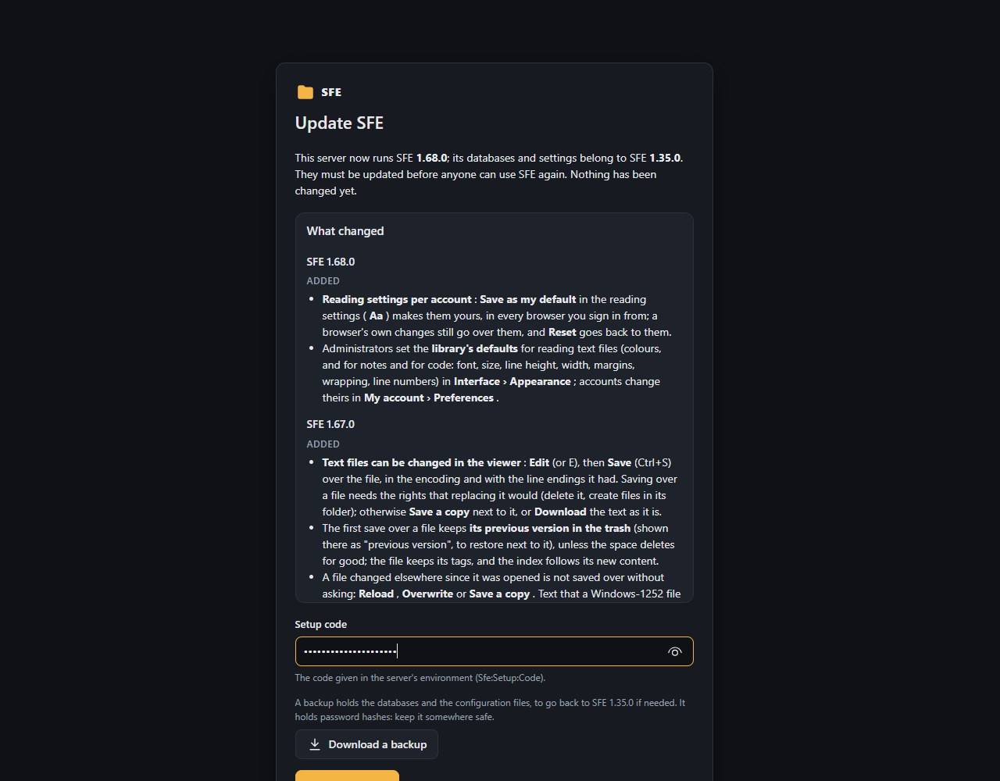

# Upgrading

Install the new version over the old one (or replace the portable package, keeping its `appsettings.json` and `data`
folder). The index, tags, thumbnails, trickplay and settings are kept: new database tables and columns are added by
the update described below, on SQL Server and SQLite alike. The notes after it say what you may notice.

## The update page (1.37 and later)

When the new version starts on an install of an earlier version, it changes nothing yet: every page shows the **update
page** and the app can't be used, by anyone, until the update is done.

1. The page says which version the databases belong to and lists every change since then (from the
   [changelog](../CHANGELOG.md)).
2. It asks for the **setup code**, the same as for the [first start](first-start.md#the-setup-code). If the server has
   none any more, the page says where to set it for the way your server runs; set it and restart.
3. **Download a backup** (recommended) saves a zip file of the databases and configuration files, to go back to the
   earlier version if needed (see [Backups](administration/system.md#backup)).
4. **Start the update** updates the databases (accounts, then every space's index), the settings and the caches when
   the version changes their layout, and follows it on the page. **Open SFE** then opens the library; sessions of before keep working.

If the update stops on an error, the page shows it: fix the cause (the server's log has the details) and start it
again. Before you confirm, nothing in the databases or the settings file has been changed, so you can still go back
to the earlier version by installing it again.

- Installs from before 1.37 recorded no version: the page says "an earlier version" and lists every change.
- A database that belongs to a **later** version than the one installed is never touched: install that version again,
  or restore a backup made with this one.
- While the database can't be reached at all (e.g. SQL Server starts after SFE), the page says so and SFE keeps trying.
- With `Sfe:Database:MigrateOnStartup` set to `false`, you update the schema yourself and SFE doesn't check versions.

## To 1.61

- A right click on a file or folder now opens SFE's item menu for everyone who may browse (it has **Properties**);
  **Shift** with the right click still opens the browser's own menu. Nothing changes in the databases or the rights.

## To 1.60

- Whoever may download files (`files.download`, members by default) may now download several files or a folder as a
  zip. To keep a group from downloading whole folders, take that right away (they can then download no file at all),
  or set **Largest zip to download** ([File management](administration/file-management.md#settings)). Nothing changes
  in the databases.

## To 1.59

- New right `files.upload`, given to **no group**, as for 1.55. Unfinished uploads are kept in the work folder
  (`uploads`); nothing changes in the databases.
- Changing **Where SFE keeps its work files** while uploads are unfinished leaves them where they were: they are no
  longer listed, and their files can be deleted by hand.

## To 1.58

- New rights `files.move` and `files.copy`, given to **no group**, as for 1.55. Nothing else changes: moves and copies
  keep no data of their own (the panel's list of recent ones lives in the server's memory).

## To 1.57

- Every space's index gets two new, empty tables for the trash, `TrashEntries` and `TrashTags` (SQL Server: a
  migration; SQLite: new tables in the same file), created by the update page.
- New rights `files.delete` and `files.deletePermanently`, given to **no group**, as for 1.55.
- A new background task, **Trash purge**, appears in Background tasks; it has nothing to do until something is deleted.

## To 1.55

- New rights `files.createFolders` and `files.rename` ([managing files](user-guide/managing-files.md)): given to **no
  group**, so nothing changes until an administrator ticks them for a group. `settings.files` (the new
  [File management](administration/file-management.md) settings) goes to the Administrators groups.
- The name `.sfe` at a library's root is now SFE's own (its work folder, for the trash and uploads of later versions):
  a folder of that name already there is no longer listed, scanned or reachable; rename it on the server's disk if
  you need it.
- To create folders and rename, the server's account needs write access to the library (see
  [Installation](installation.md)).

## To 1.52

The accounts' database gets a new, empty table, `FolderRules` (rules saying who may see or change each folder, for
a later version), created by the update page (SQL Server: a migration; SQLite: a new table in the same file). Nothing
else changes: every right still applies to the whole space.

## To 1.48

Nothing changes in the databases or settings. An install that already has accounts keeps asking for the setup code
everywhere; only a new install opened on the server's own computer skips it. **Fast sign-in** stays off until you turn
it on (Administration › System › Start-up).

## To 1.47

Security changes; nothing changes in the databases.

- **The setup code SFE made itself is renewed** by the update (1.46 also wrote it to the server's log). The next time
  one is needed (the next update, a recovery), a new one is shown in SFE's window and kept in `data/setup-code.txt`. A
  code you set in the configuration (`Sfe:Setup:Code`) is not touched.
- **Administration › System › Installation** needs a signed-in server administrator as well as the setup code.
- **ffmpeg** set on that page must be named `ffmpeg` (`ffmpeg.exe`) and be outside the spaces' folders; one already
  saved keeps working.
- **Files of a library that a browser could run** (`.html`, `.svg`, `.xml`…) are downloaded instead of opened in a
  tab; pictures, videos, audio and text open as before.
- **Sign-in:** wrong passwords now block the address they come from for that account, not the account (`MaxFailedSignIns`,
  `LockoutMinutes`); the account itself is locked only after 50 failures from all addresses
  (`Sfe:Security:AccountLockoutFailures`). A locked-out administrator recovers the account from the sign-in page with
  a code shown in SFE's console ([Locked out](first-start.md#locked-out-or-lost-administrator-password)).
- **Behind a reverse proxy** on the same computer, SFE now uses the visitor's address and scheme it forwards. A proxy
  on another computer must be named in `Sfe:Security:TrustedProxies` (see
  [Installation](installation.md#reaching-it-from-outside-https-and-a-reverse-proxy)).
- The server's [log](administration/logs.md) gets the severity **Security warning** (failed sign-ins, lockouts, wrong
  setup codes, recoveries…). Entries logged before the update keep their level (**Warning**).
- Files of SFE's own folders (keys, setup code, databases, settings) are never served as files of a library, even
  when a space's folder holds them or a folder link leads there.

## To 1.46

- The accounts' database gets a new table, `LogEntries` (the server's [log](administration/logs.md)), created by the
  update page. What the server logs while the update waits is kept in memory and written once it is done.
- The Administrators group of every space gets the new rights `logs.view` and `settings.logs` once, at the update; a
  group made by hand gets them only if you add them.
- Log entries are kept 30 days by default; nothing is written to files unless you turn it on. Nothing changes in the
  settings file.

## To 1.43

- **No file to edit for the setup code any more:** when the configuration sets none, SFE makes one and keeps it in
  `data/setup-code.txt` (shown in its window or log). An install that kept its `Sfe:Setup:Code` keeps using it; one
  that removed it finds the code for this update page in that file.
- The library folder, the listening address and the ffmpeg path can be changed on the new
  [Administration › System › Installation](administration/system.md#installation) page (with the setup code). Values
  you set in `appsettings.json` stay as they are; those set by environment variables or the command line keep winning.
- **From source (IIS, systemd from `dotnet publish`):** the repository's `src/Sfe.Api/appsettings.json` is now neutral
  (library root `~`, SQLite). If you deployed it with your own values in it, keep your file when you publish over it,
  or move those values into `appsettings.Local.json` next to it, which is read after `appsettings.json`. Portable
  packages are not concerned (their `appsettings.json` is kept, as before).
- Nothing changes in the databases or the settings file.

## To 1.42

- The accounts' database gets a new table, `QuickLinks` (the sidebar's [quick links](user-guide/browsing.md#quick-links)),
  created by the update page; nothing else changes in the databases or the settings file.
- The groups Administrators and Users of existing spaces get the new right `account.quickLinks` once, at the update;
  guests don't. A group made by hand gets it only if you add it.

## To 1.40

- The thumbnail and trickplay caches get a new folder layout (two levels of folders named after a hash, instead of one
  folder per folder of the library). The update page moves what is already there: nothing is rendered again, and on a
  large cache this step takes a few minutes (the page shows its progress). A cached file that can't be moved (e.g. open
  in another program) is listed on the page and rendered again when needed.
- Nothing changes in the databases or the settings file.

## To 1.39

- Videos the browser can't play are now converted by the server while they play, when ffmpeg is found
  ([Playback](administration/playback.md#videos-converted-by-the-server)); turn it off with **Convert videos: Never**
  (`Sfe:Streaming:Mode` = `Off`). The groups Administrators and Users of existing spaces get the new right
  `files.stream` once, at the first start; guests don't.
- Nothing changes in the databases or the settings file.

## To 1.37

- The first start of 1.37 shows the update page above (installs before it recorded no version). The accounts'
  database gets a small `ServerProperties` table with the version (SQL Server: a migration; SQLite: a new table).

## To 1.36

- The index gets an indexed `Pixels` column (width × height, computed by the database) and an index on durations, for
  the new Duration and Resolution sorts of searches (SQL Server: a migration; SQLite: added on start-up). The values
  come from what scans already read: no scan is needed. On a large SQLite index, that first start takes a little
  longer while the indexes are built (the log says so).

## To 1.35

- The rights added by 1.35 (`files.edit`, `settings.editor`, for the [picture editor](user-guide/picture-editor.md))
  are given once, at the first start, to the built-in groups of every existing space as a new space would have them:
  Administrators and Users may edit pictures, Administrators change the editor's settings. Take them away afterwards
  if you wish: later starts don't give them back.
- The accounts' database gets one new column (SQL Server: a migration; SQLite: added on start-up).

## To 1.34 (accounts)

- After the upgrade, **set a setup code** and create the administrator ([First start](first-start.md)): until then the
  app only shows the setup page. Your index, tags, thumbnails, trickplay and settings are kept: they become the first
  space's.
- The accounts' tables are added to the existing database on the first start (SQL Server: a migration; SQLite: new
  tables in the same file).
- Excluded folders and trickplay folders move from the server's settings file to the first space's settings (the log
  says so); everything else in `settings.json` keeps applying as the server level.
- Media players opened with ▶ now get links that expire (see [External player](user-guide/video-player.md#external-player)).
- Browsers keep their own theme and search history as before.

## To 1.33 (durations)

Durations of videos and audio files are new in 1.33. The database gets its new column on start-up, and the next scan
of each folder reads the duration of the videos and audio files already indexed, once: expect that scan to take about
as long as the first scan of those files did. Until then, their duration is unknown (not shown, not found by `d:`).
