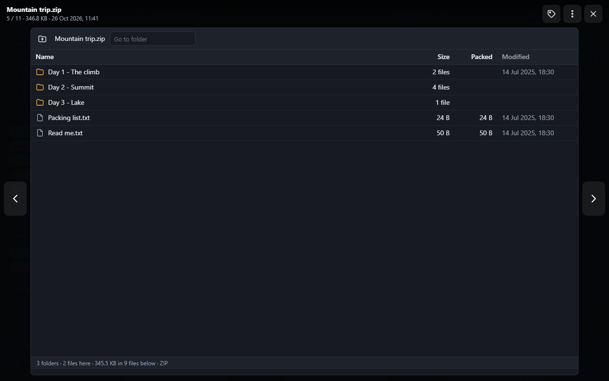
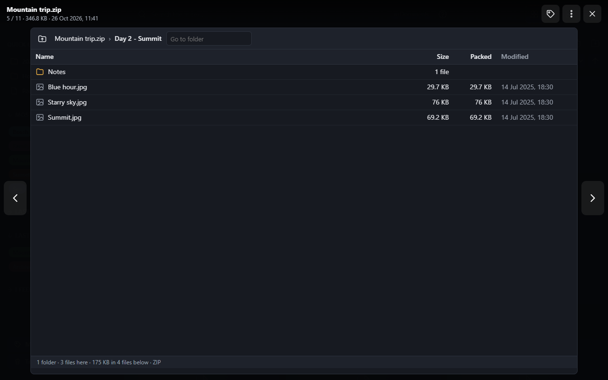

# Archives

Clicking a zip, 7z, rar or tar file opens it in the [viewer](viewer.md) like a folder of its own: its folders and
files, their sizes and dates, without unpacking anything. Archives of any size open the same way, even with millions of
entries or folders nested thousands deep.

## Moving around

- Click a folder (or double-click its row, or select it and press **Enter**) to open it. The bar at the top shows the
  way to it: click a folder of the way to go back to it. Deep down, the folders in between are shown as **…**.
- **Up** (or **Backspace**) goes to the folder above.
- **Go to folder**: type a folder's path inside the archive, with its folders separated by `/`
  (`Day 2 - Summit/Notes`), then **Enter**.
- ↑ / ↓ select a row. The bottom line counts the folder's folders and files, and the size of everything below it.

The first time an archive is opened, SFE reads its list of entries once (big archives say "Reading the list of
entries…" and how many so far); after that every folder opens at once, however big the archive is. A changed archive
is read again.

## Files inside an archive

With the right to download files, a file's name opens it in a new tab: pictures, videos, audio and plain text show
in the browser, anything else downloads. A right click on it offers **Open in new tab** and **Download**. Very large
files only download.

Some entries are only listed:

- **Links** (shown in italics): an archive made on Linux or macOS can hold them; they are never created when
  extracting.
- Entries **protected by a password** (a lock): see [below](#archives-with-a-password).
- Entries whose name would lead **out of the archive** (`../`, a drive, a root) or that are nested too deep are not
  listed at all; a line above the list says how many there are.

If the list stops (an archive cut off, or one with more entries than the server allows), a line above it says so:
what is shown is only the first part.

## Archives with a password

An archive whose list itself is protected (a 7z or rar made with "encrypt file names") asks for its password as it
opens. One whose files only are protected shows its list with a lock on those files: click one, or **Enter the
password**, to give it.

- Type the password and **Open** (**Show** shows what you type). A wrong one says so; after 10 tries in a minute, wait
  a minute.
- Once given, the archive's files open as the others do, for 15 minutes after you last use it. It is asked again after
  that, after signing out, or when the archive changes.
- The password stays on the server, in its memory, for you only: it is never written anywhere nor sent back.
- A **zip**'s password protects only its files' content: their names, sizes and dates stay readable by anyone with
  the file. A 7z or rar can hide its list too.
- Zips encrypted with AES (128 or 256 bits) and with the older ZipCrypto open, as do 7z and rar archives (rar 4 and 5)
  with a password.

## Extracting

With the right to extract archives (`files.extract`, which no group has until an administrator gives it), an
archive's files can be written into the library:

- **Extract to “name”** in the archive's menu (right click, or ⋮) extracts all of it beside it, into a new folder named
  after it (`trip.zip` → `trip`). An archive holding one folder only gives that folder (`trip.zip` holding `trip/`
  gives `trip`, not `trip/trip`). A name already taken gets a number (`trip (2)`).
- **Extract…** in the same menu picks the folder to extract into (click through the folders, then **Extract here**).
  Untick **Into a new folder** to put what the archive holds straight into the folder, with what is there: a name
  already taken there is asked about as for a [copy](managing-files.md#move-and-copy) (Replace, Skip, Keep both).
  **Password**: the archive's, when it has one.
- In the viewer, **Extract…** in the bar extracts the folder shown (the whole archive at its top), and a row's menu
  (right click) extracts that folder or file alone. The password given in the viewer is used: it isn't asked again.

Extracting runs on the server in the background, in the panel at the bottom right, as moves and copies do: its
progress, **Cancel**, the questions, then what was extracted. Until it is over, what comes out is written in a hidden
working folder (`….sfe-partial`): a cancelled or failed extraction leaves nothing half written, and a wrong password
leaves nothing at all. What comes out is added to the index, with the folder's default tags.

Some entries are never written, and the panel lists them (the first few, and how many in all):

- names leading out of the folder (`../`, a drive, a root), links, and names the server's system refuses (`CON`,
  `a:b`, a name ending with a dot; on every server when the space keeps names portable);
- a file claiming to be more than `MaxCompressionRatio` times its packed size (a "zip bomb"), one holding more or less
  data than it says, or one whose checksum doesn't match (a damaged archive);
- a second entry with the name of one already written, and paths longer than the index keeps.

An archive cut off or damaged part of the way keeps what came before the break, and the panel says where it stopped.
Extracting is refused when the drive would keep less than the space's
[Free space kept by copies](../administration/file-management.md#settings), and stops if it gets there while writing.

## What can be explored

| Kind | Explored |
|---|---|
| `.zip`, `.7z`, `.rar`, `.tar` | Yes |
| `.tar.gz` / `.tgz`, `.tar.bz2`, `.tar.xz` | Up to 2 GB (configurable): these have no list of their entries, so listing one means decompressing all of it; extracted whatever their size |
| `.gz`, `.bz2`, `.xz` holding one file | No: they open in a new tab or download, as other files; **Extract** gives the file |

A file whose content isn't the archive its name says (a renamed file) answers that it can't be explored.

## Settings

Set in the configuration only ([configuration](../configuration.md)), under `Sfe:Files:Archives`:

| Key | Default | |
|---|---|---|
| `MaxEntries` | 10 000 000 | Entries listed (or extracted) at most; past it the list stops and says so |
| `MaxDepth` | 10 000 | Folders nested at most; deeper entries are left out |
| `MaxCompressedTarMegabytes` | 2048 | Largest `.tar.gz` / `.tar.bz2` / `.tar.xz` explored |
| `MaxEncryptedListEntries` | 500 000 | Entries listed at most for an archive whose list is protected (kept in the server's memory, never on its disk, while the password is) |
| `MaxPreviewMegabytes` | 64 | Largest file opened from an archive in a tab; larger ones only download |
| `MaxSkippedMegabytes` | 2048 | A solid 7z or rar, or a `.tar.gz`, has to unpack the files before the one opened: past this much, that file is only extracted, or the archive downloaded |
| `MaxCompressionRatio` | 10 000 | A file claiming to be larger than this many times its packed size is refused (a "zip bomb") |
| `CatalogBuilds` | 1 | Archives' lists read at once by the whole server; others wait their turn |
| `CompressJobs` | 1 | Zips made at once by the whole server ([Compress](managing-files.md#compress-into-a-zip)); others wait their turn |
| `CatalogMegabytes` | 1024 | Disk space the lists read may take per library, in the server's cache folder; the least recently used are deleted past it, and read again when needed |
