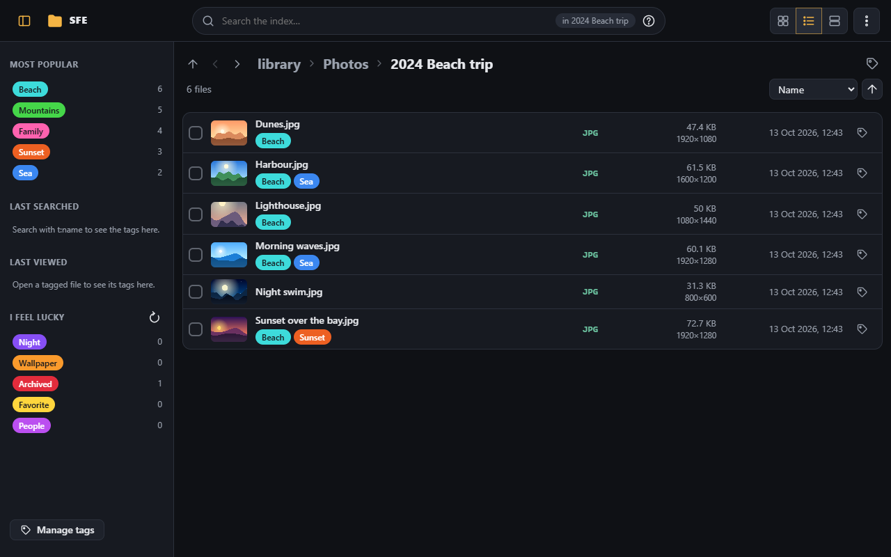
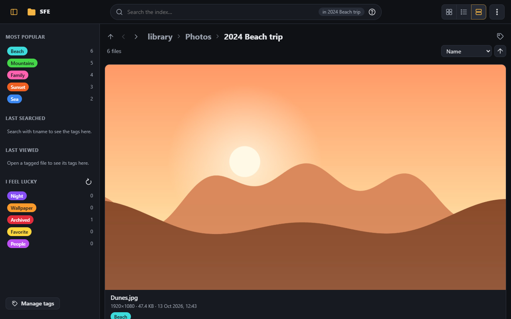
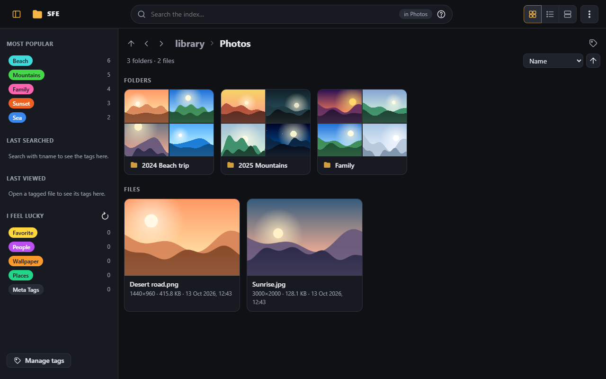
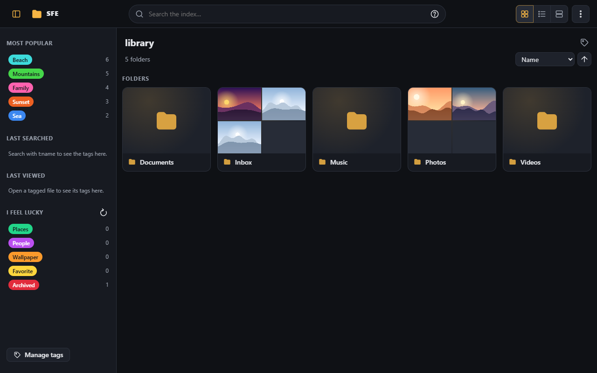
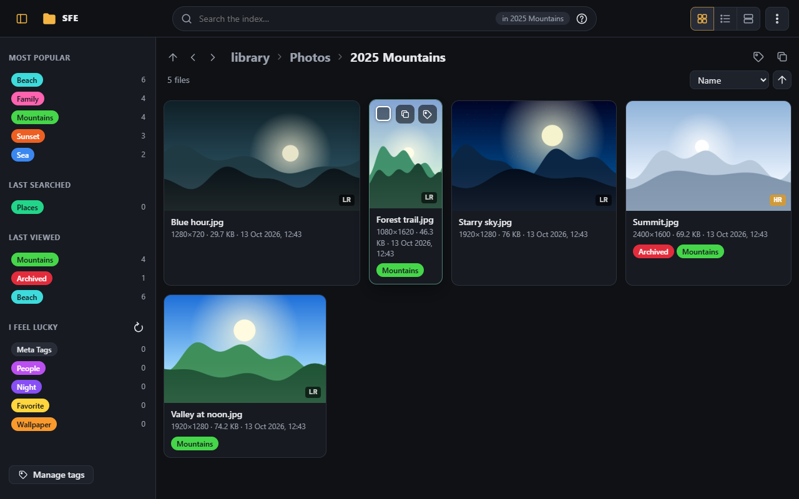
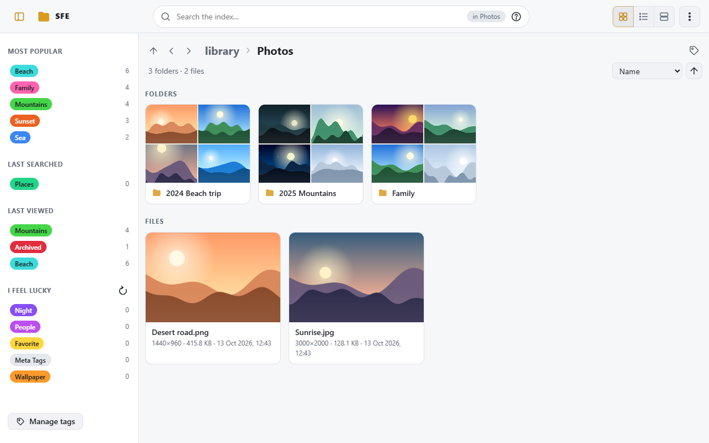
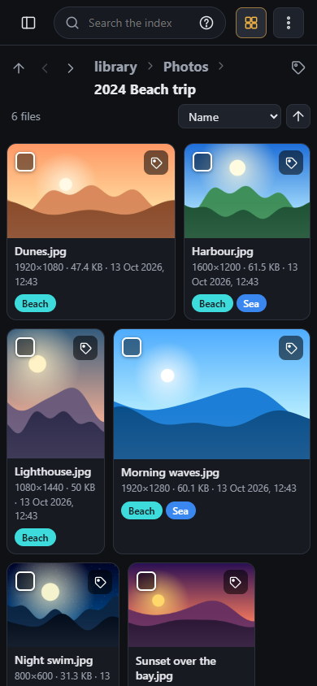
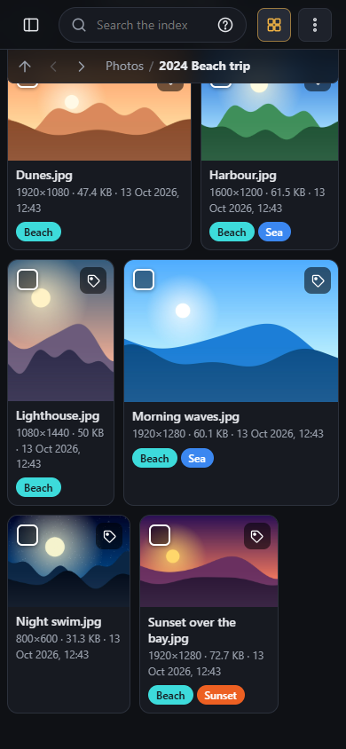

# Browsing

The library page lists the folder you are in: its sub-folders first, then its files. Click a folder to open it, a
file to open it in the [viewer](viewer.md).

The top bar holds, from left to right: the tag sidebar's button, **SFE** (back to the library's top folder), the
[search box](search.md), the three layouts and the [⋮ menu](signing-in.md#the--menu). Every button shows a hint (and
its keyboard shortcut, if any) when you rest the mouse on it.

## Layouts

The three buttons at the top right switch between:

| Layout | |
|---|---|
| **Grid** | Previews in rows, folders as cards with their first pictures (above) |
| **List** | One line per file with a small thumbnail, type, size, resolution and date; best for long folders |
| **One per row** | Large previews, one per row |

Each tile or row shows the file's name, resolution, size and date, its tags (click one to search for it) and, on
hover, a checkbox to [select it](tags.md#several-files-at-once) and a tag button.

## Moving around

- The path (breadcrumbs) at the top goes to any folder above.
- The buttons before the path go to the **parent folder** (also Backspace or Alt+↑) and to the **previous / next
  folder** of the parent (also `[` and `]`), in the order the parent is sorted by the current sort.
- Once you scroll down past the path, a slim bar under the top bar keeps these buttons and the folder's name (with its
  parent, or the search) in view; click the name to go back to the top.
- The sort list (Name, Date modified, Size, Type) and the arrow next to it set the order and its direction.
- Long folders and search results load more items as you scroll. Once you scroll down, a small box at the bottom right
  says where you are: the page, how many items you have scrolled to out of the total, and a bar for the same.
- Reloading the page, or coming back to it (from the viewer, the administration page or the browser's back button),
  brings you back to the item you were looking at.

## Folder pictures

In the **grid** and **one per row** layouts, folders are cards showing their first pictures (images, and videos when
thumbnails are available), like a Windows media folder. **Pictures per folder** (default 4, a 2×2 grid; 9 makes a 3×3
grid, up to 16; 0 lists folders compactly) is set in
[Interface › Browsing](../administration/interface.md#browsing) or in your own
[preferences](../administration/my-account.md). Only the folder's own files count, not its sub-folders; a folder
without pictures gets a card of the same size with a folder icon. In a very large folder the pictures come from its
first 5,000 files.

## Resolutions, durations and HR/LR marks

**Resolutions** of photos and videos (e.g. `1920×1080`) are shown before their size in the grid and one-per-row
layouts, under it in the list, and in the viewer, followed by the **duration** of videos and audio files (e.g.
`1:23:45`); in the grid and one-per-row layouts, the duration of a video or audio file is shown in the bottom-left
corner of its preview instead.

With **Mark high and low resolution** on, each photo and video whose resolution is known is labelled **HR** (high
resolution, highlighted) or **LR** (low resolution) in the bottom-right corner of its preview, and on the thumbnail in
the list layout; hover it for the resolution. Photos and videos have their own threshold on the **shorter side**, so
the orientation doesn't matter: by default 1500 pixels for photos and 720 for videos. A 1000×1000 photo is LR but a
1000×1000 video HR; a 2000×1500 photo or a portrait 1500×2000 one is HR, a 854×480 video LR. The searches `r:hr` and
`r:lr` use the same thresholds.

Scans read resolutions and durations ([Scanning › Indexing](../administration/scanning.md#indexing)); the three
displays are switched in [Interface › Browsing](../administration/interface.md#browsing) and in your own preferences.

## Large photos

Photos larger than **Large image size** (512 KB by default) are shown through their thumbnail in listings, which keeps
them fast. **Full images in one-per-row view** ([Thumbnails](../administration/thumbnails.md), off by default) shows
the images themselves in the **one per row** layout instead, so big previews stay sharp; each photo is then downloaded
whole as you scroll past it.

## Copying full paths

When **Copy full paths** is on (for accounts with the right `files.copyPaths`), buttons copy the full path of an item on
the server, e.g. `D:\Media\Photos\beach.jpg`, to paste it into another program: after the location for the current
folder (the folder searched in while searching), on each folder and file (on hover with a mouse), and in the viewer
for the file shown. Copying also works over plain `http://` from another computer on the network. Folders and files
whose path you copied get a dashed outline in the listing, until the page is reloaded.

It is off by default because it tells every visitor where the library lives on the server's disk.

## Light and dark

The pages come in dark and light colors. By default they follow the light or dark mode of each device; the server's
**Default theme** and each browser's own choice are in
[Interface › Appearance](../administration/interface.md#appearance) and [My account](../administration/my-account.md).
The separate video player window always stays dark.

## On a phone

 

The same page adapts to small screens: the tag sidebar becomes a drawer (its button at the top left), the search box
narrows, and the slim location bar appears as you scroll. Tile buttons are always shown, since there is no hover. In
the viewer, swipe to go to the previous or next file.
