# Browsing

The library page lists the folder you are in: its sub-folders first, then its files. Click a folder to open it, a
file to open it in the [viewer](viewer.md).

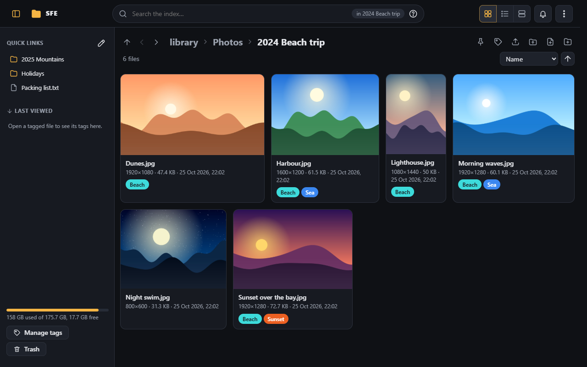

The top bar holds, from left to right: the sidebar's button ([quick links](#quick-links) and [tags](tags.md#the-tag-sidebar)), **SFE** (back to the library's top folder), the
[search box](search.md), the three layouts, the [notifications](#notifications) bell and the [⋮ menu](signing-in.md#the--menu). Every button shows a hint (and
its keyboard shortcut, if any) when you rest the mouse on it.

## Dashboard

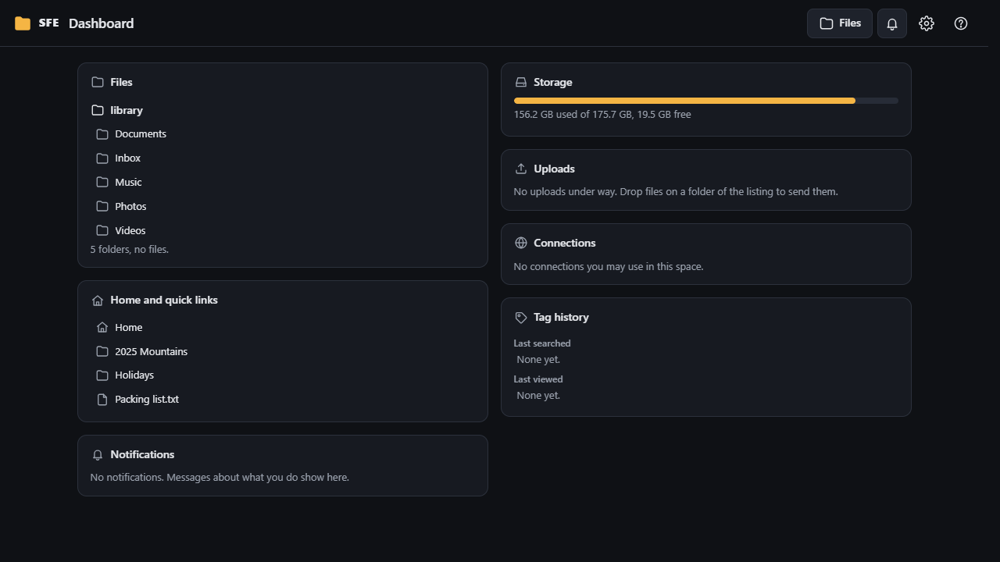

SFE's address alone (a bookmark of the server, a new tab) opens the dashboard: cards with what you use most, side by
side, one under the other on a phone.

- **Home and quick links**: your [home folder](#home-folder) and your [quick links](#quick-links). A folder opens
  its listing, a file the folder holding it; those not there any more show faded.
- **Notifications**: the last five messages of the [bell](#notifications), newest first; the bell
  lists them all and acts on them.
- **Tag history**: the tags you last searched for and those of the files you last viewed, as in the sidebar. A tag
  finds its files.
- **Storage**: the space used and free on the disk holding the library, as the sidebar's bar shows it.
- **Uploads**: the uploads under way in this tab (they go on while the dashboard is open) and those a reload cut
  off. Each opens the folder it goes into, where the [operations panel](managing-files.md#upload) pauses, resumes or
  cancels it.
- **Connections**: the [connections](../administration/connections.md) you may use in this space, each opening its files, with
  **sign in again** when it needs it, else **read only** or **read and change**.

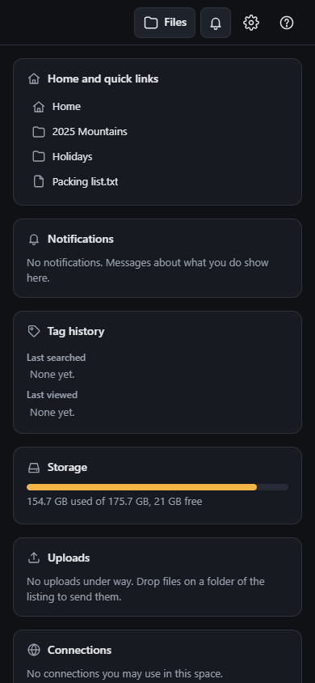

Each card shows only with its rights. **Files** (or **SFE**) opens the top of the library; **Dashboard** in the
[⋮ menu](signing-in.md#the--menu) comes back. To open something else at the start, choose **Start page** in your
settings ([My account](../administration/my-account.md) › Settings): **Home folder** (the top of the
library while you have none) or **Top of the library**. Links to a folder, a search or a file still open them, and
reloading a page keeps it.

## Layouts

The three buttons at the top right switch between:

| Layout | |
|---|---|
| **Grid** | Previews in rows, folders as cards with their first pictures (above) |
| **List** | One line per file with a small thumbnail, type, size, resolution and date; best for long folders |
| **One per row** | Large previews, one per row |

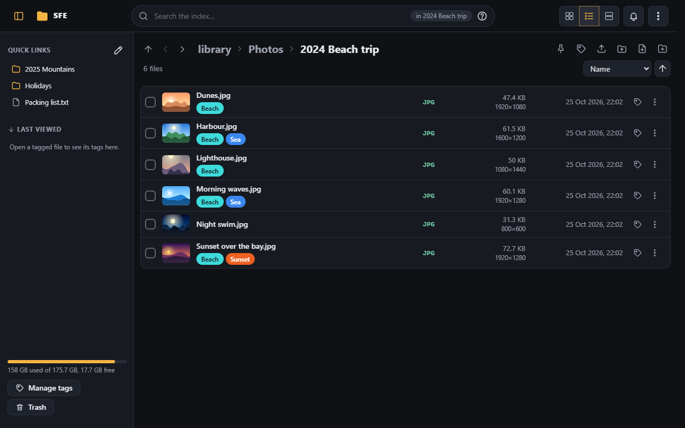

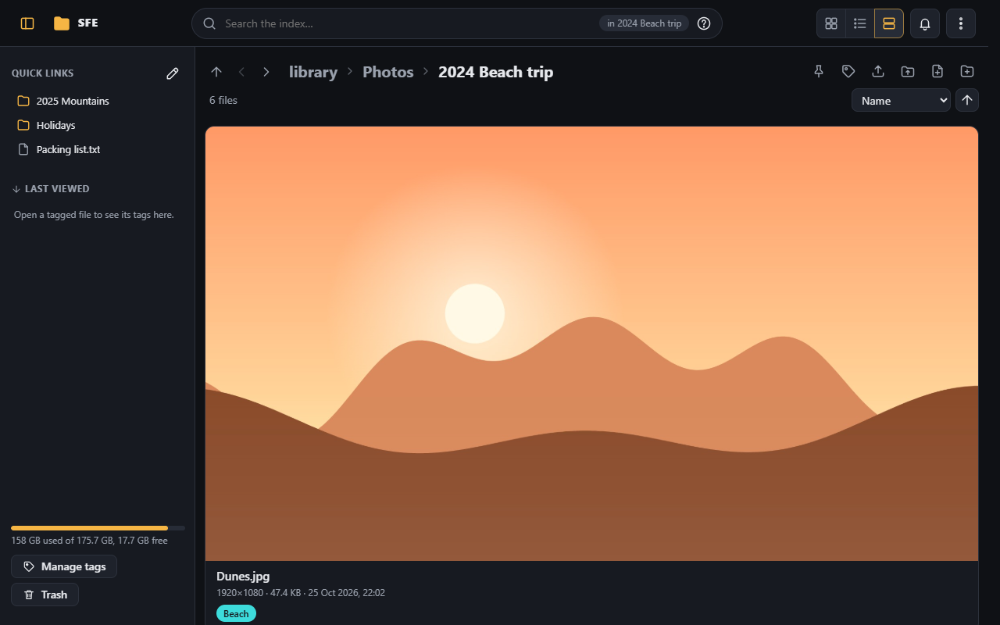

Each tile or row shows the file's name, resolution, size and date, its tags (click one to search for it) and, on
hover, a checkbox to [select it](tags.md#several-files-at-once) and a tag button.

Large photos are shown through their thumbnail, which is still. Resting the mouse on a large **animated image** (GIF,
PNG, WebP or AVIF with several frames) plays the image itself over its thumbnail, after a thin bar while it loads; on a
touch screen, press and hold it (a tap still opens it). Only files that are really animated are played. See
[Thumbnails](../administration/thumbnails.md) to turn it off.

Files and folders that are **not indexed yet** (added since the last [scan](scanning.md), or in a folder never scanned)
are shown faded, back to full strength under the mouse; their hint says so. Browsing and viewing them works as usual,
but search, duplicates and tag searches only find them after a scan. Tagging a file, or the files of a folder, indexes
them.

An indexed folder shows how many items the index has **directly inside it** (its files and sub-folders, not what the
sub-folders hold, as of the last scan): in the bottom-right corner of its card, or at the end of its line in the list
layout. Hover the number for its meaning.

## Moving around

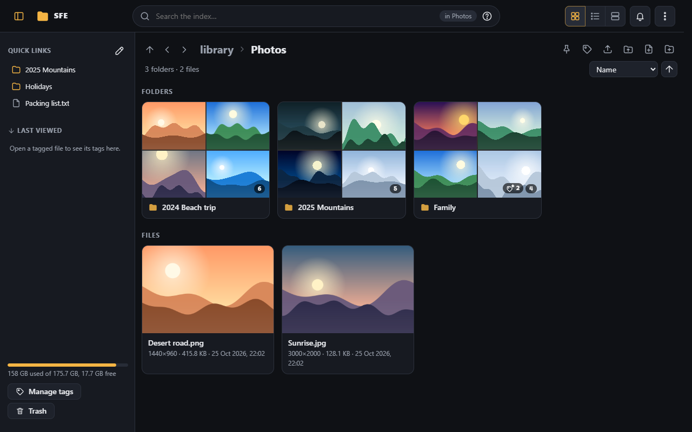

- The path (breadcrumbs) at the top goes to any folder above. When you may only see one folder deep down, the
  library opens there, and the folders above it are greyed: they only lead to it.
- The buttons before the path go to the **parent folder** (also Backspace or Alt+↑) and to the **previous / next
  folder** of the parent (also `[` and `]`), in the order the parent is sorted by the current sort.
- Once you scroll down past the path, a slim bar under the top bar keeps these buttons and the folder's name (with its
  parent, or the search) in view; click the name to go back to the top.
- The sort list (Name, Date modified, Size, Type) and the arrow next to it set the order and its direction. Searches
  also sort by Duration, Resolution and Path ([Search results](search.md#results)).
- Long folders and search results load more items as you scroll. Once you scroll down, a small box at the bottom right
  says where you are: the page, how many items you have scrolled to out of the total, and a bar for the same.
- Reloading the page, or coming back to it (from the viewer, the administration page or the browser's back button),
  brings you back to the item you were looking at.
- With the keyboard: <kbd>Tab</kbd> to an item (or click one), then the arrow keys move to the item beside, above or
  below it, <kbd>Home</kbd> and <kbd>End</kbd> to the first and last loaded, <kbd>Enter</kbd> opens it,
  <kbd>Space</kbd> selects it and <kbd>Shift</kbd>+arrows select the items passed. Until an item has the focus, the
  arrows scroll the page as usual.

## Read-only folders and files

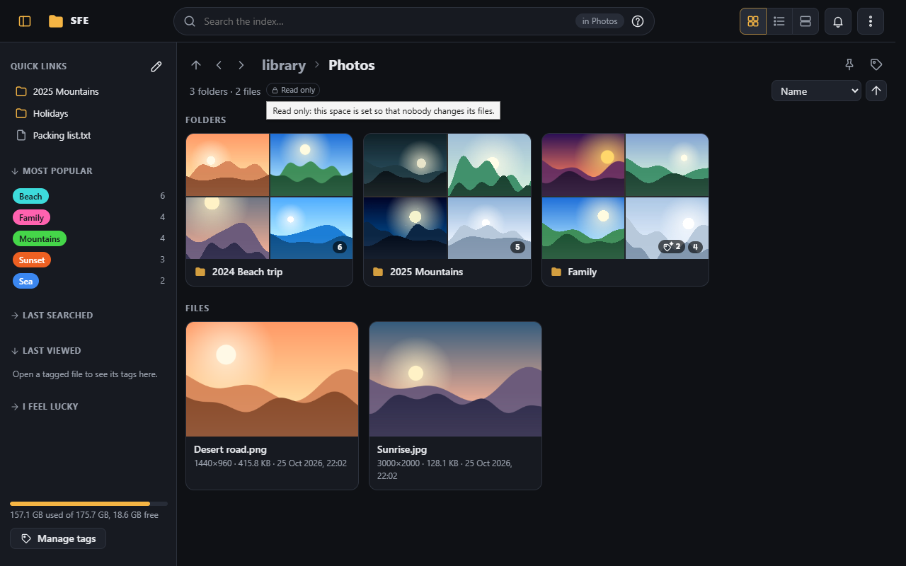

When you can open the files of a folder but not change them, a **Read only** chip follows the counts under the path;
its hint says why, in one sentence:

- this server, or this space, is set so that nobody changes files;
- you are a visitor or use a guest account;
- your rights in this space, or a folder rule on this folder, let you open files only (ask an administrator);
- the folder is behind a link leaving the library, which the server keeps read-only;
- the disk refuses changes: it is mounted read-only, or the server isn't allowed to write in this folder;
- on a [connection](../administration/connections.md#browsing-a-connection): the connection is made read only, it is
  shared with your groups to read only, or the storage refuses changes (a Dropbox folder shared with the account to
  view only).

When you can change the folder, nothing is shown, but a small **lock** marks the files and folders inside that you
can't change: a folder rule makes them read-only for you, or the disk marks the file read-only (it opens, but can't be
saved over); on a connection, what its storage refuses to change. The buttons and menu entries for what you can't do are hidden or greyed, as before; in a folder the disk
refuses, the menu entries that would write there (Rename…, Move to…, Delete…, New folder…, uploads, Paste…) are
greyed with the disk's reason. The [properties](managing-files.md#properties) of an item say, in their **Access**
section, what you may do with it and why not.

## Quick links

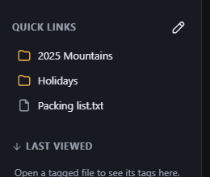

**Quick links**, at the top of the sidebar, keep the folders and files you use most one click away, like the Quick
access of Windows Explorer. Each account has its own, in each space; visitors without an account have none (right
`account.quickLinks`).

- **Click a folder** to open it; the one you are in is highlighted.
- **Click a file** to open its folder and show it there: pictures, videos and audio open in the [viewer](viewer.md),
  other files are scrolled to and outlined for a moment. Ctrl+click (or the middle button) opens the file in a new tab
  instead.
- A link whose folder or file was moved, renamed or deleted stays in the list, struck through, until you remove it.
- At most 100 links per list.

**Adding.** Drag a folder, a file or a breadcrumb of the path onto the quick links, and drop it where it should go: a
line shows the place. Dragging one of several selected files adds all of them. Without dragging:

| Where | Adds |
|---|---|
| The pin after the path, at the top of the listing | the folder you are in |
| **Add to quick links** in the [menu](managing-files.md#the-item-menu) of a folder or file (right click or **⋮**) | that folder or file |
| In the [selection bar](tags.md#several-files-at-once), **Quick links** | the selected files |
| **Add to quick links** in the [viewer](viewer.md)'s **⋮** menu | the file shown |

A filled pin means the folder or file is a quick link already: click it again to remove it; in the item menu, the entry
reads **Remove from quick links**.

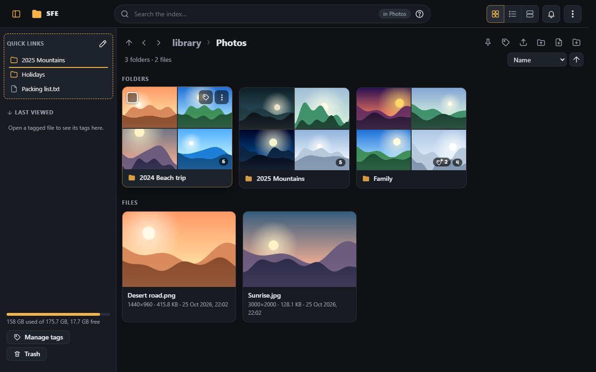

**Reordering and removing.** Drag a link up or down the list. The × at the end of a link (on hover with a mouse)
removes it; the folder or file itself stays. The pencil button next to **Quick links** turns on the edit mode, with ↑
and ↓ buttons on each link: that is how links are moved on a phone, where pages can't be dragged and dropped.

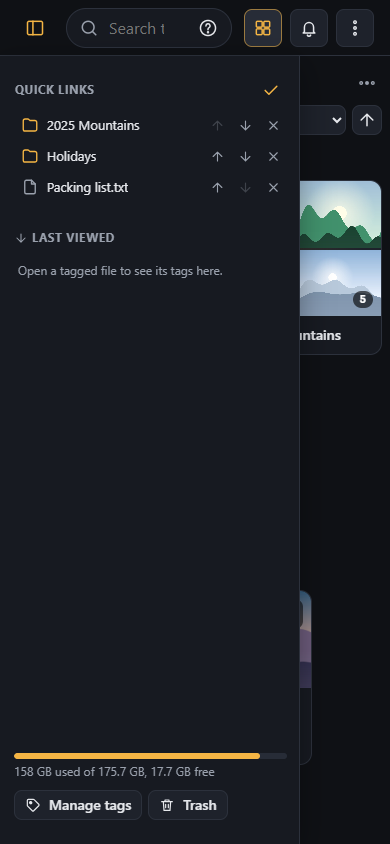

**Connections.** Under the quick links, the sidebar lists the connections to other storage (Dropbox) you may use; one
opens its files in the same listing ([browsing a connection](../administration/connections.md#browsing-a-connection)).
Quick links keep the library's folders and files only.

**Space used and free.** At the bottom of the sidebar, a bar shows how full the storage of what is listed is: the disk
holding the folder you are in, or the account of the connection you are in ("120 GB used of 500 GB, 380 GB free").
A folder of the library that is a junction, a mounted folder or a link to another disk shows that disk's space, and so
do the folders inside it (on Linux, also a disk mounted on a folder of the library). It turns orange from 85 % used and
red from 95 %; its hint gives the share used. A connection whose storage service doesn't tell shows "Free space not
reported", and one telling only what is used shows no bar. The numbers are read again when you open another folder, a
moment after files are copied, moved, uploaded or deleted there through SFE (by you or anyone else), and every few
minutes while the page is open.

## Home folder

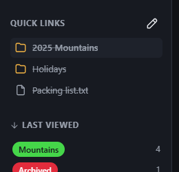

**Home**, at the top of the sidebar, opens your home folder in the space: a folder of your own, or the one your group
gives its members ([set by an administrator](../administration/spaces-and-accounts.md#home-folders)). Without one,
the sidebar shows no Home. Each account has its own, in each space; visitors without an account have none (right
`account.homeFolder`).

- **Set as home folder**, in the [menu](managing-files.md#the-item-menu) of a folder (right click or **⋮**, also the
  menu of the folder you are in), makes it yours, over your group's.
- **Stop using as home folder** in the same menu, or **Use your group's home folder** in the menu of Home, goes back
  to the one your group gives (or to none).
- SFE never makes a home folder: one not made yet, or moved or deleted since, shows faded, and clicking it says so.
  A folder renamed or moved in SFE stays your home folder under its new name.
- Home folders are folders of the space, not of a [connection](../administration/connections.md).

## Folder pictures

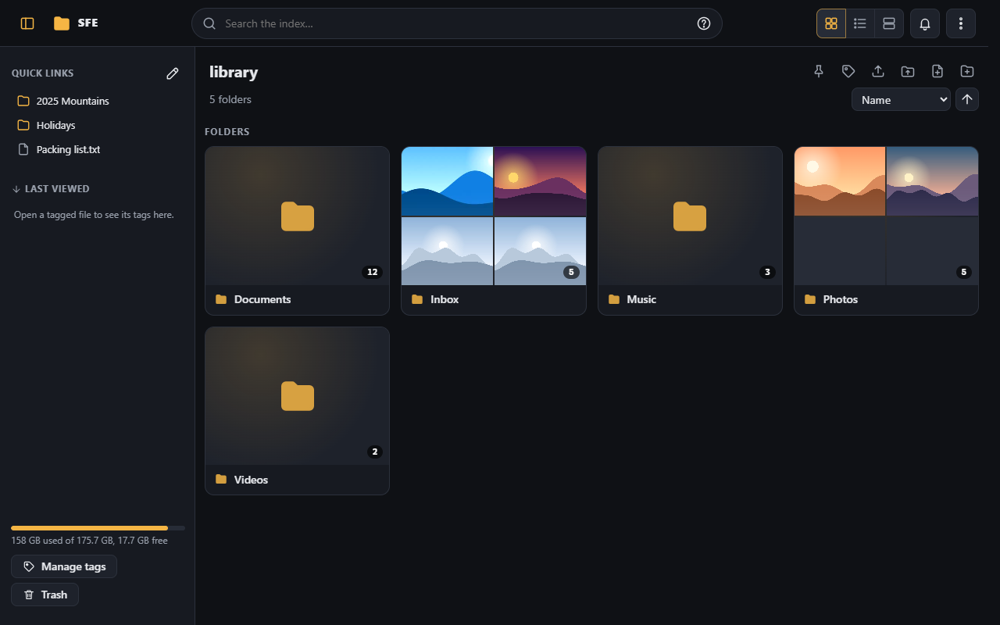

In the **grid** and **one per row** layouts, folders are cards showing their first pictures (images, and videos when
thumbnails are available), like a Windows media folder. **Pictures per folder** (default 4, a 2×2 grid; 9 makes a 3×3
grid, up to 16; 0 lists folders compactly) is set in
[Interface › Browsing](../administration/interface.md#browsing) or in your own
[preferences](../administration/my-account.md). Only the folder's own files count, not its sub-folders; a folder
without pictures gets a card of the same size with a folder icon. In a very large folder the pictures come from its
first 5,000 files.

## Resolutions, durations and HR/LR marks

**Resolutions** of photos and videos (e.g. `1920×1080`) are shown before their size in the grid and one-per-row
layouts, under it in the list, and in the viewer, followed by the **duration** of videos and audio files (e.g.
`1:23:45`); in the grid and one-per-row layouts, the duration of a video or audio file is shown in the bottom-left
corner of its preview instead.

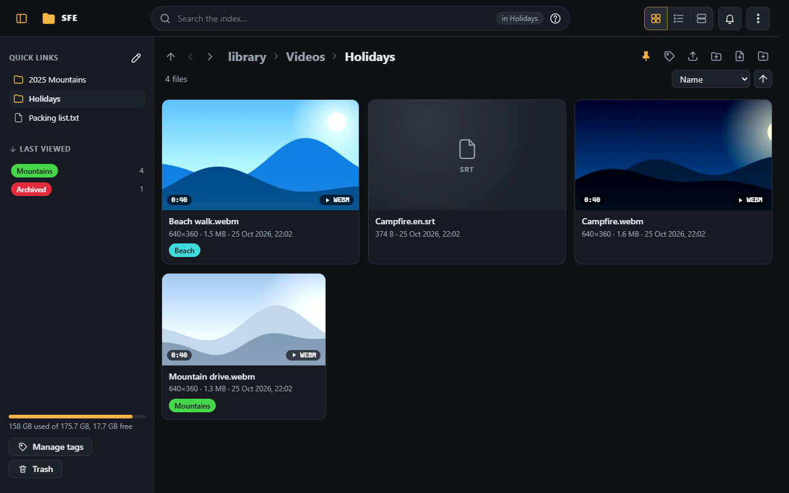

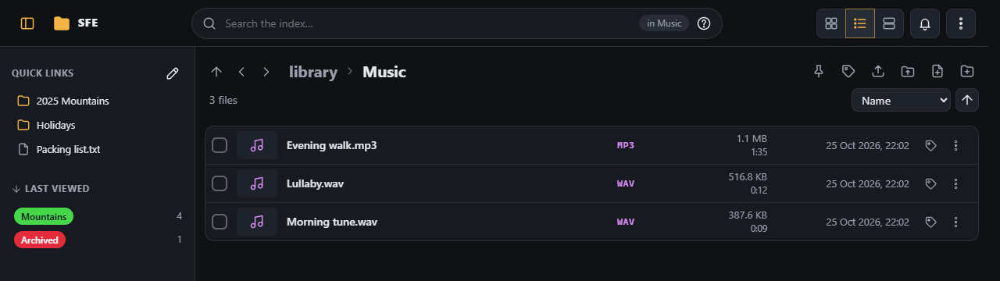

Resting the mouse on a video that has [trickplay](../administration/trickplay.md) plays its frames over the thumbnail
(on a phone: press and hold it).

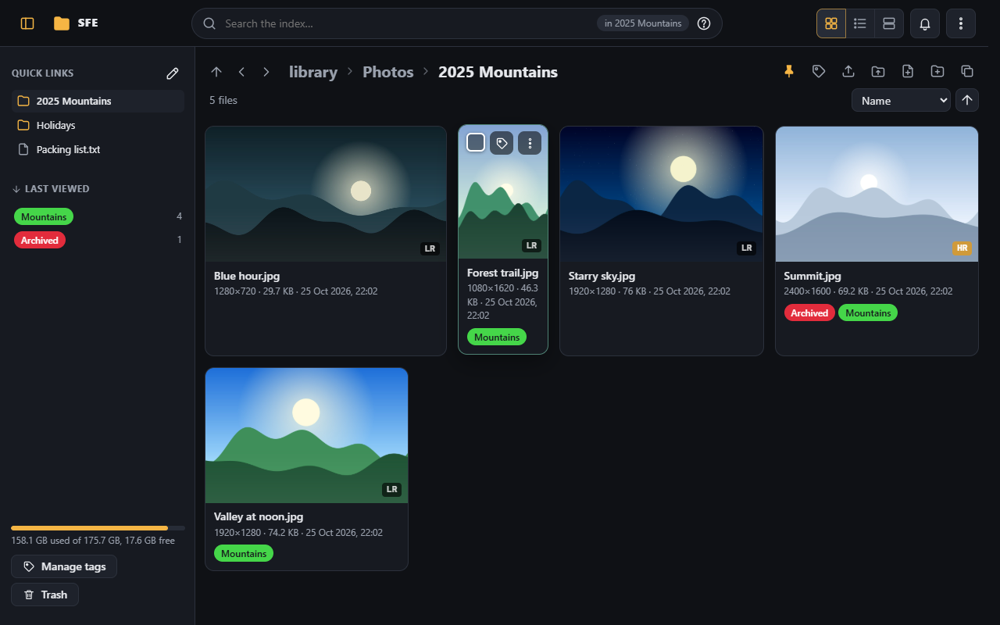

With **Mark high and low resolution** on, each photo and video whose resolution is known is labelled **HR** (high
resolution, highlighted) or **LR** (low resolution) in the bottom-right corner of its preview, and on the thumbnail in
the list layout; hover it for the resolution. Photos and videos have their own threshold on the **shorter side**, so
the orientation doesn't matter: by default 1500 pixels for photos and 720 for videos. A 1000×1000 photo is LR but a
1000×1000 video HR; a 2000×1500 photo or a portrait 1500×2000 one is HR, a 854×480 video LR. The searches `r:hr` and
`r:lr` use the same thresholds.

Scans read resolutions and durations ([Scanning › Indexing](../administration/scanning.md#indexing)); the three
displays are switched in [Interface › Browsing](../administration/interface.md#browsing) and in your own preferences.

## Large photos

Photos larger than **Large image size** (512 KB by default) are shown through their thumbnail in listings, which keeps
them fast. **Full images in one-per-row view** ([Thumbnails](../administration/thumbnails.md), off by default) shows
the images themselves in the **one per row** layout instead, so big previews stay sharp; each photo is then downloaded
whole as you scroll past it.

## Copying full paths

When **Copy full paths** is on (for accounts with the right `files.copyPaths`), buttons copy the full path of an item on
the server, e.g. `D:\Media\Photos\beach.jpg`, to paste it into another program: a button after the location for the
current folder (the folder searched in while searching), **Copy full path** in the menu of each folder and file (right
click or **⋮**), and a button in the viewer for the file shown. Copying also works over plain `http://` from another computer on the network. Folders and files
whose path you copied get a dashed outline in the listing, until the page is reloaded.

It is off by default because it tells every visitor where the library lives on the server's disk.

## Notifications

The messages that show for a few seconds in the corner of the page ("3 items moved to …", "Could not …") are kept
by the bell at the top right, on the library page and on the administration page. Its number counts what you haven't
seen yet: warnings and errors, and anything that came while the page was in the background. Click it to see the list,
newest first, which also marks them as seen (they stay highlighted until the list closes).

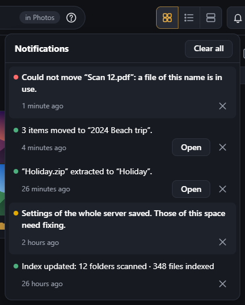

- **Open** (after a move, a copy, an extraction) goes to the folder the items went to, even after the page is
  reloaded. **Undo** stays while the page is open, until that action is undone.
- A background task you started by hand (a scan, a trickplay check, a search for similar videos, a trash purge, a
  connection index) tells you here when it ends, even if it ended while the library page was closed or in the
  background (as long as the server hasn't restarted since). If you may see the background tasks, every run that
  fails is told too. **Open** shows the run and its log in the task history.
- **×** removes one, **Clear all** removes them all.
- Each browser keeps its own, for each account and space: the last 200, for 30 days. Another browser or device starts
  empty, and signing out doesn't clear them, so on a shared computer use **Clear all** before leaving.

On a phone the list opens at the bottom of the screen.

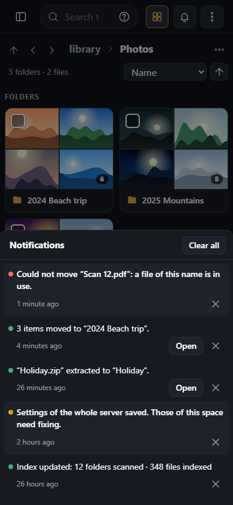

## Light and dark

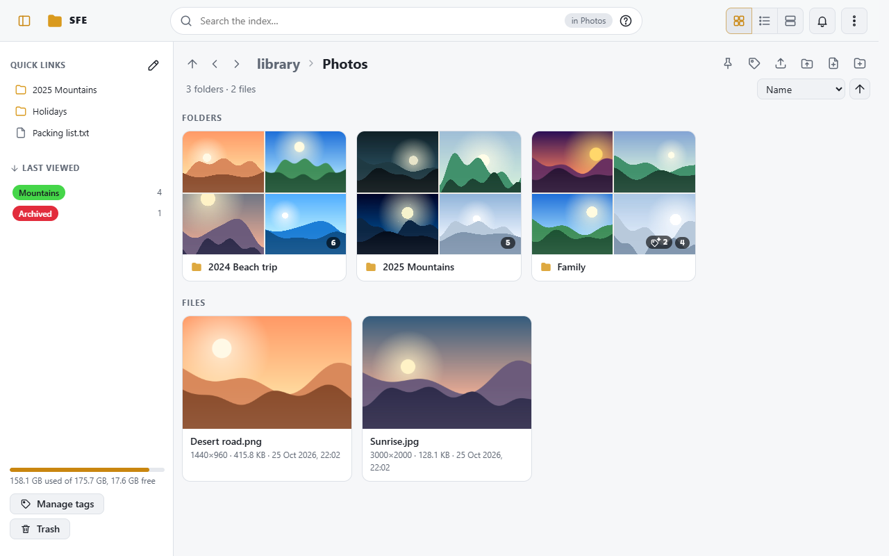

The pages come in dark and light colours. By default they follow the light or dark mode of each device; the server's
**Default theme** and each browser's own choice are in
[Interface › Appearance](../administration/interface.md#appearance) and [My account](../administration/my-account.md).
The separate video player window always stays dark.

## On a phone

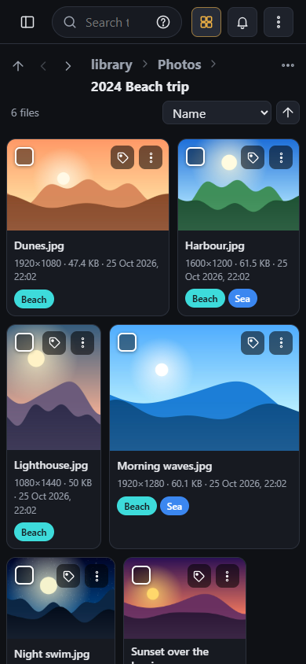 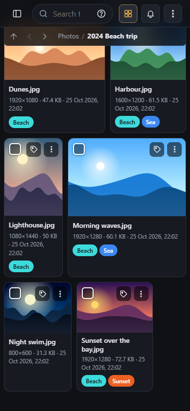

The same page adapts to small screens: the sidebar (quick links and tags) becomes a drawer (its button at the top left), the search box
narrows, and the slim location bar appears as you scroll. Tile buttons are always shown, since there is no hover. In
the viewer, swipe to go to the previous or next file.

In the **List** layout a narrow list (a phone, or a small window with the sidebar open) gives each file two lines:
its whole name on the first, its type, size and resolution under it; the tag and ⋮ buttons stay at the end.

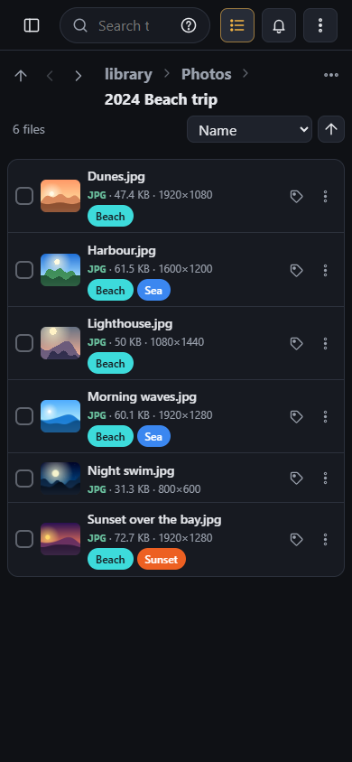

The folder's buttons beside the path (quick link, tags, upload, new file, new folder, copy full path) give way to one
**⋯** at the end of the path's line: it opens the folder's menu, the same as a right click on the page on a computer
(New folder, New file, Upload, Paste, Select all, Refresh, Tags of this folder, quick link, Copy full path,
Properties…). In a search it holds the search's actions.

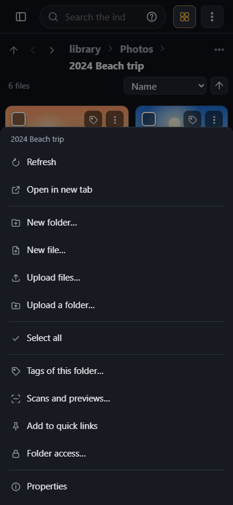
