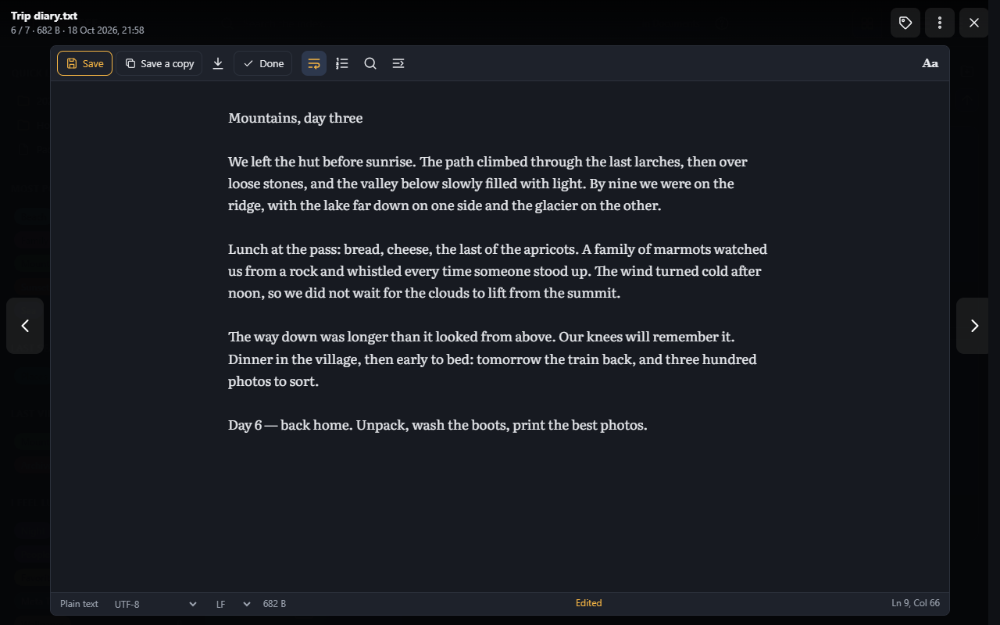
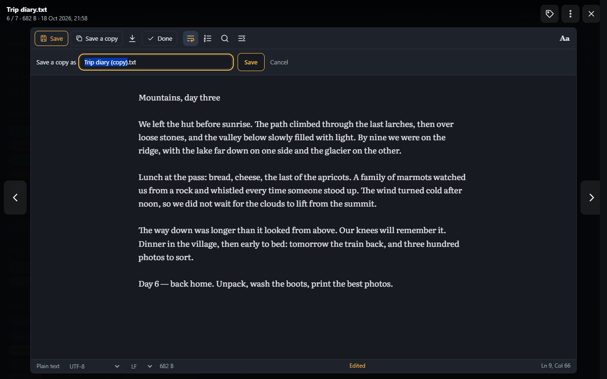

# Editing text files

[Text files](text-files.md) open in the viewer to be read; **Edit** at the left of the text's bar (or the **E** key)
lets you change them. What you can do with your changes depends on your [rights](#who-may-save): save over the file,
save a copy next to it, or download them.

| Button | Key | |
|---|---|---|
| Edit | E | Starts changing the text (the cursor goes in it) |
| Save | Ctrl+S | Saves over the file |
| Save a copy | Ctrl+Shift+S | Saves the text as a new file in the same folder; the copy then opens, ready to be changed further |
| Download (arrow) | | Downloads the text as it is now, to your computer's downloads |
| Done | | Back to reading; changes not saved are given up (asked first) |
| | Ctrl+Z / Ctrl+Y | Undoes / redoes a change |
| | Tab / Shift+Tab | Indents / unindents the line, or the lines selected |

- **Edited** in the bar at the bottom tells that the text has changes not saved yet. Undoing them all takes it away.
- A file is saved as it was: in the same **encoding** (UTF-8, UTF-16 or Windows-1252) and with the same **line endings**
  (Windows CRLF or Unix LF; a file that mixes them gets the one it uses most). While editing, the encoding and the line
  endings in the bar at the bottom choose others for the next save (UTF-8 with a BOM, for a program that wants one).
- **Markdown** files are edited beside the document: the source on one side, the document as it reads on the other,
  which follows what you type.
- **JSON** files are edited the same way, beside their [tree](text-files.md#json); **Format** lays the source out
  again, indented.
- **New file** (in a folder's [bar](managing-files.md#new-file)) opens the new text file here, ready to be written.

Ctrl+S never saves the web page itself while a text file is shown, even when there is nothing to save.

## Who may save

**Save** over a file needs the rights that replacing it would: deleting it (`files.delete`, or
`files.deletePermanently` in a space that deletes for good) and creating files in its folder (`files.createFiles`).
Without them, **Save a copy** needs `files.createFiles`, and **Download** needs `files.download`. With none of these,
the file is only read: there is no **Edit**. See [Rights](../reference/rights.md).

When the file can't be saved over, the bar says so, and Ctrl+S asks for the name of a copy:

The name offered is the file's with **(copy)**; a name already taken is refused, and nothing is written over another
file. A file that is read-only on the server, or a link to another file, is never saved over either.

## The previous version, in the trash

The first time you save over a file, its **previous version** goes to the [trash](managing-files.md#delete) (once each
time you open the file to edit it, not at every save). It is listed there as **previous version**: **Restore** puts it
back next to the file, with a number added to its name (`notes (2).txt`), so you can compare them or keep the one you
want. In a space that deletes for good, no previous version is kept.

The file itself keeps its tags, and the index (size, date, duplicates) follows its new content.

## Changed elsewhere

While a file is open, SFE checks whether it was changed elsewhere: at once for a change made through SFE (another
tab, another person), every 30 seconds for the rest. The bar then offers **Reload** (your changes are lost) or **Keep
editing**.

A file changed by someone else (or another program) since you opened it is not saved over without asking:

- **Reload** reads it as it is now: your changes are lost.
- **Overwrite** saves your text over theirs.
- **Save a copy** keeps both: yours in a new file.
- **Keep editing** closes the question; the next save asks again.

Text that the file's encoding can't hold (a Windows-1252 file given Chinese or Cyrillic letters) is not saved: the bar
names the letters and offers **Save as UTF-8**, which holds them all.

## Leaving with changes not saved

Before changes not saved are lost, SFE asks: going to another file in the viewer, closing it (Esc, ✕), opening another
folder or search, or closing the tab or the browser. Cancel to stay on the file with your changes.

The changes are kept only in the page: they are not saved anywhere until you save them.
