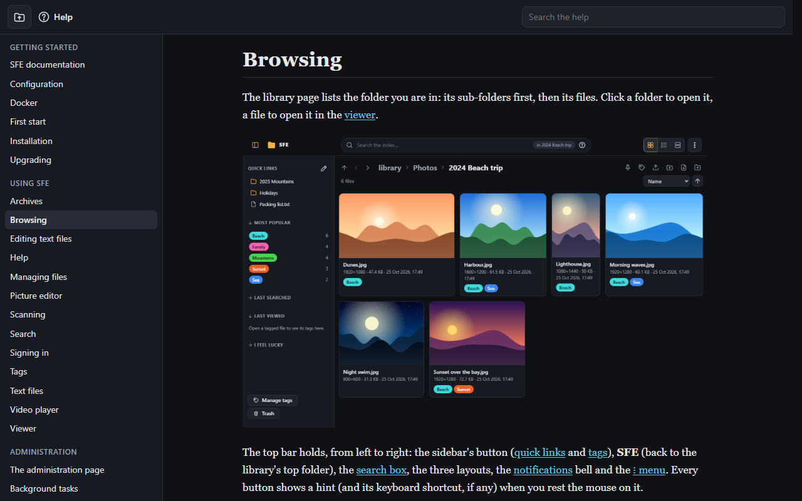
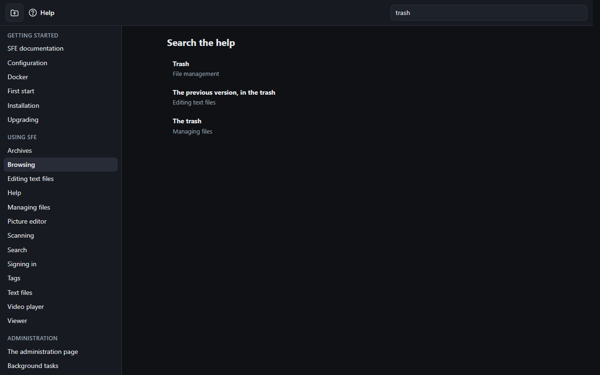
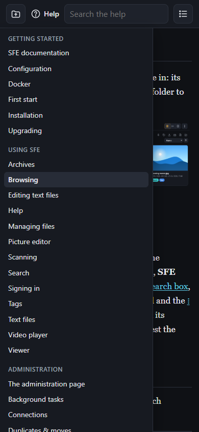

# Help

These pages come with SFE: **Help** in the [⋮ menu](signing-in.md#the--menu) opens them in a new tab, so the page you
were on stays as it was. They are the same on every install, whatever its version, and work without the internet.

- The **contents** on the left list every page by part: Getting started, Using SFE, Administration, Reference. On a
  phone, the list button at the top right shows them.
- Links between pages stay in the help; a link with Ctrl (⌘ on a Mac) or the middle button opens in a new tab.
- The arrow at the top left opens your files; **Help** next to it, the first page of the help.
- The pages read with your [reading settings](text-files.md#reading-settings) for prose (font, size, width), in
  the app's colours.

## Searching the help

Type in **Search the help** at the top: the page titles and headings holding every word you typed are listed, page
titles first, as you type. Parts of words count (`scan` finds **Scanning** too), and words are found without their
accents. Click a result to open the page at that heading; Escape clears the search.

## On a phone

## Help from other pages

- Each page of the [administration](../administration/README.md) has a **?** after its title: it opens the part of
  the help about that page.
- The [setup page](../first-start.md#the-setup-page) links to the help about the first start.

Anyone using SFE may read the help: a signed-in account, a visitor of a space open to visitors, and anyone before the
first administrator is created. A visitor of a server not open to visitors is asked to sign in first.
