# Managing files

You can create folders and empty files, rename, move, copy and delete files and folders from the listing, if your
groups have the rights `files.createFolders`, `files.createFiles`, `files.rename`, `files.move`, `files.copy`,
`files.upload`, `files.delete` (to the trash) and `files.deletePermanently` ([Rights](../reference/rights.md)). No group has them until an administrator gives them.
Folder access rules also apply: in a read-only folder these actions are not offered, and in a folder you can't see
they don't exist.

Downloading several files or a whole folder as one zip file needs only the right to download (`files.download`),
which members have ([below](#download-several-files-or-a-folder)).

## The item menu

Right-click a file or folder for its menu, or use its **⋮** button (it shows when the pointer is over the item, and
always on phones and tablets). With the keyboard, press the **menu key** (or **Shift+F10**) on the item that has the
focus. On a phone the menu opens at the bottom of the screen, under the item's name, and pressing and holding an item
**selects** it instead ([On phones](#on-phones)). The menu offers what you may do with that item:

| Entry | Key | |
|---|---|---|
| **Open** | | A folder: lists it; a file: shows it in the viewer |
| **Open in new tab** | | The folder, or the file (its viewer page for text and documents), in a tab of its own |
| **Open containing folder** | | In search results: lists the folder the item is in, and shows it there |
| **Edit** | | Text files: opens it in the viewer, ready to be changed ([Editing text files](editing-text.md)) |
| **Crop…** | | Pictures: opens it in the [picture editor](picture-editor.md) (right `files.edit`) |
| **Rename…** | F2 | Gives it another name; several selected: [renamed together](#rename-several-at-once) |
| **Delete…** | Delete | Moves it to the trash ([below](#delete)); with items selected, all of them |
| **Cut**, **Copy** | Ctrl+X, Ctrl+C | Keeps it (or the selection) to move or copy with **Paste** ([below](#move-and-copy)) |
| **Paste into …** | | On a folder, after Cut or Copy: puts what was kept into it |
| **Move to…**, **Copy to…** | | Moves or copies it (or the selection) into a folder you pick |
| **Download** / **Download as zip** | | Saves the file to your device; a folder, or several items selected, as one zip ([below](#download-several-files-or-a-folder)) |
| **Tags…** / **Tag its files…** | | The tags of a file; adding tags to every file of a folder ([Tags](tags.md)) |
| **Add to quick links** / **Remove from quick links** | | Keeps it in your [quick links](browsing.md#quick-links), in the sidebar |
| **Copy full path** | | Where it is on the server, when [copying paths](browsing.md#copying-full-paths) is on |
| **Properties** | Alt+Enter | Its size, dates and what SFE knows of it; a folder's size; a file's checksum ([below](#properties)) |

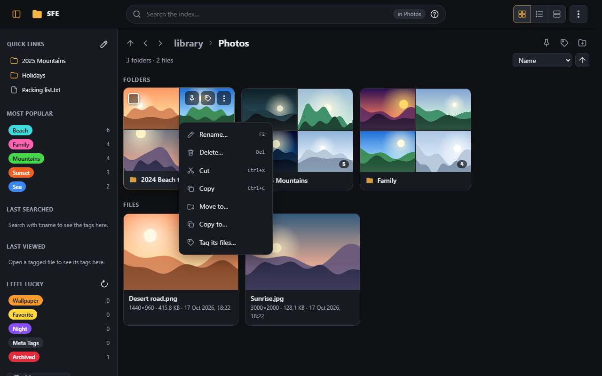

Arrow keys move through the menu and Esc closes it. With several items selected, the menu of one of them acts on all
of them (and has no Open entries). Everyone who may browse has the menu, with **Properties** at least.

### Other menus

Right-clicking elsewhere on the page also opens SFE's menu, for what is under the pointer:

- **The page itself** (an empty part of the listing, the counts, the buttons): the folder you are viewing. New
  folder, New file, Upload, Paste, Select all, Refresh, its tags, quick link, Open in new tab, Properties… In a search:
  Select all, Tag the results, Search again, Open in new tab and Copy link.
- **A folder's name in the path** at the top, the **up / previous / next** buttons, and the folder shown under a
  search result: Open, Open in new tab, Paste into, quick link, Copy full path, Properties.
- **A quick link** in the sidebar: the same for its folder or file, then Move up, Move down and Remove.
- **A recent search** suggested by the search box: Search, Open in new tab, Remove from the history.
- **Any other link** of the app (in the ⋮ menu, in the administration): Open, Open in new tab, Copy link address.
- **The administration page** elsewhere: Back, Reload, Open in new tab, Copy page link.

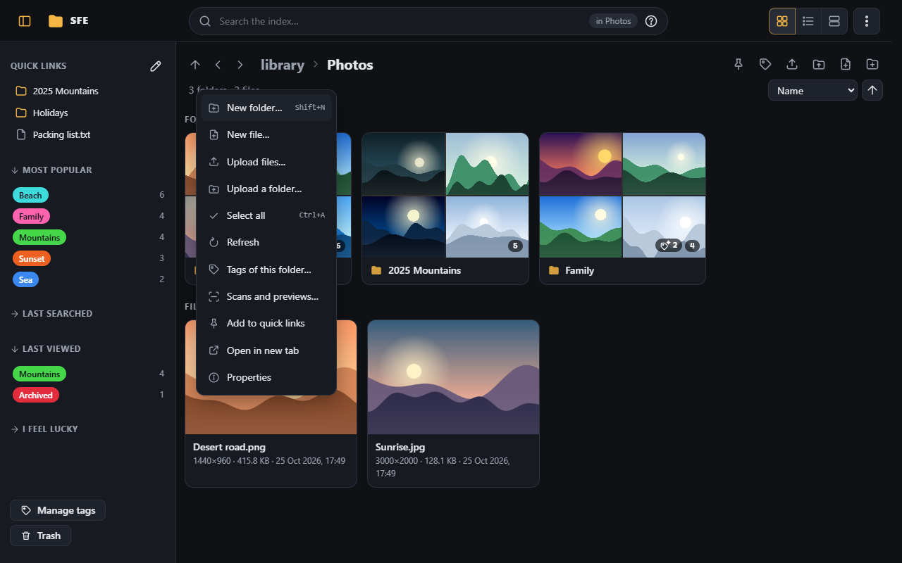

In text boxes, and on text you have selected, a right click still gives the browser's own menu (to paste, or copy
the text). Hold **Shift** while you right-click to get the browser's own menu anywhere.

In windows over the page (properties, the picture editor, the viewer's bar) a right click opens no menu, except on a
link. Documents in the viewer (text, PDF, books, tables…) keep their own right click.

## New folder

The **New folder** button next to the folder's name (or **Shift+N**) asks for the name of a folder to create in the
folder you are viewing. In a search there is no New folder button.

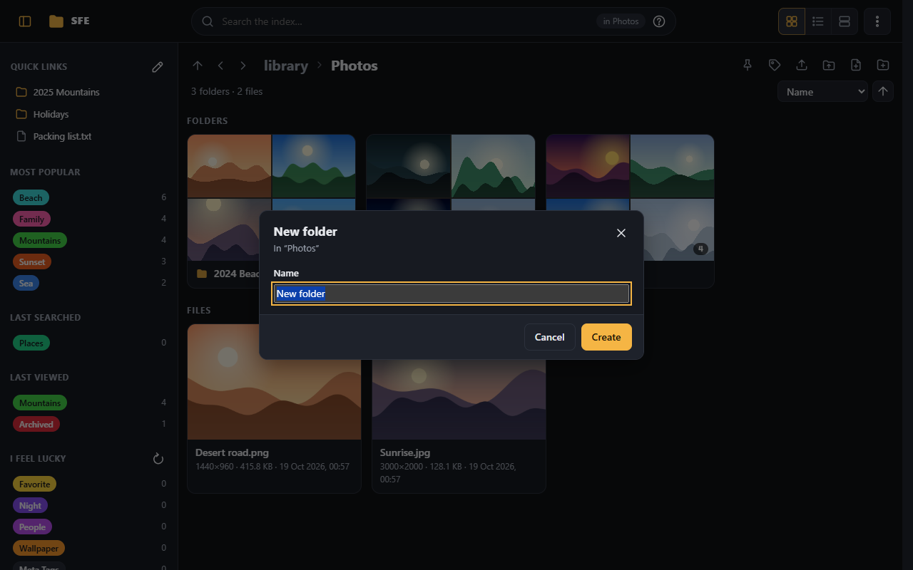

## New file

The **New file** button next to it asks for the name of an **empty** file to create there (`New file.txt` to start
with; the name is selected up to its extension). It needs the right `files.createFiles`. A text file (`.txt`, `.md`,
`.json`…) then opens in the viewer, ready to be written: see [Editing text files](editing-text.md).

## Rename

**Rename…** in the item menu, or **F2** with one file selected (or the item focused with the keyboard), asks for the new
name. The name is selected up to its extension, so typing replaces the name but keeps `.jpg`. The item keeps its place
in the listing until you reload it, and is highlighted for a moment.

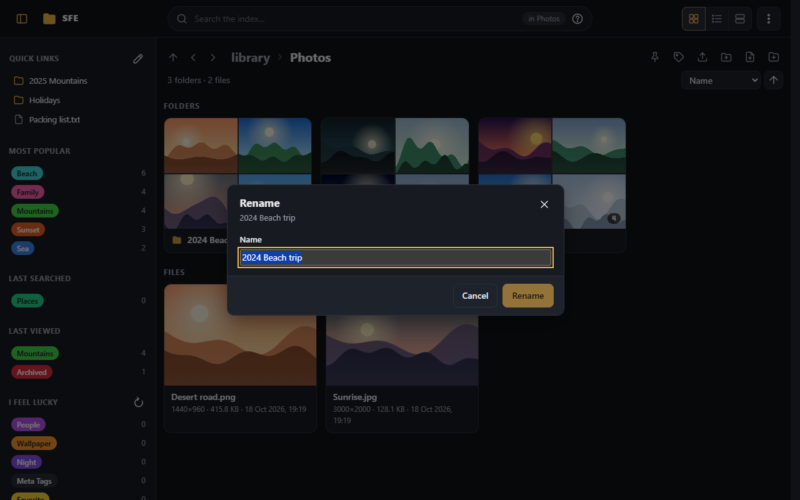

What SFE knows about a file or folder goes with it to the new name: its tags, thumbnails and trickplay, and for a
folder, its folder access rules, quick links, scheduled scans and the settings that name it (excluded folders, trickplay
folders, the folder for edited pictures).

On Windows servers you can change only the case of a name (`photo.jpg` to `Photo.jpg`).

A message in the corner offers **Undo** for a few seconds, which gives the item its old name back (unless something
took that name meanwhile).

## Rename several at once

With several files or folders of one folder selected, **Rename** in the selection bar (or **Rename…** in the menu, or
**F2**) renames them together:

- **Find and replace**: a text in their names replaced by another (**Match case** to tell `IMG` from `img`);
- **Numbered**: a new name for each, `#` standing for the number (`Beach trip ##` gives `Beach trip 01`,
  `Beach trip 02`…), counting from the number you choose, in the listing's order.

Extensions stay. The preview shows every new name before anything changes; names that can't be given are shown in red
and left out: empty, holding `/`, given to two items, already taken by another item of the folder, or the current name
of another item renamed (rename in two steps then). **Undo**, in the message afterwards, gives them all their names back.

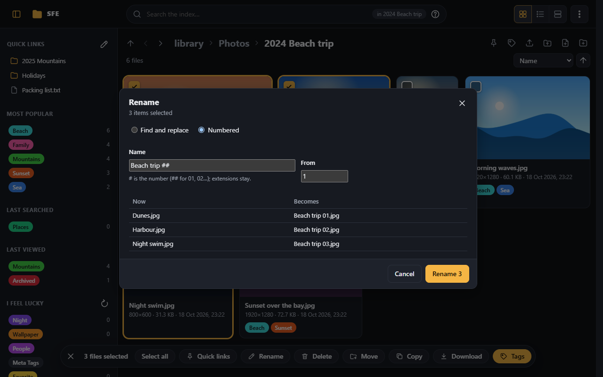

## Delete

**Delete…** in the item menu, **Delete** in the selection bar, or the <kbd>Delete</kbd> key (for the selection, or the
item with the focus) asks first, naming what goes and its size, then moves it to the space's **trash**. A message in
the corner offers **Undo** for a few seconds, which puts everything back.

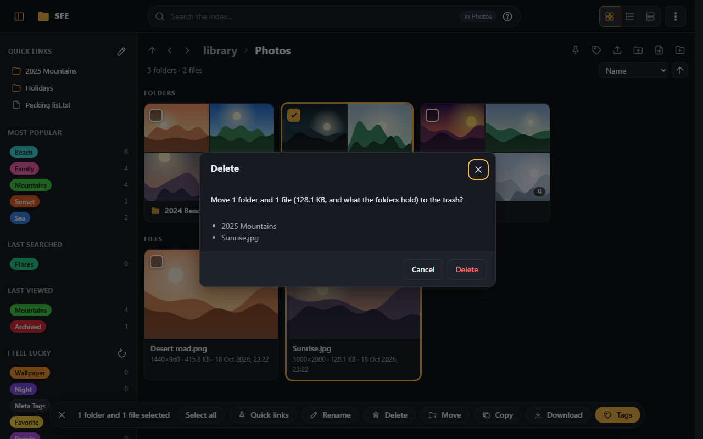

<kbd>Shift</kbd>+<kbd>Delete</kbd> deletes for good, skipping the trash, for those with the right
`files.deletePermanently`. A space can also **always delete permanently**
([File management](../administration/file-management.md)): then every delete is for good, and only those with that
right can delete.

- A folder goes with everything in it; you can delete a folder only if you may delete everywhere inside it.
- A link (a shortcut or junction to another folder) is deleted as a link: what it leads to stays.
- A folder holding links that sits on another drive than the trash can't go to the trash: SFE says so and offers to
  delete it permanently instead.

## The trash

**Administration › File management › Trash**, also opened by **Trash** at the bottom of the library's sidebar (its icon
shows whether the trash is empty, and a number how many items you see in it), lists what was deleted to the trash: what
you deleted, and what was deleted in folders where you may delete. **Restore** puts an item back where it was, with the
tags of its files and a folder's access rules (its folder is made again if it is gone; a number is added to its name if
that is taken there); a restored folder is scanned again. **Delete** and **Empty the trash** delete for good (right
`files.deletePermanently`).

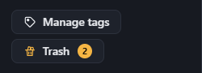

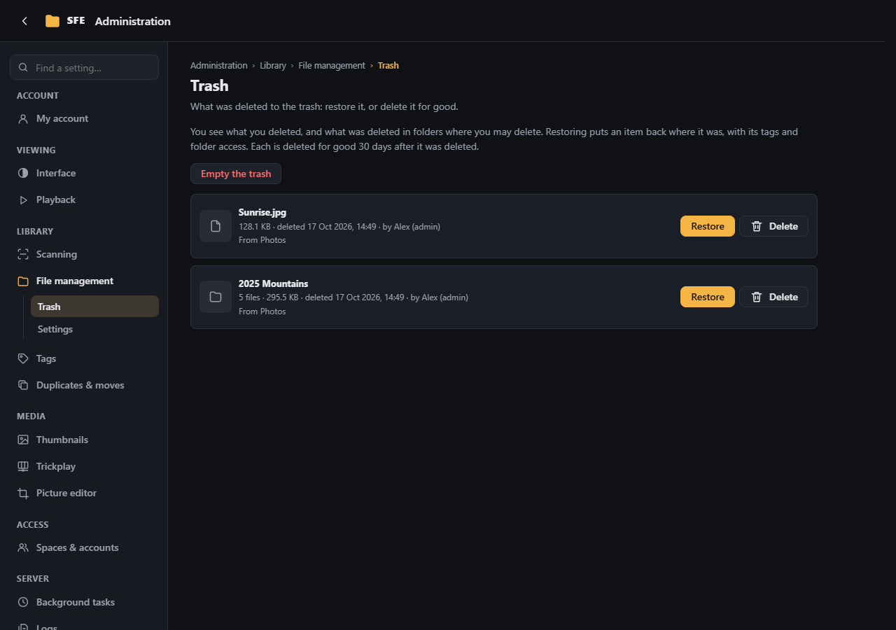

What stays in the trash longer than the space's **Days in the trash** (30 by default) is deleted for good by the
**Trash purge** task ([Background tasks](../administration/background-tasks.md)).

## Move and copy

There are several ways to move or copy files and folders, as in a file browser on your computer:

- **Move to…** or **Copy to…** in the item menu, or **Move** or **Copy** in the selection bar, opens a folder picker:
  click through the folders (the names at the top go back up), then **Move here** or **Copy here**. Folders where you
  may not move or copy are refused, and a folder can't go into itself.
- **Cut** (Ctrl+X) or **Copy** (Ctrl+C) keeps the selection, or the item with the keyboard focus; open the folder
  they should go to and press **Ctrl+V**, or use **Paste here** in the panel at the bottom right, or **Paste into …**
  in a folder's menu. Cut items look faded until they are pasted. What was copied can be pasted again elsewhere.
- **Drag** files and folders (all the selected ones when you drag one of them) onto a folder of the listing, or onto a
  folder of the location bar above it: they are moved there. Hold **Ctrl** when you drop them to copy them instead.

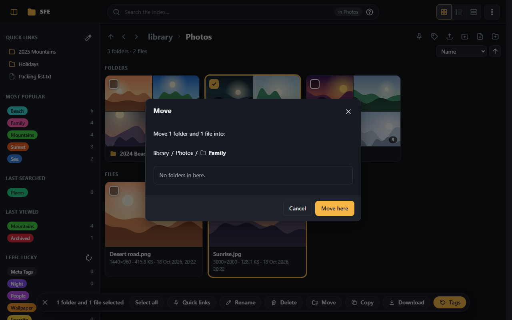

Moves and copies run on the server in the background: you can go on browsing. A panel at the bottom right shows each
one with its progress; **Cancel** stops it (what is done stays, nothing half copied does). When it is over, the panel
says what was done and what was not, and why; close it with ×. A right click on it gives the same (Cancel, or Close)
and opens the folder it puts things into, also in a new tab. After a move, a message offers **Undo** for a few
seconds: the items go back into the folders they came from.

When the folder already holds an item with the same name, the panel asks, showing the size and date of both:
**Replace** (the one there goes to the trash: you need the right to delete there), **Skip** (leave this one out) or
**Keep both** (a number is added to the new one's name). Tick **The same for the next ones** to answer once for the
rest. A copy into the folder it is in always keeps both.

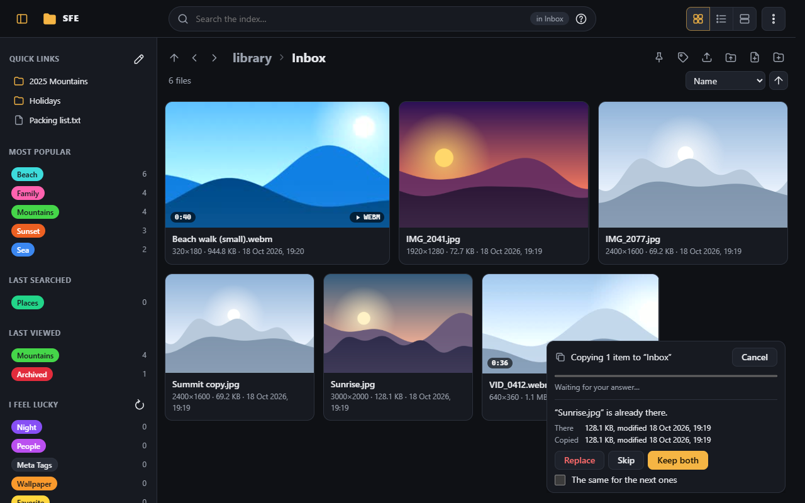

**Moving** keeps what SFE knows about the files and folders, as a [rename](#rename) does: tags, thumbnails and
trickplay, a folder's access rules, quick links, scheduled scans and settings naming it. A folder takes along the
access it has in its own rules; what it got from the folder it was in changes to what the new place gives. When more
people would see or change a folder in its new place, SFE says who, and offers to **Keep the access they have now**
(rules on the moved folder keep it as before). You can move a folder only if you may move everywhere inside it.

**Copying**:

- **Copy their tags too** (asked each time) gives the copies the tags of the files they come from.
- Copies are added to the index at once (a copied folder is scanned), with the thumbnails and trickplay of their
  originals.
- Only what you may see is copied: sub-folders you can't see or open are left out, and the panel says which.
- Links (shortcuts or junctions to other folders) inside a copied folder are left out too: SFE never copies what they
  lead to.
- A read-only folder's files can be copied elsewhere.
- A copy is refused when it would leave less free space on the drive than the space's
  [Free space kept by copies](../administration/file-management.md#settings) (1 GB by default).

## Compress into a zip

With the right to compress (`files.compress`, which no group has until an administrator gives it), files and folders
can be put in a zip saved in the library: **Compress…** in the selection bar, or in a file's or folder's menu. The zip
goes into the folder listed (in search results, the folder of the first item); **Another folder…** picks another one
by clicking through the library. The dialog says how much will be read, from the index (folders never scanned are
named, not counted).

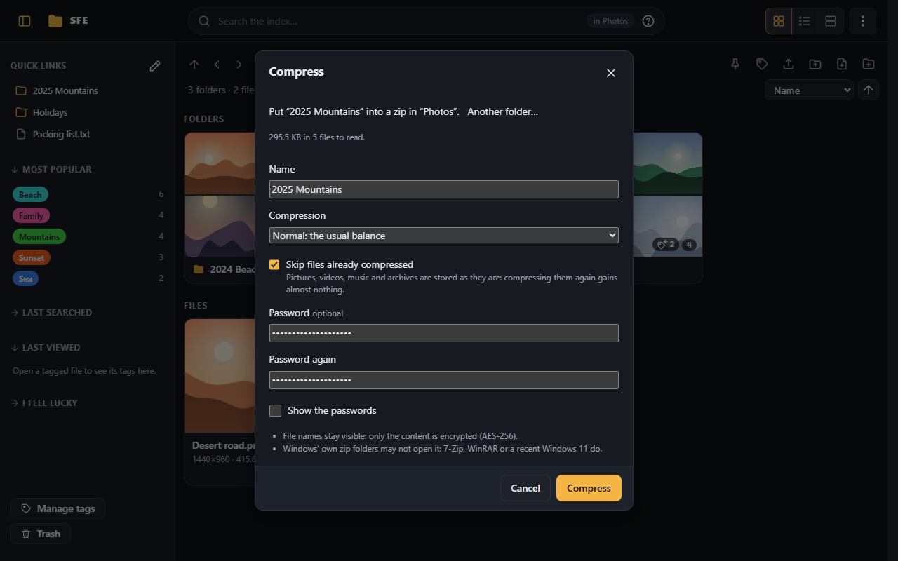

- **Name**: the only item's name, or the folder's; `.zip` is added.
- **Compression**: **Store** (no compression: the fastest), **Fastest**, **Normal** (the default) or **Maximum** (the
  smallest, several times slower).
- **Skip files already compressed** (ticked by default): pictures, videos, music and archives are stored as they are,
  since compressing them again gains almost nothing.
- **Password** (typed twice): the files' content is encrypted with AES-256. Their **names stay visible** to anyone with
  the zip. 7-Zip, WinRAR and recent Windows 11 open such zips; older Windows zip folders don't. 7-Zip takes only
  passwords made of A–Z, digits and common signs.

The zip is made on the server in the background, one at a time for the whole server, in the panel at the bottom
right: its progress and the time left, **Cancel** (nothing half made stays), then the ratio achieved ("12 MB → 4 MB (33 %)"); **Show**
in the message shows it in its folder. When a zip of that name is already there, the panel asks (Replace, Skip, Keep
both). What it holds is what you could download: folders you can't see are left out, links and folders you may not
download are named in a file `SFE - left out.txt` inside the zip. A zip is refused when the drive would keep less than
the space's [Free space kept by copies](../administration/file-management.md#settings).

Downloading several items as a zip ([below](#download-several-files-or-a-folder)) doesn't change: it saves the zip on
your device, not in the library.

## Extract an archive

**Extract to “name”** and **Extract…** in a zip, 7z, rar or tar archive's menu write its files into the library, in
the background; see [Archives](archives.md#extracting).

## Upload

Files and folders from your computer go into the folder you are viewing:

- **Upload files** (the arrow next to the folder's name) picks files; **Upload a folder** picks a folder, uploaded with
  everything in it (its sub-folders are made as they come).
- Or **drop** files and folders from your computer onto the page: they go into the folder listed, or into a folder of
  the listing (or of the location bar) when you drop them on it.

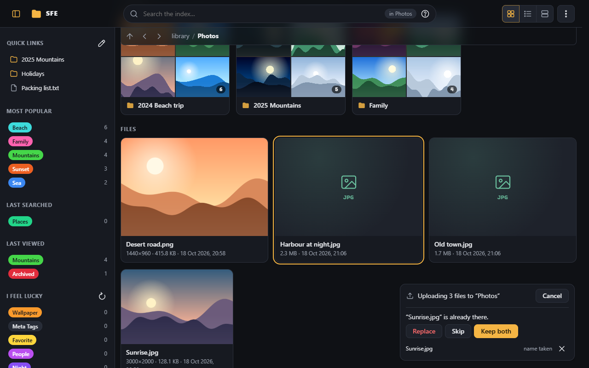

Before sending anything, SFE checks the names. When some are already taken there, the panel asks for each:
**Replace** (the file there goes to the trash: you need the right to delete there), **Skip**, or **Keep both** (a
number is added to the new name); tick **The same for the other names taken** to answer once.

The panel at the bottom right shows each upload with its progress and speed. Files are sent in pieces, two files at a
time: **Pause** and **Resume** stop and go on, a piece that fails is sent again by itself, **Retry** goes on with a
file that failed, and **Cancel** stops (what was sent of an unfinished file is removed); a right click on an upload
has them too, and the folder it goes into (also in a new tab). The browser warns you before
you leave the page while files are being sent.

**Interrupted uploads go on:** if the page is reloaded or closed, or the connection drops, the panel lists the
unfinished files when you come back. Pick or drop the same files into the same folder again: they go on where they
stopped. What was sent is kept on the server for the space's **Keep unfinished uploads for** (48 hours by default)
after the last piece arrived.

An uploaded file keeps its date from your computer and is added to the index at once.

- A space can set the **largest file** one may upload (no limit by default); larger files are left out before sending.
- An upload is refused when it would leave less free space on the drive than the space's **Free space kept by copies
  and uploads** (1 GB by default).
- Behind a reverse proxy, SFE sends smaller pieces by itself when the proxy refuses large requests
  ([Installation](../installation.md#reaching-it-from-outside-https-and-a-reverse-proxy)).

## Seeing changes made elsewhere

When someone else (or you, in another tab) creates, renames, moves, copies, uploads or deletes something through SFE,
the folder you are viewing is listed again by itself a moment later: what was added shows, what went away goes,
without losing your place or what you selected. Changes made to the disk outside SFE show when you open the folder
again.

## On phones

- **Press and hold** a file or folder to select it (as phone file managers do); press and hold others, or tick their
  boxes, to add them, then use the selection bar.
- The **⋮** button of each item opens its menu, as a sheet at the bottom of the screen.

  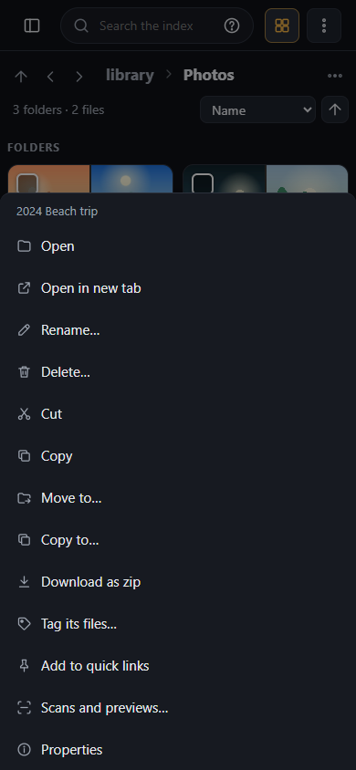

- Items are not dragged with a finger: use **Move to…** and **Copy to…** in the menu or the selection bar.

## Download several files or a folder

Select the files and folders, then **Download** in the selection bar (or **Download as zip** in the menu of one of
them): your browser downloads one zip file holding them, folders with everything in them. One file alone is
downloaded as it is.

- The zip is made while it downloads: it starts at once whatever its size, and the browser shows how much has come
  (not how much is left: the size isn't known in advance). Stopping the download in the browser stops it on the server.
- It is named after the folder downloaded, or the folder the items are in.
- Photos, videos, music and other files already compressed are put in the zip as they are (compressing them would only
  take time); text files are compressed.
- Hidden files are included. Folders you can't see are left out without a word; links (shortcuts to other folders),
  files that couldn't be read and folders you may not download are left out too, and listed in a file
  **SFE - left out.txt** inside the zip.
- Each person downloads at most two zips at once.
- A space can set the **largest zip** ([File management](../administration/file-management.md#settings)): a larger
  one is refused before it starts.

## Properties

**Properties** in the item menu, or **Alt+Enter** on the item with the focus (or the one selected), shows:

- its name, kind, the folder it is in, its size (exact, in bytes), when it was modified, created and last opened (as
  far as the server's disk keeps it), and whether it is hidden, read-only or a link to another place;
- what the index knows: a picture's or video's resolution, a video's or song's length, its tags, or that no scan has
  indexed it yet.

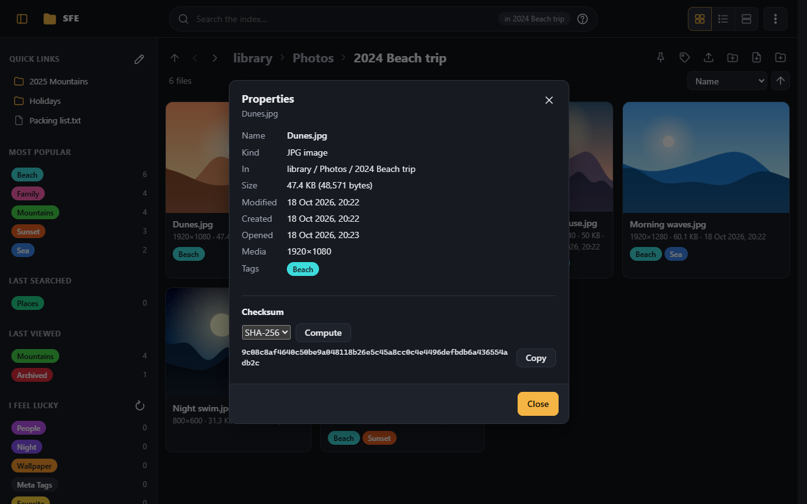

**A folder** shows what it holds as the index knows it (as of the last scan) at once. **Count on disk** goes through
the folder on the server for the exact count now, with its progress; **Stop**, or closing the sheet, stops it. Folders
you can't see are never counted; links to other places are not followed (the count says how many were left out). A
count stops at two million files and folders ("more than").

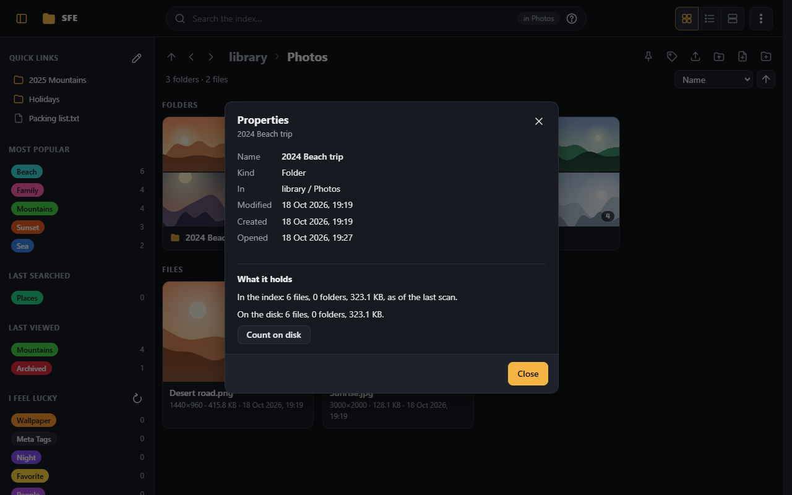

**A file's checksum** (SHA-256, SHA-1 or MD5), to compare it with one published elsewhere: pick the algorithm, then
**Compute**. The server reads the whole file, with its progress; **Copy** puts the result on the clipboard. Only those
who may download the file can compute it, one file at a time.

## Names that can't be used

SFE refuses a name, and says why, when it:

- is already used by a file or folder in that place (even one you can't see): nothing is ever replaced;
- contains `/`, or is `.` or `..`;
- contains a character Windows refuses (`< > : " \ | ? *`), ends with a dot or a space, or is a device name such as
  `CON`, `NUL`, `COM1`. A Linux server accepts these when the space's setting
  [Only names Windows accepts](../administration/file-management.md) is off;
- is longer than 255 characters (255 bytes on Linux), or would make the full paths of files inside a folder too long
  for the index;
- is `.sfe` at the library's root, which SFE keeps for its own work files.

A name starting with a dot (`.config`) is a hidden item: the listing shows it only when hidden items are shown
([Scanning › What to scan](../administration/scanning.md#what-to-scan)).

## When it can't be done

- **A scan is running** over that folder: try again when the scan has finished.
- **The drive is (nearly) full**: copies and uploads keep the free space the space asks for.
- **The file is in use**: another program has it open, or a video is playing. Close it and try again.
- **The server's account may not change files there**: the server was installed with read-only access to the library
  ([Installation](../installation.md) says how to give it write access).
- **Folder access rules are set for a folder of that name** (rules left from a folder that was deleted or moved outside
  SFE): an administrator can remove them or point them elsewhere in
  [Folder access](../administration/spaces-and-accounts.md#folder-access).
- A folder can be renamed only by someone who may rename **everywhere inside it**: a sub-folder you can't see, or that
  is read-only for you, keeps you from renaming the folder holding it.
