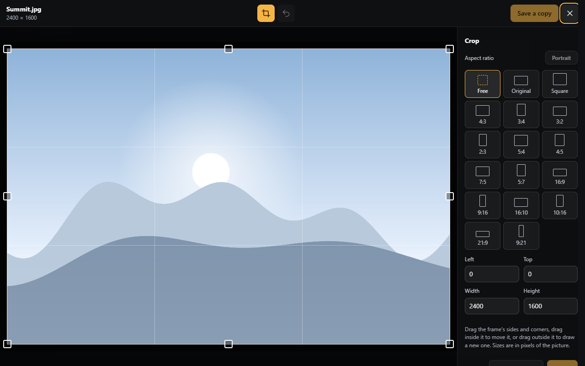
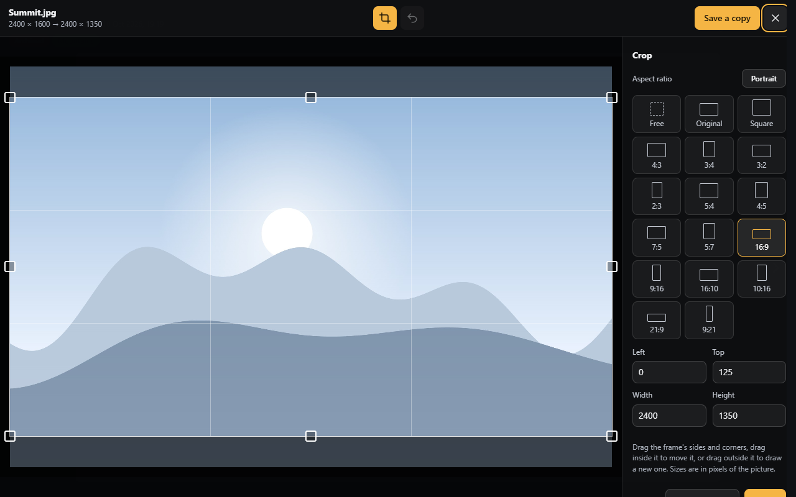

# Picture editor

**Crop…** in the viewer's **⋮** menu (or the E key), or in a picture's [item menu](managing-files.md#the-item-menu) (right
click), opens a picture in the editor, for accounts with the right `files.edit`. The original is never changed: the result is saved as a new file.

## Cropping

**Crop** is the editor's first tool:

- drag the frame's sides and corners, drag inside it to move it, drag outside it to draw a new one, or type its
  position and size in pixels (Left, Top, Width, Height);
- the **Aspect ratio** buttons keep the frame to a shape: Free, Original (the picture's own), Square (1:1), 4:3, 3:2,
  5:4, 7:5, 16:9, 16:10 and 21:9, each also in portrait (3:4, 2:3, 4:5, 5:7, 9:16, 10:16, 9:21). Picking one gives the
  largest frame of that shape around the current frame's centre;
- the **Portrait** / **Landscape** button (or X) turns the chosen ratio the other way round.

| Button | Key | |
|---|---|---|
| **Apply** | Enter | Crops and lets you go on |
| **Undo** | Ctrl+Z | Takes the last edit back |
| **Save a copy** | Ctrl+S | Saves the result as a new file |
| × | Esc | Closes the editor |

The heading shows the picture's size before and after (`2400 × 1600 → 2400 × 1350`).

## Where the copy goes

The result is saved in the folder for edited pictures under the original's own folders
(`Photos/2024/beach.jpg` becomes `Edited/Photos/2024/beach.jpg`), with ` (2)`, ` (3)`... added when that name is
taken. The folder is set in [Picture editor](../administration/picture-editor.md) (default `Edited`); when it is
empty, edited pictures go next to their originals as `beach (edited).jpg`. Pictures already in that folder are saved
next to themselves. The new file is added to the index at once, so search finds it straight away.

## Good to know

- The browser does the editing: JPEG, PNG and WebP pictures keep their format (JPEG and WebP at the configured
  quality, 92 by default), other formats are saved as PNG.
- The saved picture keeps no metadata of the original (EXIF date, camera, location); a photo's orientation is applied
  to its pixels.
- A browser can only edit pictures it can show, and phones may refuse very large ones.
- Saves are limited to 200 MB; behind IIS, its own request limit (30 MB by default) applies first.
