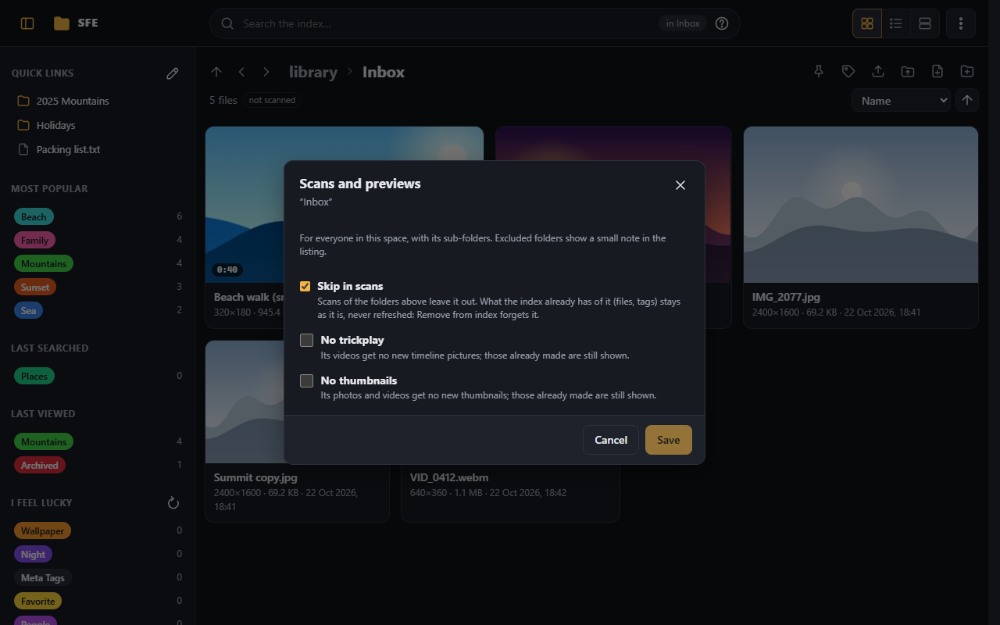
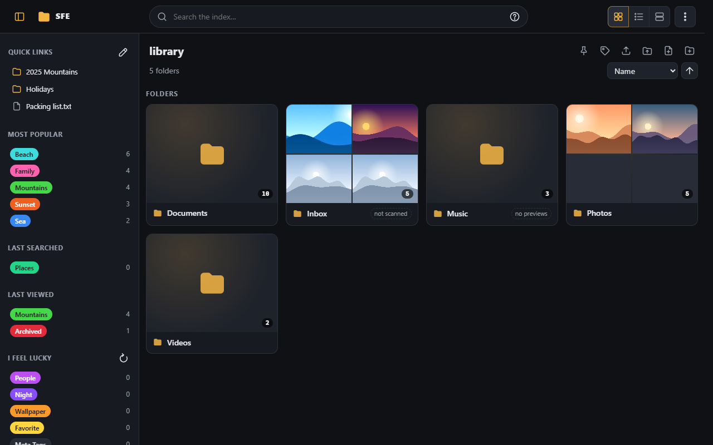

# Scanning

SFE browses folders straight from the disk, but search, tags, duplicates and similar videos work from the **index**,
a database of the library's files. A **scan** brings the index up to date with the disk.

## Scan this folder

**Scan this folder** in the [⋮ menu](signing-in.md#the--menu) (right `index.scan`) indexes the folder you are in and its
sub-folders in the background. A panel under the top bar shows its progress while it runs, then what it did:

A scan:

- adds new files, updates changed ones and removes deleted ones;
- reads each new or changed file's fingerprint (for [duplicates](../administration/duplicates-and-moves.md)) and its
  resolution and duration (for [display](browsing.md#resolutions-durations-and-hrlr-marks) and search);
- gives tagged files that were moved back their tags ([Moved files](../administration/duplicates-and-moves.md#moved-files)).

Folders and files skipped by scans, and what scans read, are set in
[Administration › Scanning](../administration/scanning.md). Scans can also run at set times
([Background tasks › Schedules](../administration/background-tasks.md#schedules)).

## Excluded folders

An administrator (right `index.exclude`) can keep folders out of scans, trickplay or thumbnails, each on its own, for
the whole space: **Scans and previews…** in a folder's menu (right click, or its ⋮ button), or in the ⋮ menu for the
folder you are in.

- **Skip in scans**: scans of the folders above it leave it out, so the library can be scanned knowing these folders
  are skipped. What the index already has of it (files, tags) stays as it is and is still found by search, but is
  never refreshed; [Remove from index](#remove-from-index) forgets it. A scan of the folder itself, or of a folder
  inside it, is refused.
- **No trickplay** / **No thumbnails**: its videos and photos get no new [trickplay](../administration/trickplay.md) or
  [thumbnails](../administration/thumbnails.md); those already made are still shown.
- The choice covers the folder's sub-folders. A sub-folder excluded through a folder above it shows it checked and
  greyed: change it on that folder.

Everyone browsing sees what a folder is kept out of: a small note after its name (**not scanned**, **no thumbnails**,
**no trickplay**, **no previews** for both, **skipped** for all three), and the same next to the counts of the folder
you are in, where those with the right can click it to change it.

All excluded folders are listed, added, changed and removed in
[Administration › Scanning › Excluded folders](../administration/scanning.md#excluded-folders). The lists are also in
the settings: [Scanning › What to scan](../administration/scanning.md#what-to-scan),
[Thumbnails](../administration/thumbnails.md) and [Trickplay](../administration/trickplay.md#settings) (**Excluded
folders**).

## Remove from index

**Remove from index…** in the ⋮ menu (right `index.remove`) takes the folder being browsed and its sub-folders out of
the index. Not possible while a scan runs.

- It says first how many folders, files and tagged files that is.
- The files stay on the disk and browsing still shows them; search no longer finds them.
- Tagged files are kept with the [moved files](../administration/duplicates-and-moves.md#moved-files) (unless relinking
  is off), so scanning the folder again gives their tags back.
- **Skip this folder in future scans** (ticked by default) adds it to **Excluded folders**
  ([Scanning › What to scan](../administration/scanning.md#what-to-scan)), so a scan of a folder above it leaves it out;
  without it, the next such scan indexes it again.
