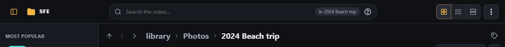
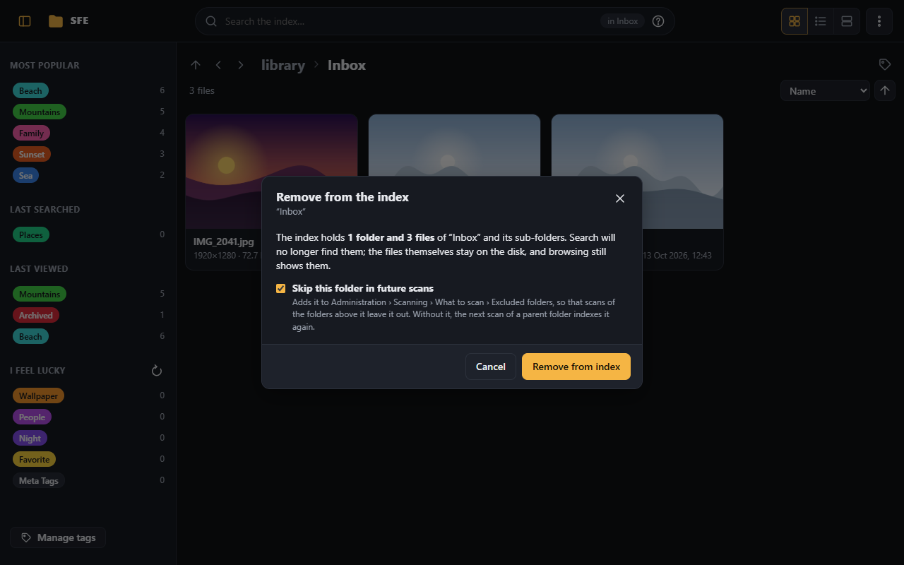

# Scanning

SFE browses folders straight from the disk, but search, tags, duplicates and similar videos work from the **index**,
a database of the library's files. A **scan** brings the index up to date with the disk.

## Scan this folder

**Scan this folder** in the [⋮ menu](signing-in.md#the--menu) (right `index.scan`) indexes the folder you are in and its
sub-folders in the background. A panel under the top bar shows its progress while it runs, then what it did:

A scan:

- adds new files, updates changed ones and removes deleted ones;
- reads each new or changed file's fingerprint (for [duplicates](../administration/duplicates-and-moves.md)) and its
  resolution and duration (for [display](browsing.md#resolutions-durations-and-hrlr-marks) and search);
- gives tagged files that were moved back their tags ([Moved files](../administration/duplicates-and-moves.md#moved-files)).

Folders and files skipped by scans, and what scans read, are set in
[Administration › Scanning](../administration/scanning.md). Scans can also run at set times
([Background tasks › Schedules](../administration/background-tasks.md#schedules)).

## Remove from index

**Remove from index…** in the ⋮ menu (right `index.remove`) takes the folder being browsed and its sub-folders out of
the index. Not possible while a scan runs.

- It says first how many folders, files and tagged files that is.
- The files stay on the disk and browsing still shows them; search no longer finds them.
- Tagged files are kept with the [moved files](../administration/duplicates-and-moves.md#moved-files) (unless relinking
  is off), so scanning the folder again gives their tags back.
- **Skip this folder in future scans** (ticked by default) adds it to **Excluded folders**
  ([Scanning › What to scan](../administration/scanning.md#what-to-scan)), so a scan of a folder above it leaves it out;
  without it, the next such scan indexes it again. Folders added to that list by hand are removed from the index by the
  next scan of their parent.
