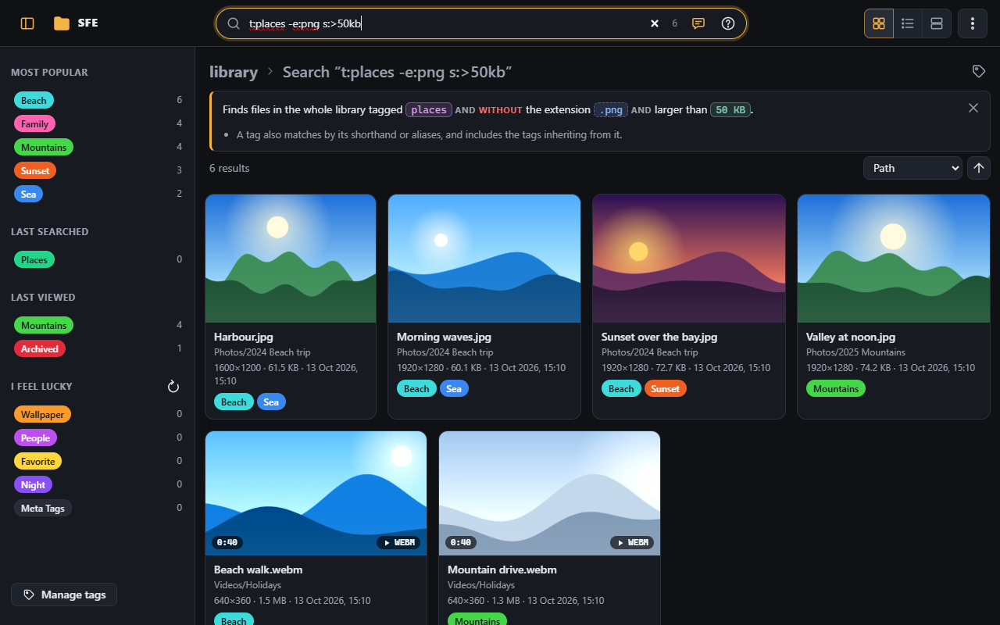
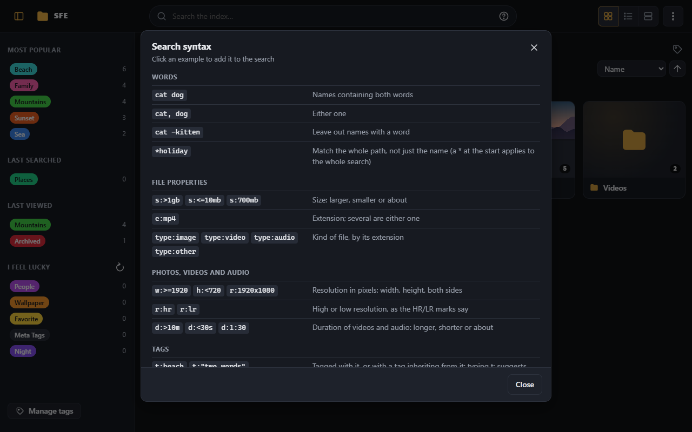
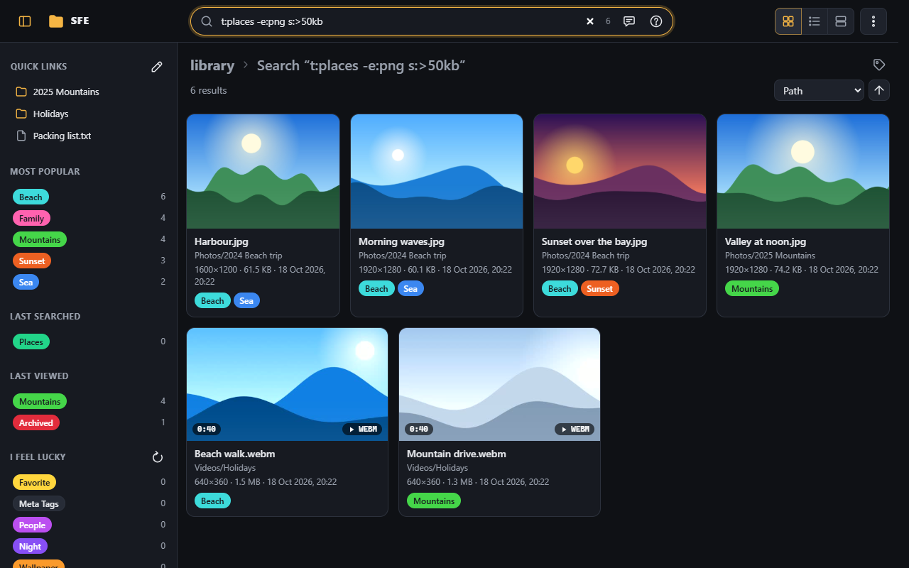
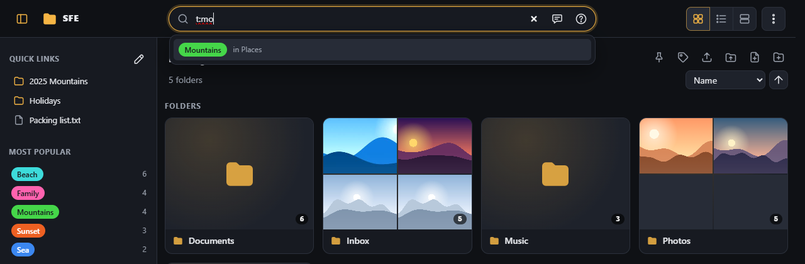
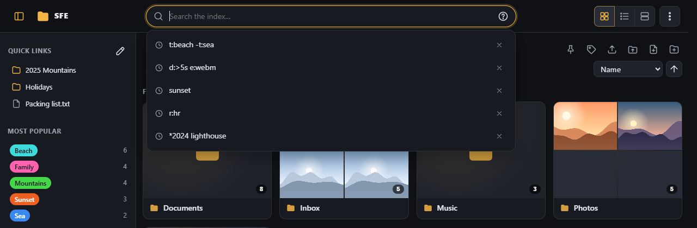

# Search

The search box in the top bar searches the **index** of the folder you are in and its sub-folders (the grey chip
`in 2024 Beach trip` at its end says where; click it to search the whole library). Results update as you type once the
query has more than 3 characters; press Enter to search shorter ones.

Search only finds indexed files: **Scan this folder** in the ⋮ menu brings the index up to date
([Scanning](scanning.md)).

## The query language

| Query | Meaning |
|---|---|
| `cat dog` | name contains both |
| `cat, dog` | either one |
| `cat -kitten` | exclude a word |
| `s:>1gb`, `s:<=10mb`, `s:700mb` | size larger / smaller / about |
| `e:mp4` | extension |
| `type:image`, `type:video`, `type:audio`, `type:other` | photos / videos / audio files / anything else |
| `w:>=1920`, `h:<720`, `r:1920x1080` | width / height / both sides, in pixels |
| `r:hr`, `r:lr` | high / low resolution, as the [HR/LR marks](browsing.md#resolutions-durations-and-hrlr-marks) say |
| `d:>10m`, `d:1:30` | videos and audio longer than 10 minutes / about a minute and a half |
| `*holiday 2020` | match the whole path instead of the file name |
| `t:beach`, `t:"science fiction"` | tagged with it, or with a tag inheriting from it |
| `special:untagged` | files without tags |
| `-t:work`, `-e:jpg` | a `-` before any term finds the files that term doesn't |

Search is case-insensitive. Every term, its units and the fine print are in the
[search syntax reference](../reference/search-syntax.md). The **?** button in the box shows a summary:

## Explanations

Not sure what a query does? The speech-bubble button in the search box (shown while it has text) puts the search into
words under the location, updated as you type: words, tags, extensions and sizes each get their own colour, AND / OR /
NOT are spelled out, and parts that are ignored or don't work as they may seem (an invalid size, `-e:mp4`, a `*` not
at the start, `clip.mp4` as a name) are pointed out. It stays open until you close it (remembered per browser). An
administrator can remove the button for everyone ([Interface › Search](../administration/interface.md#search)).

## Results

- Each result shows its folder under its name: click the folder to browse there.
- The count of matches shows in small grey numbers at the end of the box (`10,000+` beyond 10,000); hover it for the
  words. It disappears while you change the query, until the new results are in.
- Results are grouped by folder (sort **Path**) unless you pick another sort: name, date modified, size, type,
  **Duration** or **Resolution** (width × height, the number of pixels), in either direction. Name and type sorts use
  the database order, not the natural number order used when browsing.
- Sorted by duration or resolution, the files whose value is known come first, in the order you chose (shortest or
  longest first, smallest or largest first), then every other file (photos for a duration, documents, files a scan
  hasn't read yet) by path. These two sorts, like Path, are only offered for searches: a folder lists its files from
  disk, where durations and resolutions are not known. To sort the videos of a folder (and of its sub-folders) by
  length, search `type:video` in it.
- Pressing Enter on the search already shown keeps the results and your place.
- Files with a hidden tag, like **Archived**, only show up when the search names that tag (or a parent of it).
- The [tag button next to the location](tags.md#a-whole-folder-or-every-search-result) tags every result at once.

## Tag suggestions

While you type a `t:` term the box suggests matching tags (by name, shorthand or alias), with their parent. Pick one
with the mouse or the arrow keys and Enter.

## Search history

The search box remembers your last searches and suggests them again, like a web search engine: all of them, newest
first, when you click into the empty box, then those starting with what you type, followed by those containing it. The
characters you typed show in bold in each suggestion.

- Pick one with the mouse or the arrow keys and Enter (Enter alone still searches what you typed); the × next to a
  suggestion forgets it.
- A search is remembered when you press Enter, pick a suggestion, or leave the box on its results.
- Each browser keeps its own searches, so other devices and visitors don't see them.
- How many are kept (10 by default, 0 = off) and **Clear search history** are in
  [Interface › Search](../administration/interface.md#search).
