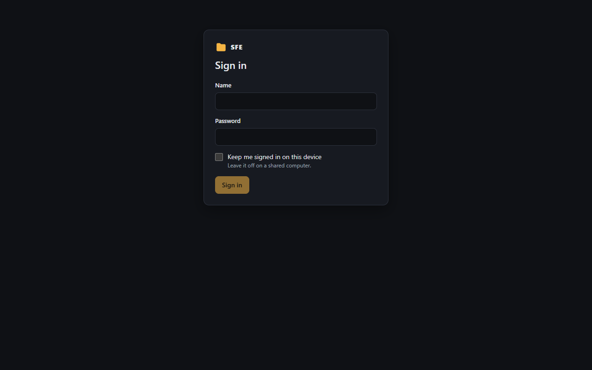
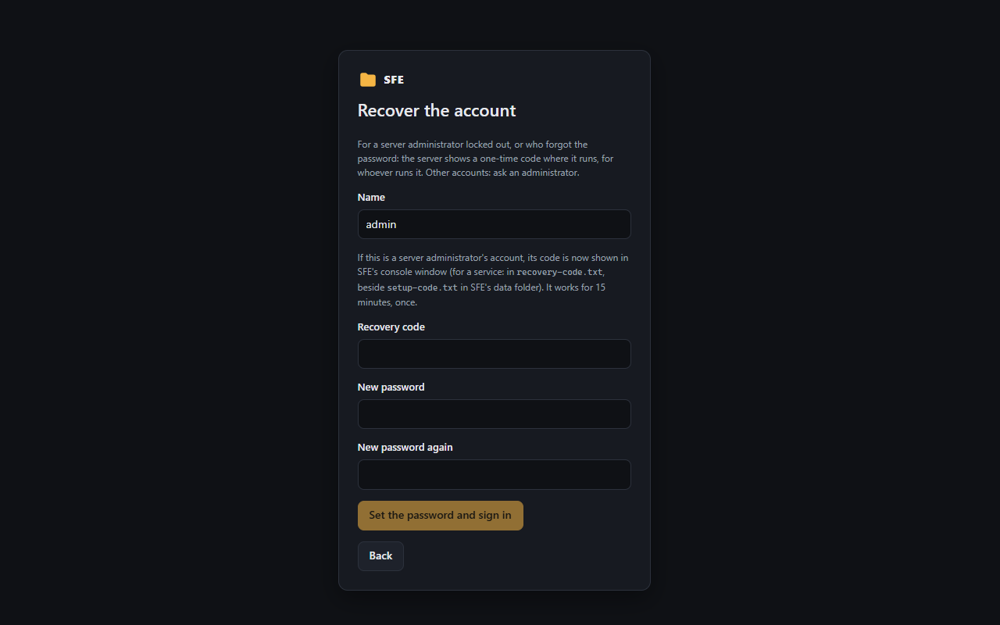
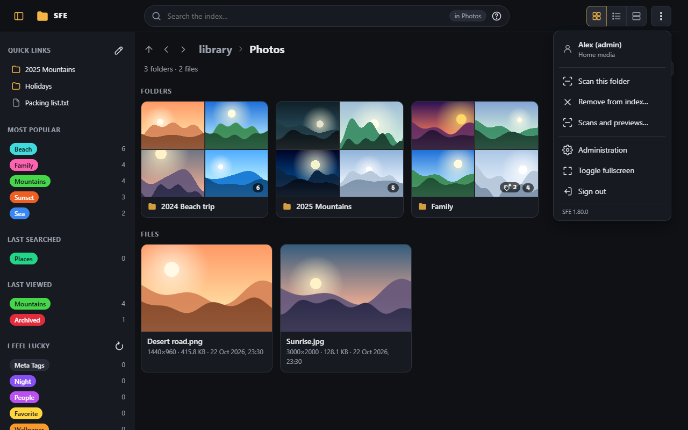
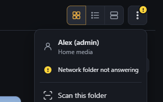
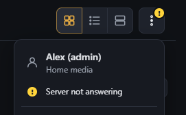

# Signing in

Everyone signs in, or browses as a visitor where a space allows it. Each account only gets the
[rights](../reference/rights.md) its groups give it: what you may not do is hidden.

## The sign-in page

Enter your name and password (names ignore case).

- **Keep me signed in on this device** keeps the session for 30 days without use (`Sfe:Security:SessionDays`); otherwise it ends with
  the browser.
- Five wrong passwords in a row to an account from one address make that address wait 15 minutes before trying that
  account again; you can still sign in from elsewhere. Each address may try 10 times a minute. The account itself is
  locked only after 50 wrong passwords from all addresses together.
- A new password, a disabled account or a deleted one ends its sessions at once, on every device.
- When a space lets visitors in without an account, the page offers a button to browse it without signing in.

### Locked out, or forgot the password

**Recover the account** under the form is for server administrators: SFE shows a one-time code where it runs (its
console window, or `recovery-code.txt` in its data folder for a service), and that code with a new password unlocks the
account and signs you in; your other sessions end. Other accounts: ask an administrator to unlock them or set a new
password. Details: [First start](../first-start.md#locked-out-or-lost-administrator-password).

## The ⋮ menu

The ⋮ button at the top right holds:

- who is signed in, and the space you are in: click your name to open **My account** (your preferences and password);
- **Scan this folder** and **Remove from index…** ([Scanning](scanning.md));
- your other spaces, if you have several: picking one switches to it (and reloads the page);
- **Administration** ([the administration page](../administration/README.md)): settings, tags, duplicates, accounts,
  tasks, and **My account** (your preferences and password);
- **Toggle fullscreen**, which shows the page full screen or leaves it;
- **Sign out** (or **Sign in** for a visitor);
- the version of SFE, at the bottom.

Each entry shows only with its right.

### The network folder indicator

While [keep alive](../administration/keep-alive.md) pings the library folder of the space, a mark on the ⋮ button
says how it goes, and a line at the top of the menu says it in words:

- a small **green dot**: the network folder answers (**Network folder answering**);
- a yellow **!**: it didn't answer the last ping (**Network folder not answering**); files may not open until the
  connection comes back.

There is no mark while keep alive is off. With the right `settings.keepAlive`, the line opens
**Administration › Keep alive**, which says which folder and why. The mark changes by itself, without reloading.

### When the server doesn't answer

When the connection to the server is lost (the server stopped, or the network is down), the ⋮ button shows a yellow
**!** after about ten seconds, for everyone, and the menu says **Server not answering**. Meanwhile changes made
elsewhere don't show and actions may fail. The mark goes away by itself once the server answers again, and the folder
you are viewing is read again.
