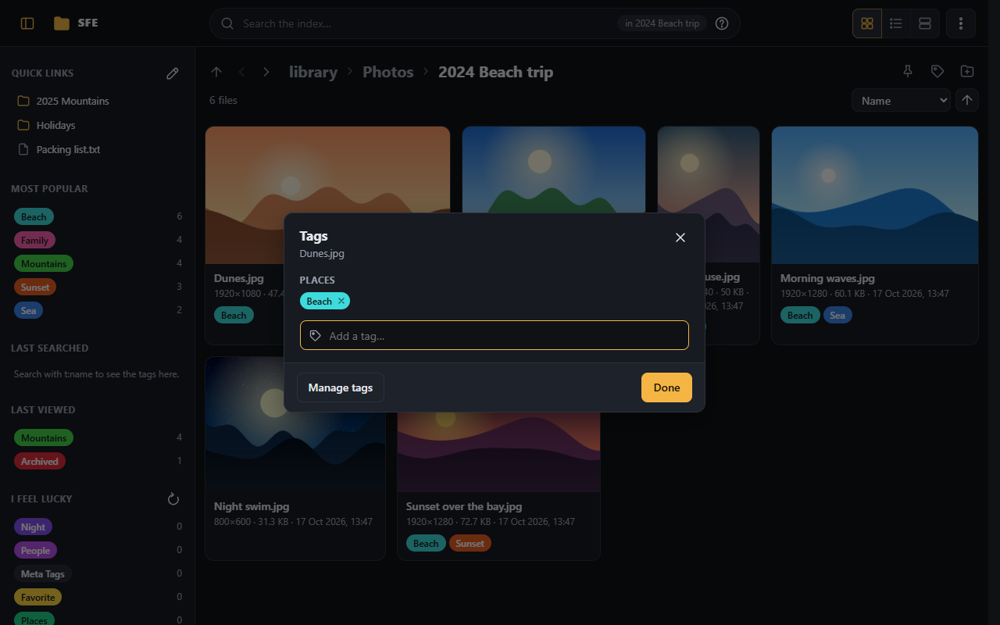
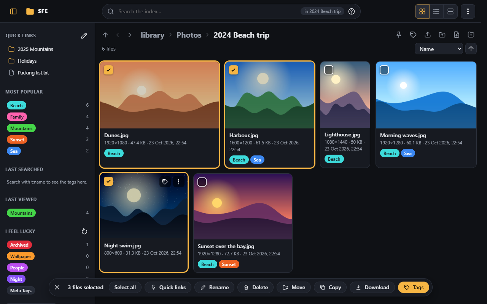
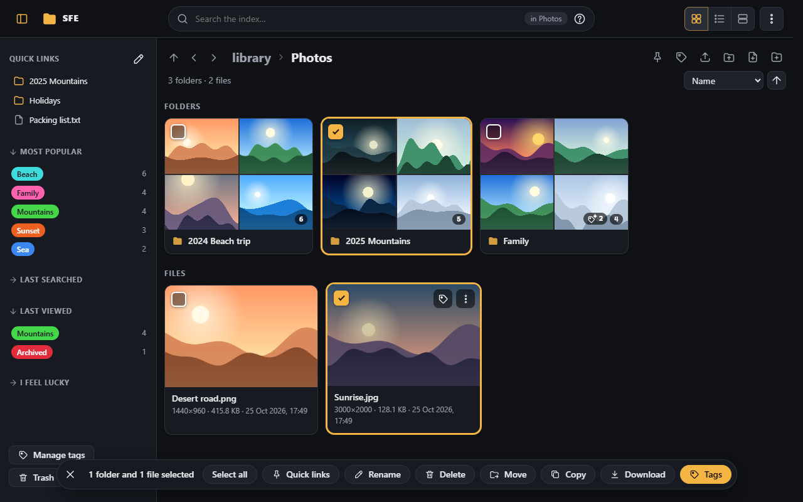
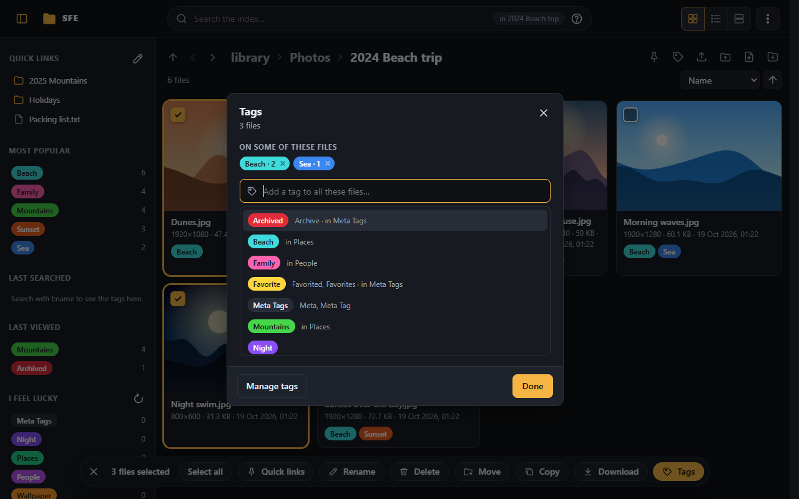
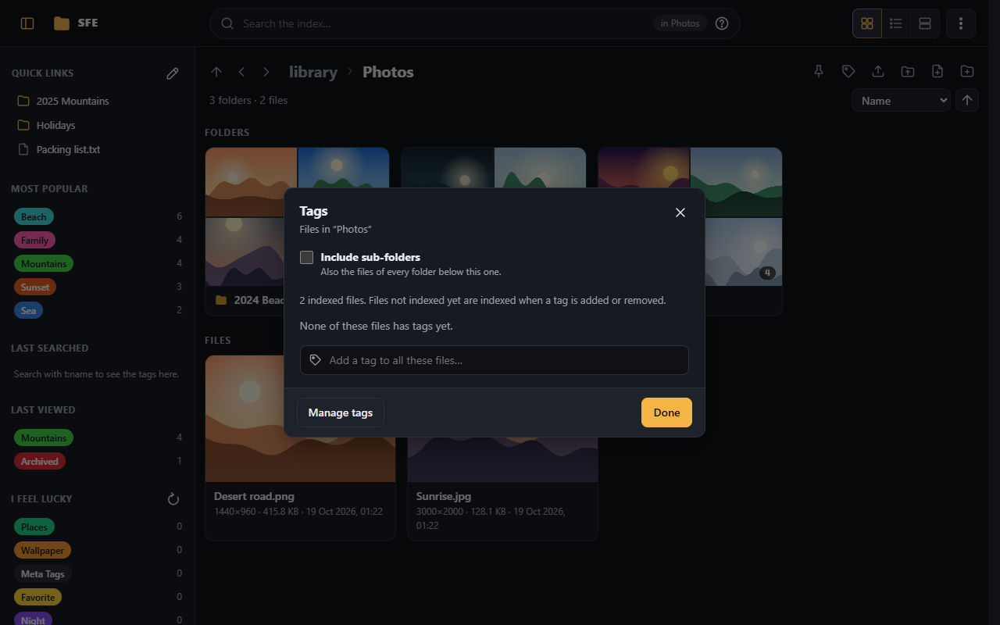
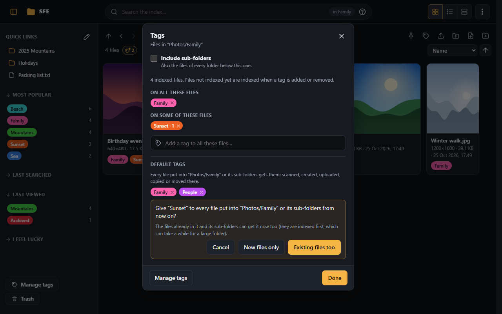
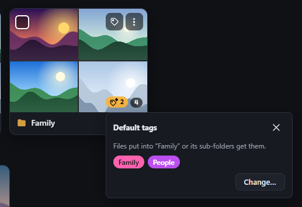
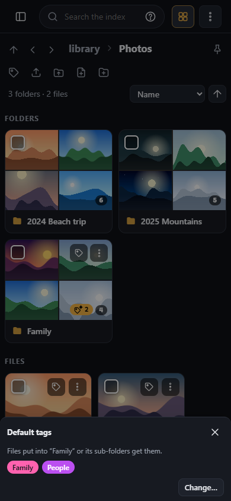

# Tags

Tags label files so you can find them again: `t:beach` in the [search box](search.md) finds every file tagged
**Beach**. Tags follow [TagStudio](https://github.com/TagStudioDev/TagStudio)'s model.

## How tags work

- A tag has a **name** (not necessarily unique), an optional **shorthand** and **aliases**, all searchable: `t:lol`
  finds files tagged "League of Legends" if "LoL" is its shorthand. Double quotes in a tag name are ignored when
  searching: `t:"12 Vinyl"` finds the tag `12" Vinyl`.
- **Parent tags:** a file tagged `Shrek` (parent `Character`) is found by `t:character` too, through any number of
  levels. Loops are refused.
- **Disambiguation:** a parent can be shown after the name, e.g. "Freddy (FNAF)".
- **Category** tags group the tags inheriting from them in a file's tag list.
- **Hidden** tags keep their files out of search results unless the search names the tag (or a parent).
- New spaces start with **Favorite** and **Archived** (hidden), under **Meta Tags**. They can be edited, not deleted.
- Colors come from TagStudio's standard palette.

Tags are created, edited and deleted in [Administration › Tags](../administration/tags.md) (also **Manage tags** under
the tag sidebar, and in each tag dialog), by accounts with the right `tags.manage`. Tagging files needs `tags.assign`.

## One file

The tag button on a file (on hover with a mouse; or <kbd>T</kbd> in the [viewer](viewer.md)) opens its tags: type to
add an existing tag or create one, × removes one. Click a tag on a file to edit it, a tag chip in the listing to search
for it. Tagging a file that isn't indexed yet indexes it first.

A right click on a tag chip (on a file, in the sidebar, in the viewer) opens its menu: **Search this tag**, **Search
in new tab**, **Add to the search** or **Leave out of the search** (while searching; else **Search without this
tag**), **Remove from this file** (right `tags.assign`) and **Edit the tag…** (right `tags.manage`).

## Several files at once

Tick their checkboxes (top-left of a tile or folder card, first column of the list, over a folder's icon in a line).
Shift-click selects a range, <kbd>Ctrl</kbd>+<kbd>A</kbd> every file and folder loaded, <kbd>Esc</kbd> clears; the
keyboard selects too ([Moving around](browsing.md#moving-around)). While something is selected, clicking a file or
folder selects it instead of opening it. The bar at the bottom says how many folders and files are selected, with
**Select all**, **Quick links** (adds them to your [quick links](browsing.md#quick-links)), **Rename** when one item is
selected and you [may rename](managing-files.md#rename), and **Tags** (for the files: selected folders are left out;
to tag a whole folder, use its tag button).

**Tags** lists the tags on all of them and on some (with how many): adding a tag puts it on every file, clicking a
partial tag completes it, × removes it from all. The selection is cleared when you open another folder or search.

## A whole folder, or every search result

The tag button next to the location (right of the breadcrumbs) opens the tags of every file of the folder you are in,
or of every result of the current search (all of them, not only the ones loaded). The tag button on a folder (shown on
hover; always on touch screens) does the same for that folder.

- For a folder, **Include sub-folders** extends it to every file below it.
- The dialog counts the files and shows the tags on all of them and on some; each change (adding a tag, completing a
  partial one, removing one) says how many files it touches and waits for you to confirm it.
- A folder is indexed first, so its files not indexed yet are tagged too (this can take a while for a large tree, and
  is refused while a scan runs); search results are the indexed files the search finds.

## Default tags of a folder

A folder can have **default tags**: every file put into it or into one of its sub-folders gets them, whether it is
found by a scan, created, uploaded, copied or moved there. Open the folder's tags (its tag button, or the one next to
the location) and use **Default tags** at the bottom of the dialog.

- **Add a default tag…** asks whether the files already in the folder and its sub-folders get it now too
  (**Existing files too**), or only the files put there from now on (**New files only**).
- **×** on a default tag asks whether the files already there keep it (**Keep it on the files**) or lose it
  (**Remove it from the files too**).
- A folder's default tags apply to its sub-folders: the dialog of a sub-folder shows them after its own ones, with the
  name of the folder they are set on (change them there).
- A file gets a default tag once, when it arrives: if you take the tag off a file, a rescan doesn't give it back. A
  file moved inside the folder (or renamed) gets nothing again; one moved out keeps its tags.
- A folder with default tags shows a tag with a sparkle next to its item count (with their number when there are
  several; the plain tag button is the one that tags its files), and the folder you are in shows one next to its
  counts. Click it (tap on a touch screen) to see them all; on a phone they show along the bottom of the screen.
  **Change…** there opens the folder's tags.

  
  
- They follow a folder when it is renamed or moved, go to the trash with it and come back when it is restored.
- Setting them needs the right `tags.folderDefaults`; changing the files already there also needs `tags.assign`.

## The tag sidebar

The sidebar at the left of the library page (a drawer on phones; the button at the top left shows or hides it) shows a
few tags in each section, with their number of files. Click a tag to search for it.

| Section | |
|---|---|
| **Most popular** | The tags with the most files |
| **Last searched** | Tags searched with `t:` |
| **Last viewed** | Tags of the files opened lately |
| **I feel lucky** | Random tags; the ↻ button shows others |

The history is shared by everyone using the space; it is turned off or cleared in
[Administration › Tags › Settings](../administration/tags.md#settings).

## When files move

A file's tags survive rescans while it keeps its path, and follow it when it is moved or renamed: see
[Moved files](../administration/duplicates-and-moves.md#moved-files).
