# Text files

Text files open in the [viewer](viewer.md), like pictures and videos: notes (`.txt`, `.md`), logs (`.log`), settings
(`.json`, `.yaml`, `.ini`, `.xml`), subtitles (`.srt`, `.vtt`), scripts and code (`.ps1`, `.sh`, `.py`, `.cs`, `.js`,
`.html`, `.css`, `.sql`…), and files such as `README`, `LICENSE` or `Dockerfile`. They are shown as they are: nothing in
them runs. **Edit** changes them: see [Editing text files](editing-text.md).

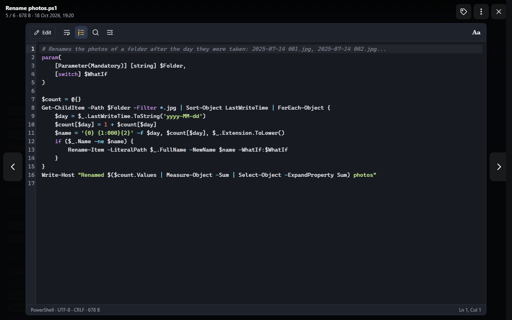

- **Highlighting** follows the file's type: keywords, strings, numbers and comments in their own colours; in logs,
  dates, times and levels (errors in red, warnings in purple).
- The bar at the bottom tells the type, the **encoding** (UTF-8, UTF-16, or Windows-1252 for older files, as Notepad
  reads them), the **line endings** (Windows CRLF or Unix LF) and the size; at the right, the line and column of the
  cursor. Letters shown wrong (`café` for `café`)? Pick another encoding there: the file is read again with it.
- A file opens **where you last read it** in this browser (the last hundred files are remembered).
- A file changed elsewhere while it is open (by another person, another tab or a program) says so at the top:
  **Reload** reads it as it is now, **Keep this one** keeps what is shown.
- **‹ / ›** at the sides go to the previous and next file of the folder that the viewer shows, pictures and videos
  included.
- Notes and documents (`.txt`, `.md`, `README`…) open as **text to read**: long lines wrapped, a reading font, wide
  margins. Code, logs and settings open as **code**: a monospace font, line numbers, long lines kept whole. Each has
  its own [reading settings](#reading-settings).

## Buttons and keys

| Button | Key | |
|---|---|---|
| Wrap long lines | | Long lines continue on the next line instead of going off the side. Off, the text scrolls sideways to their end (drag it with a finger on a phone), and a fade at the right edge shows a line goes on |
| Line numbers | | Shows or hides the numbers at the left |
| Find (magnifier) | Ctrl+F | Finds a word in the text: **next**, **previous**, **all**, match case, regular expression, whole word |
| Go to line | Ctrl+Alt+G | Jumps to a line number (`42`), or a line and column (`42:7`) |
| | F3, Ctrl+G / Shift+F3, Shift+Ctrl+G | Next / previous match of the word found |
| Follow | | Shows what is added to the end of the file as it grows, every two seconds (a log being written); click again to stop |
| Aa | | The [reading settings](#reading-settings) |
| | Ctrl+= / Ctrl+− / Ctrl+0 | Larger / smaller text, back to its usual size (with the cursor in the text) |
| | Ctrl+A, Ctrl+C | Selects all the text, copies the selection |

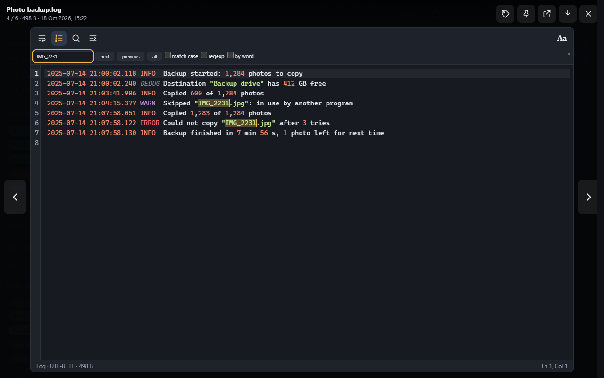

The bar of buttons stays on one line in every kind of document (text, Markdown, JSON, CSV, subtitles, PDF). On a phone
or in a narrow window, the buttons that don't fit leave from the right (**Aa** first) into a **⋯ More actions** button
at the end of the bar: it lists them, with a check mark next to those that are on (Line numbers, Wrap long lines…), and
the choice of view (Tree, Table, Source, Split), of separator or of zoom opens in place. **Edit** (or Save, Save a copy,
Download, Done while editing: on a phone Save a copy and Done show only their icon) and the fields (filter, the PDF's
page number) always stay, narrower on a phone, as do the PDF's page buttons and its Smaller / Larger. On a phone the
PDF's find is a magnifier: it opens the find field on a line under the bar (Esc hides it).

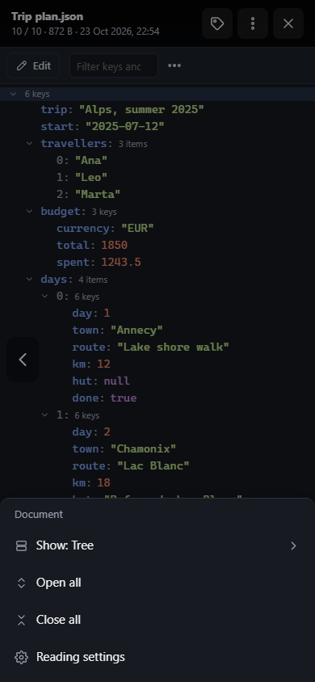

Click in the text to move around in it with the keys: the arrows, Page Up / Page Down, Home / End, Ctrl+Home / Ctrl+End;
the mouse wheel and swipes scroll it. **Esc** leaves the text (then ← / → go to other files again), a second **Esc**
closes the viewer.

## Large files and logs

A text file larger than 10 MB opens **in parts** of about 256 KB, cut at whole lines: **Start**, **‹ Earlier**,
**Later ›** and **End** move through it, and the bar at the bottom tells which bytes are shown (`1.2 MB – 1.5 MB of
480 MB`). A `.log` opens at its end, where the latest lines are. Find works in the part shown; large files can't be
edited here.

**Follow** works in both: the view keeps to the end of the file and shows each line added to it, as `tail -f` does.
A log that starts again (rotated, emptied) is read again from its new end.

## Markdown

Markdown files (`.md`) open **rendered**, as they are meant to be read: headings, lists, tables, quotes, links and
pictures, with code blocks highlighted. The **outline** button lists the headings at the left; click one to jump to it.

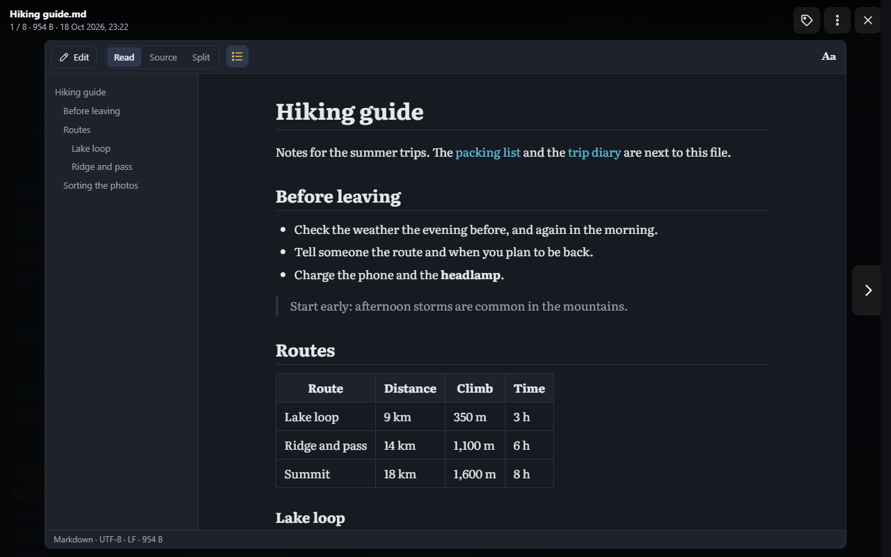

- **Read** / **Source** / **Split** at the left of the bar: the document, its text as written (with line numbers and
  Find, as other text files), or both side by side (one above the other on narrow screens). The choice is kept for the
  next documents.
- **Links** to other documents of the library (`[packing list](Packing list.txt)`) open them in the viewer; links to
  other files open the file in a new tab, links to folders their listing, links to web sites a new tab.
- **Pictures** of the library show; pictures of other web sites are not loaded until you click **Show** in the bar
  at the bottom, so that reading a document doesn't tell those sites. HTML written in a document is shown as text,
  never run.
- In the document, Ctrl+F is the browser's own find; with the source shown, it finds in the source.

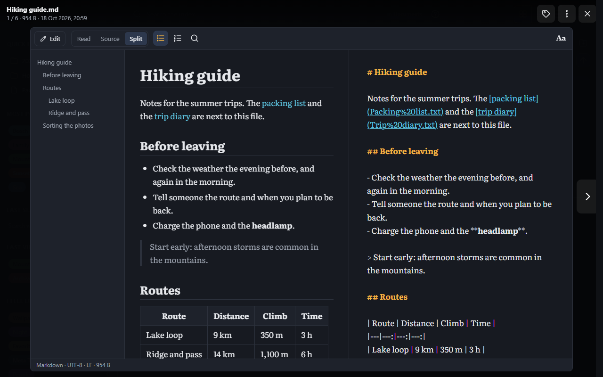

## JSON

JSON files (`.json`, `.jsonc`, `.geojson`, `.webmanifest`, `.har`) open as a **tree** of their members. A small file
opens whole; a large one shows its first levels. A closed member shows what it holds in a line
(`{ "day": 2, "town": "Chamonix", … }`) and how many keys or items.

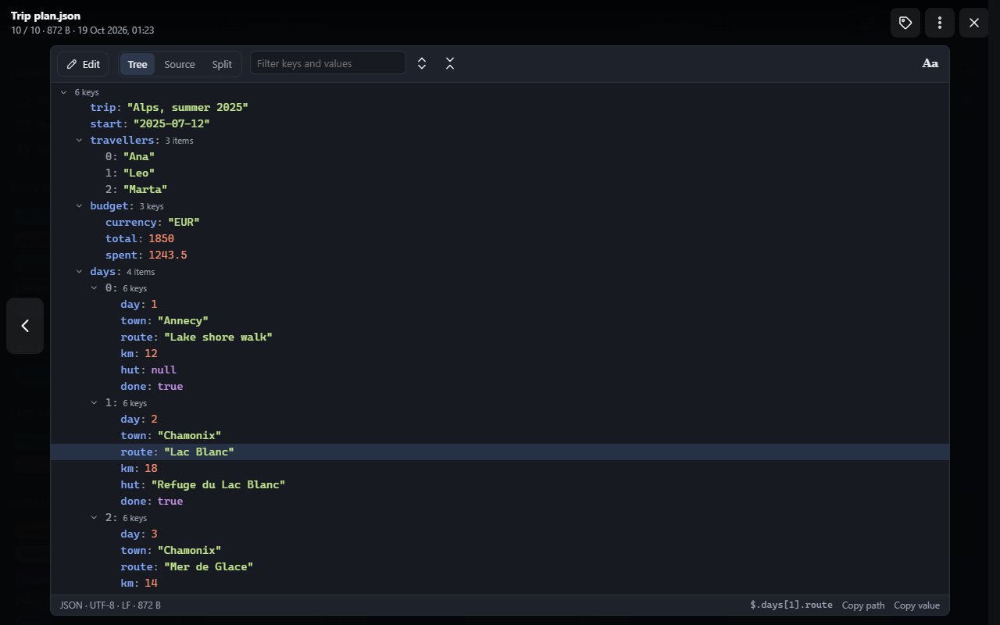

- **Open and close** a member with the arrow at its left, or with the keys: ↑ ↓ move, → opens (then goes in), ←
  closes (then goes up), Space opens or closes, `*` opens all under the member selected. **Open all** and **Close
  all** are in the bar.
- Large lists show their first 200 items; **Show 200 more** at the end shows the next ones.
- The bar at the bottom tells the **path** of the member selected, as code writes it (`$.days[1].route`); **Copy path**
  and **Copy value** copy it, or its value exactly as written in the file.
- **Filter** (Ctrl+F) shows only the members whose key or value holds what you type, with the members they are in.
  Esc clears it.
- Keys stay **in the order written** and numbers **as written**: a long id (`12345678901234567890`) is not rounded as a
  browser would.
- Comments and trailing commas (`appsettings.json`, `tsconfig.json`) are allowed: the bar says **JSON with comments**.
  A file that isn't valid JSON says where (line and column) above the tree; **Show in the source** goes there.
- **Tree** / **Source** / **Split**, as for Markdown: its text, or both side by side. Enter or a double click on a
  member selects it in the source.
- **Edit** changes the source beside the tree, which follows as you type. **Format** lays the source out again,
  indented as it is (two spaces when it isn't), comments kept; Ctrl+Z undoes it.

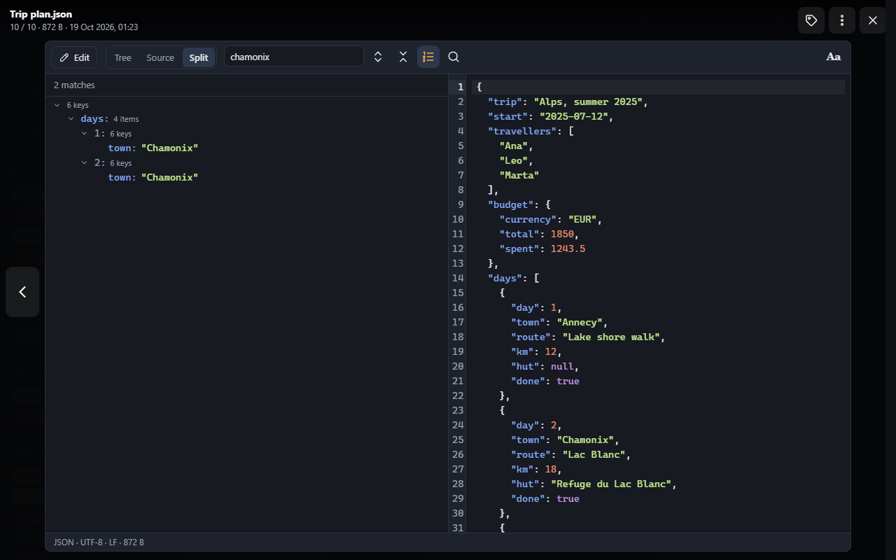

JSON Lines (`.jsonl`, `.ndjson`), which are mostly logs, open as text, where they can be read in parts and followed.

## CSV and TSV

Comma separated (`.csv`), tab separated (`.tsv`) and pipe separated (`.psv`) files open as a **table**. Long tables
scroll as smoothly as short ones: only the rows on screen are drawn.

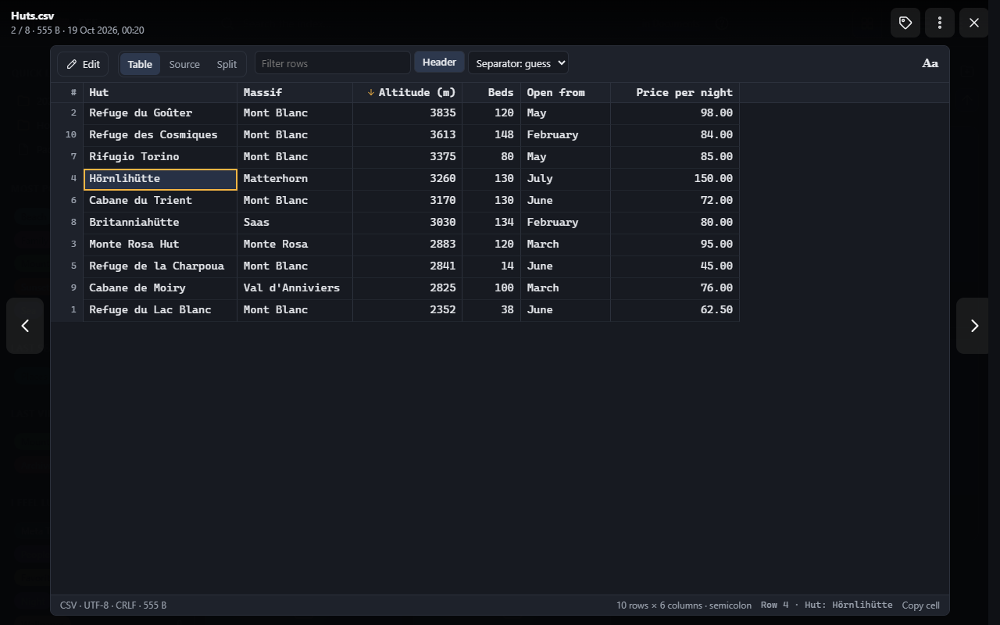

- **Header**: the first row names the columns (on by default; the choice is kept). Off, the columns are named A, B,
  C… as in a spreadsheet, and the first row is a row.
- **Separator**: guessed from the file (commas, semicolons as spreadsheets write them in many countries, tabs or
  pipes); the list in the bar chooses another when the guess is wrong.
- Columns of **numbers** are aligned to the right. Click a column's name to **sort** by it: smallest first, then
  largest first, then as in the file. Numbers sort as numbers (`1,014` after `18`), text as in a dictionary, empty
  cells last.
- **Filter** (Ctrl+F) shows only the rows with a cell holding what you type; the bar at the bottom says how many of
  all. Esc clears it.
- Click a cell, or move with the arrows (Page Up / Down, Home / End; with Ctrl, the first and last rows): the bar at
  the bottom shows its row, column and value; **Copy cell** or Ctrl+C copies it. Long cells are cut in the table;
  line breaks inside a cell show as ↵.
- A row with a quote left open says where (**Record** 12) above the table.
- **Table** / **Source** / **Split**, as for Markdown and JSON. **Edit** changes the source beside the table, which
  follows as you type.

## Subtitles

SubRip (`.srt`) and WebVTT (`.vtt`) subtitles open as the list of their **cues**: the number, when each starts and
ends, and what is said, in italic or bold as written, with who speaks (`<v Ann>`) in colour. A cue that starts before
the one before it has ended shows its time in red, and the bar at the bottom counts them.

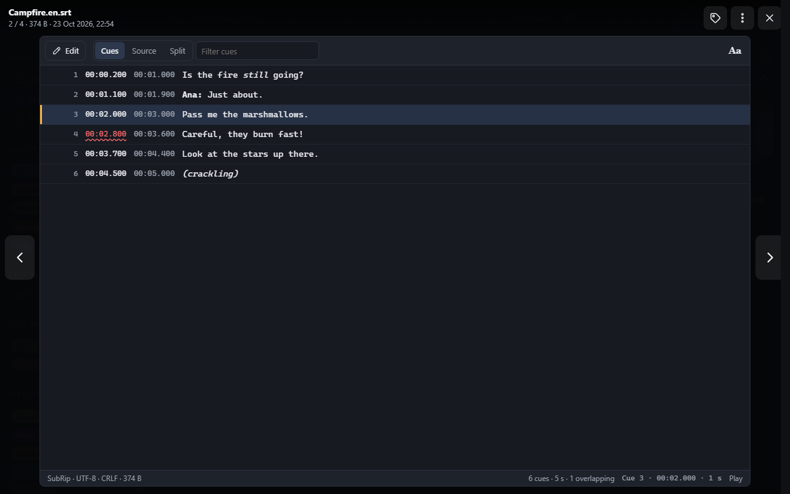

- **Filter** (Ctrl+F) shows the cues holding what you type.
- Click a cue, or move with ↑ ↓: the bar at the bottom shows its time and length. **Play** opens the video the
  subtitles belong to at that cue, in a new tab: the video next to them with the same name, without the language and
  other marks (`Film.en.forced.srt` → `Film.en.forced`, `Film.en`, then `Film`, with any video extension).
- Double-click a cue (or Enter) to see it in the source. A file that isn't valid says on which line.
- **Cues** / **Source** / **Split**, as for Markdown.
- While editing, **Shift times** moves every cue by the seconds typed (`2.5` later, `-2.5` earlier), for subtitles
  out of sync with their video. Only the times change, written as they were; Ctrl+Z undoes it.

SubStation subtitles (`.ass`, `.ssa`) open as text.

## PDF documents

PDF documents open in the viewer too, drawn as they are scrolled to; everything needed to show them comes with SFE,
nothing is fetched from elsewhere.

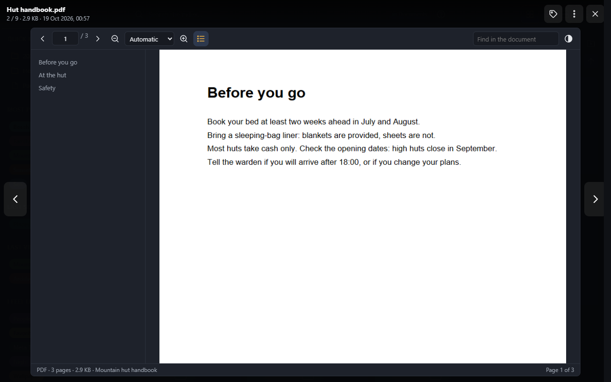

- **‹ / ›** in the bar, or **←** / **→**, turn the pages; type a page number to go to it. The bar at the bottom tells
  the page shown, how many there are, the size and the document's title.
- **Zoom**: **−** / **+** (Ctrl+− / Ctrl+=), or the list: Automatic, Page width, Whole page, 50 % to 300 %; Ctrl+0
  back to automatic.
- **Find** (Ctrl+F) marks every match; Enter goes to the next one, Shift+Enter to the previous one.
- The **outline** (the document's own table of contents, when it has one) is at the left; click a heading to go to it.
- Text can be selected and copied; links to other pages of the document go there, links to web sites open in a new
  tab.
- **Dark pages**, in the bar, turns the pages dark, for reading at night; the choice is kept.
- A document opens at the page it was last read at in this browser.
- A document protected by a password asks for it. Forms are shown, not filled; scripts in documents never run.
- A file that isn't a PDF it can show offers **Download** instead.

## EPUB books

EPUB books open in a reader, with three ways to lay them out, in the bar:

- **Page**: one page at a time, turned with **‹ ›**, **←** / **→**, Page Up / Page Down, Space, or a swipe.
- **Two pages**: two pages side by side, as an open book (one page when the window is too narrow).
- **Scroll**: the whole book as one long page, scrolled with the mouse, ↑ ↓, Page Up / Page Down or Space.

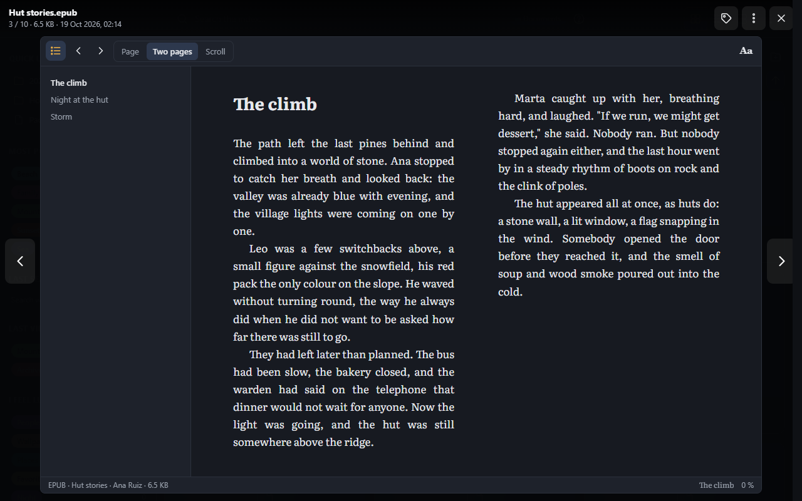

- **Contents** (the list button) shows the book's chapters; click one to go to it. The bar at the bottom tells the
  chapter and how far through the book you are (counted once the book is opened: `…` until then).
- A book opens where it was last read in this browser; the layout chosen is kept for the next books.
- The **reading settings** (**Aa**) apply to its pages: font, size (also Ctrl+= / Ctrl+−), line spacing and colours.
  With the sepia and dark colours, the book's own colours give way to them.
- Nothing in a book runs: its pages are shown, never their scripts.

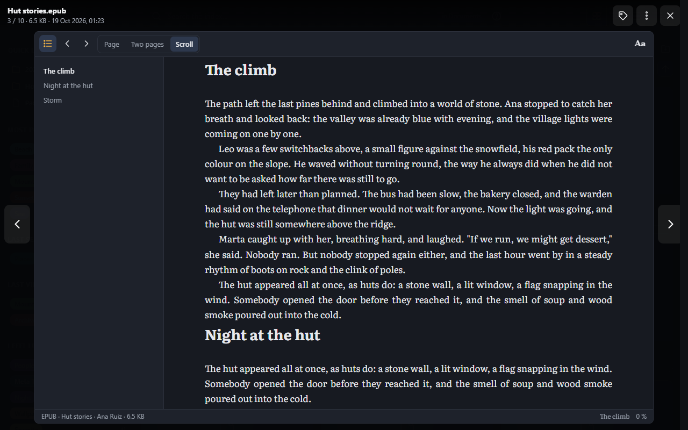

## Reading settings

**Aa** at the end of the text's bar opens the reading settings. They apply at once, and this browser keeps them: one
set for text to read, one for code. They start from your account's defaults (the library's, until you save your own).

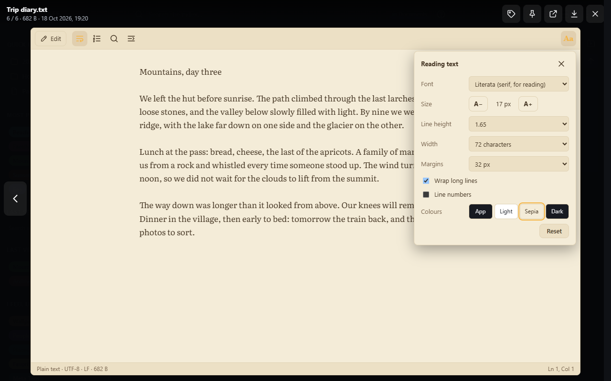

| Setting | |
|---|---|
| Font | **Literata** (made for reading long texts), **Atkinson Hyperlegible** (letters that can't be mistaken for each other), **JetBrains Mono** (for code); or the serif, sans-serif or monospace font of this device; or **Another font of this device…**, by its name (`Fira Code`, `Calibri`) |
| Size | **A−** / **A+**, from 10 to 32 pixels (also Ctrl+− / Ctrl+= in the text, Ctrl+0 for the usual size) |
| Line height | The room between lines |
| Width | The longest line when lines wrap, in characters (about 70 is easiest to read), or the whole width |
| Margins | The room around the text |
| Wrap long lines, Line numbers | As the buttons of the bar |
| Colours | **App** (light or dark, with the app's [theme](browsing.md#light-and-dark)), **Light**, **Sepia** (warm paper) or **Dark** |
| Reset | Back to your defaults (for this kind of text), and the colours |
| Save as my default | These settings (both kinds of text, and the colours) become your account's: every browser you sign in from starts from them. Also in **My account › Preferences** ([Administration](../administration/my-account.md)) |

The three bundled fonts are downloaded from the server the first time one of them is used, and only the letters a
page needs. On a phone the settings open as a sheet at the bottom of the screen:

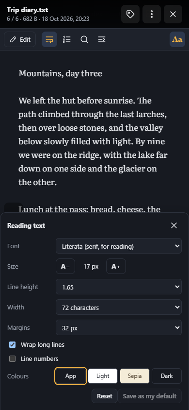

## A page of its own

**Open in new tab** (in the viewer's **⋮** menu, at the top right) opens the text file in its viewer, in a tab of its own, with the
same buttons and settings; so does a middle click or Ctrl+click on a text file in a listing. The arrow at the top left
of that page opens its folder.

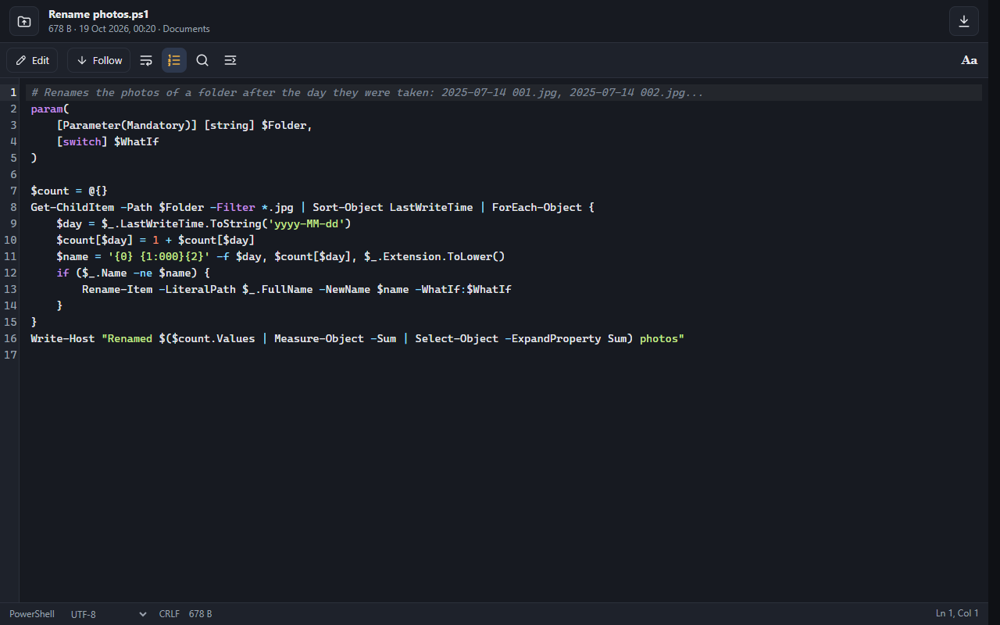

## Other files: Open as text

Files the viewer doesn't show (a `.dat`, a file without an extension) can still be read as text: **Open as text** in
their [item menu](managing-files.md) (right click, or **⋮**). Files that aren't text (a picture saved under another name,
an archive) say so and offer **Download** instead.

The administrators of the library can add more extensions to open as text (**More text files**, in
[Scanning › File types](../administration/scanning.md#file-types)).

Opening a text file needs the right to open files (`files.view`, see [Rights](../reference/rights.md)); Download
needs `files.download`.
