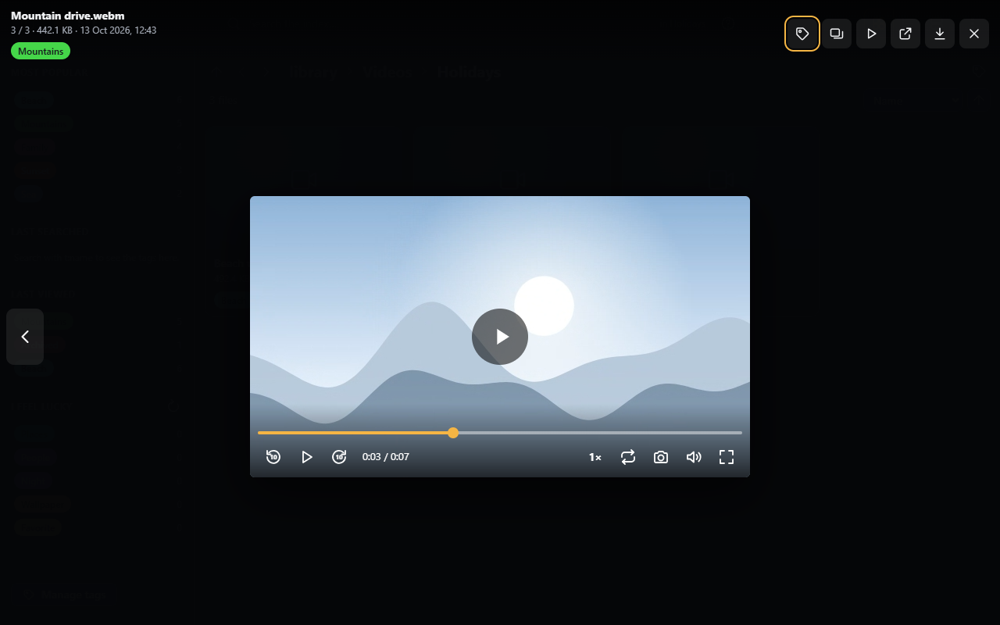

# Video player

Videos and audio files play in SFE's own player, in the [viewer](viewer.md) or in a window of its own.

## Controls

| Control | Key | |
|---|---|---|
| Play / pause (also a click on the picture) | Space or K | |
| Seek bar | | Shows [trickplay](../administration/trickplay.md) frames above it while you hover or drag, when the video has them |
| Back / forward | J / L | Jumps by **Jump back / forward** (10 s by default, [Playback](../administration/playback.md)) |
| Speed (`1×`) | | Lists the rates, 0.5× to 2× |
| Loop | R | Starts the video over when it ends; whether it is on when a video opens is the **Loop videos** setting (off by default) |
| Camera | S | Saves the frame on screen as a PNG at the video's resolution, named after the video and the position (e.g. `Holiday 1-23.png`) |
| Mute | M | |
| Fullscreen | F | |

On a touch screen, double-tap the left or right of the picture to jump (keep tapping to jump further), and hold a
finger on the right of a playing video for 1.5 s to play it at 2× until you lift it.

## Its own window

**Open in a new window** (W, in the viewer) moves the video to a window of its own, going on from the same position.
That window always stays dark, whatever the theme.

## External player

The viewer's ▶ **Open in …** button (also offered when the browser can't play a format) opens the video or audio file
in a player app installed on the device, such as VLC, through a link the app registered. The administrator picks the
player in [Playback › External player](../administration/playback.md#external-player).

The player app doesn't have your browser's sign-in, so the address it gets is a **link of its own** to that one file.
It works without signing in for a while (6 hours by default, enough for a film: the player asks again at every seek),
and stops earlier when your account's password changes, the account is disabled, or it loses the right to use
external players. Anyone holding the link can play the file until then: share it as you would the file.

The app streams the file from SFE (or from the [data server](../administration/playback.md#streaming-data-server)),
so the device must reach that address.
