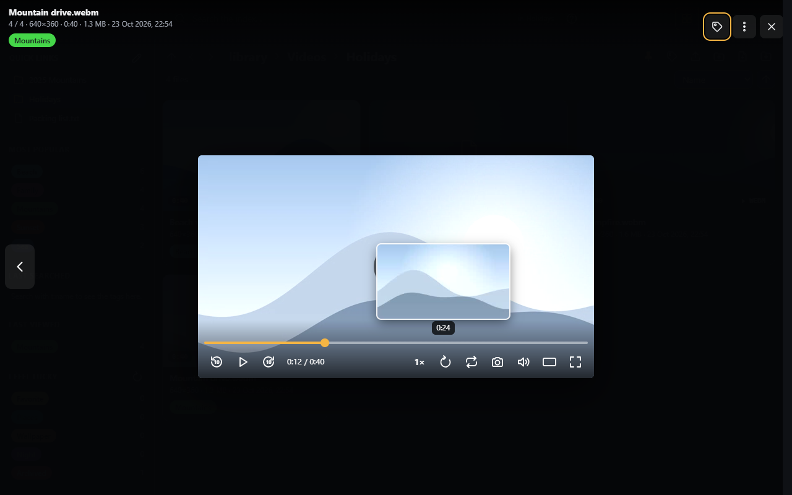
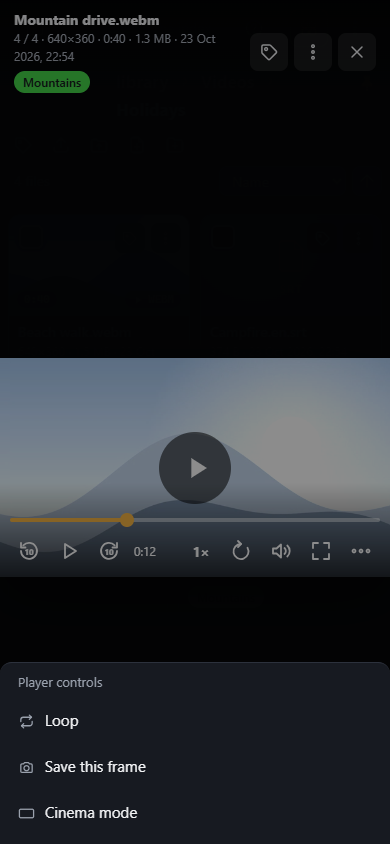

# Video player

Videos and audio files play in SFE's own player, in the [viewer](viewer.md) or in a window of its own.

## Controls

| Control | Key | |
|---|---|---|
| Play / pause (also a click on the picture) | Space or K | |
| Seek bar | | Shows [trickplay](../administration/trickplay.md) frames above it while you hover or drag, when the video has them |
| Back / forward | J / L | Jumps by **Jump back / forward** (10 s by default, [Playback](../administration/playback.md)) |
| Speed (`1×`) | | Lists the rates, 0.5× to 2× |
| Loop | R | Starts the video over when it ends; whether it is on when a video opens is the **Loop videos** setting (off by default) |
| Camera | S | Saves the frame on screen as a PNG at the video's resolution, named after the video and the position (e.g. `Holiday 1-23.png`) |
| Mute | M | |
| Cinema mode | C | In the viewer: the player spans the whole width of the window and the video is enlarged to it (as YouTube's theater mode); press again for the default view. Remembered by this browser |
| Fullscreen | F | |
| Convert (⟳) | | Shown when the server can convert videos: plays the video converted by the server, from where it is (see below) |

On a touch screen, double-tap the left or right of the picture to jump (keep tapping to jump further), and hold a
finger on the right of a playing video for 1.5 s to play it at 2× until you lift it.

The controls stay on one line. When the player is too narrow for all of them (a phone, a small window), the length
of the video leaves the time first (`0:12` instead of `0:12 / 1:05`), then the buttons leave from the right (Cinema
mode first, Back last) into a **⋯ More actions** button at the end of the line: it lists them, with a check mark next
to Loop or Cinema mode when they are on, and **Speed** opens its rates in place. **Play**, **Mute** and
**Fullscreen** always stay. A very small video is shown wider, so that these stay visible.

## Its menu

A right click on the video (in the viewer, or in its own window) opens a menu with the player's controls: **Play** /
**Pause**, **Speed** (its rates in the menu's place; **Back** returns), **Loop**, **Mute**, **Save this frame**,
**Full screen** and, where the browser has it, **Picture in picture**. In the viewer the file's menu follows (Open in
a new window, **Copy link at this time**, Open in new tab, Download…); in its own window, Copy link at this time,
Download and Copy full path. Hold **Shift** for the browser's own video menu.

## Formats the browser can't play

When the browser can't play a video (AVI, WMV, many MKV files, HEVC pictures), the player asks the server to convert it
while it plays, if the server has ffmpeg and you have the right to (see
[Playback](../administration/playback.md#videos-converted-by-the-server)). It goes on from the same position and the
seek bar keeps the video's whole length; a jump further than what has arrived takes a second or two, while the server
starts again from there. A video that plays without sound or picture can be converted by hand with the ⟳ button.
If the server can't convert it either (it may be busy with as many videos as it allows), the viewer says so and offers
the external player and the download.

## Its own window

**Open in a new window** (W, in the viewer) moves the video to a window of its own, going on from the same position.
That window always stays dark, whatever the theme.

## External player

The viewer's ▶ **Open in …** button (also offered when the browser can't play a format) opens the video or audio file
in a player app installed on the device, such as VLC, through a link the app registered. The administrator picks the
player in [Playback › External player](../administration/playback.md#external-player).

The player app doesn't have your browser's sign-in, so the address it gets is a **link of its own** to that one file.
It works without signing in for a while (6 hours by default, enough for a film: the player asks again at every seek),
and stops earlier when your account's password changes, the account is disabled, or it loses the right to use
external players. Anyone holding the link can play the file until then: share it as you would the file.

The app streams the file from SFE (or from the [data server](../administration/playback.md#data-server)),
so the device must reach that address.
