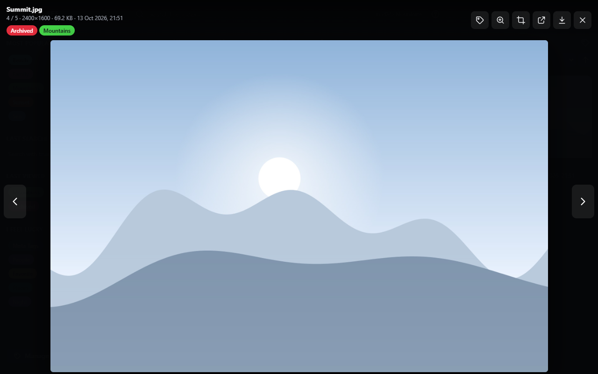
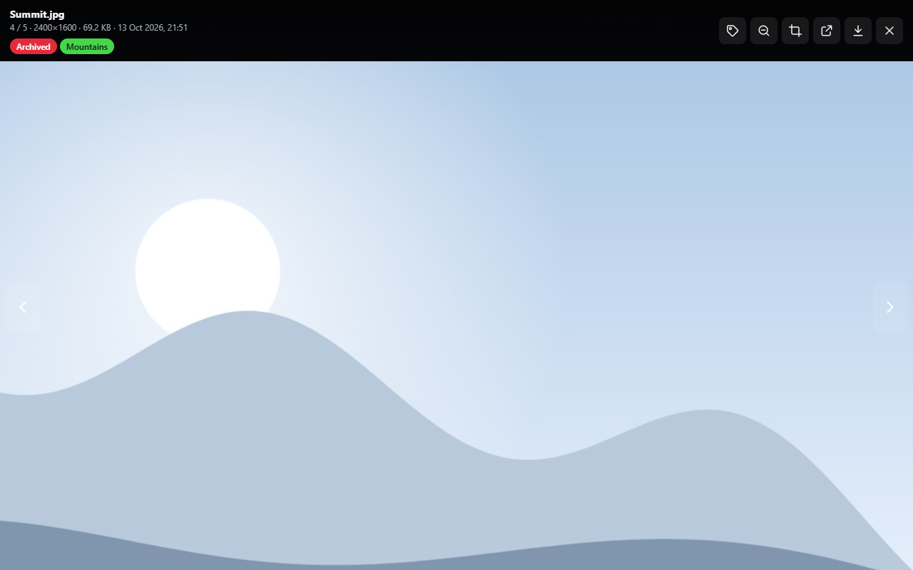

# Viewer

Clicking a file in a listing opens it full screen over the page: pictures as they are, videos and audio in SFE's own
[player](video-player.md).

At the top left: the file's name, its position in the listing (`5 / 6`), resolution, size, date and duration, and its
tags. Hidden tags such as **Archived** are shown here too.

## Buttons and keys

| Button | Key | |
|---|---|---|
| ‹ / › at the sides | ← / →, mouse wheel down / up, a swipe | Previous / next file of the listing (the wheel works anywhere but over the video controls) |
| Actual size / Fit to the screen (magnifier) | Z | Pictures larger than the screen: [100%](#actual-size) or whole again |
| Tags | T | The file's [tags](tags.md) |
| Edit (crop icon) | E | Opens a picture in the [picture editor](picture-editor.md) (right `files.edit`) |
| Open in a new window | W | Videos: moves the video to a [window of its own](video-player.md#its-own-window) |
| ▶ Open in … | | Videos and audio: an [external player](video-player.md#external-player) such as VLC |
| Copy full path | | When [copying paths](browsing.md#copying-full-paths) is on |
| Open in new tab | | The file itself, in a new browser tab |
| Download | | Saves the file (right `files.download`) |
| × | Esc | Back to the listing, scrolled where you were |

Photos larger than **Large image size** ([Thumbnails](../administration/thumbnails.md)) are shown through their
thumbnail, in the viewer as in the listings.

## Actual size

A picture larger than the screen is shrunk to fit it, and the pointer turns into a magnifier over it. Click it (or press
<kbd>Z</kbd>, or the magnifier button) to see it at its actual size, 100%, with the point clicked staying under the
pointer. The pointer then becomes a hand: drag the picture (with the mouse, or a finger on a touch screen) to look
around it, or scroll it with the mouse wheel (<kbd>Shift</kbd> + wheel: sideways). A click without dragging, the button,
<kbd>Z</kbd> or <kbd>Esc</kbd> show it whole again. Moving to another file shows it whole too.

A large photo shown through its thumbnail can be seen at its actual size once its original has loaded.
